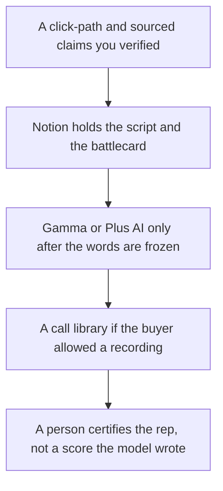

**An enablement team should use AI to keep three files true: the demo script reps can click, the battlecard with sourced claims, and the deck that matches those words.** A call library helps when you already record calls the buyer agreed to. A model that writes a ramp-time promise is not a curriculum. This page is one tool per artifact. The rep-facing shelf is [best AI tools for sales teams](/blog/best-ai-tools-for-sales-teams-2026/).

The lead who formats the calendar and the seat list from dates they already set is [best AI tools for enablement leads](/blog/best-ai-tools-for-enablement-leads-2026/). The manager who drafts a coaching note from a call they are allowed to use is [best AI tools for enablement managers](/blog/best-ai-tools-for-enablement-managers-2026/).

The script workflow is [how to create a demo script with AI](/blog/how-to-create-a-demo-script-with-ai-2026/). The card workflow is [how to create a competitive battlecard with AI](/blog/how-to-create-a-competitive-battlecard-with-ai-2026/). The new-hire list, which is people ops rather than sales enablement, is [how to create an onboarding checklist with AI](/blog/how-to-create-an-onboarding-checklist-with-ai-2026/).

Prices are US list prices excluding tax. Most figures are from directory pages checked October 16, 2026. Fathom's prices also match the October 24, 2026 pricing article. Gong has no public price. Published October 24, 2026. We did not score ramp time.

## The enablement job

| The job | Start here | First paid step | The limit |
|---|---|---|---|
| The wiki for scripts and cards | [Notion AI](/tools/notion-ai/) | Business is $20 a seat a month | Plus at $10 is not the full AI tier |
| The draft of a script or a card | [Claude](/tools/claude/) | Pro is $20, or $17 billed annually | It may not invent a feature or a competitor price |
| The deck reps can present | [Gamma](/tools/gamma/) or [Plus AI](/tools/plus-ai/) | Gamma Plus is $9 a seat. Plus AI Basic is $10 a user a month billed annually | The file format decides it |
| A practice-call library, bot allowed | [Fathom](/tools/fathom/) | Premium is $16 a month billed annually. Business is $25 a user annually for CRM fields | Free lists unlimited recordings. Confirm the bot is allowed |
| You already run Gong | [Gong](/tools/gong/) | Custom. No public dollar on the card | Do not invent a license fee. Enable is a product name, not a price |
| The line edit | [Grammarly](/tools/grammarly/) | Pro is $12 a member a month billed annually | It will not catch a wrong claim |

## What to pay for, and what to leave

**The system of record for the talk track.** Notion Business is the seat if enablement lives in Notion. Name an owner per script. A Project in [ChatGPT](/tools/chatgpt/) Plus at $20 can draft, and it is a poor system of record for a 40-person sales team. Business chat seats are $20 a user a month billed annually, minimum two, when the content is confidential. The record habit is [what a system of record for AI is](/blog/what-is-a-system-of-record-for-ai-2026/). The Notion card is [Notion AI pricing explained](/blog/notion-ai-pricing-explained-2026/).

**The deck.** If reps send a link, Gamma Plus at $108 a seat a year is the lower step. If they live in PowerPoint or Google Slides, Plus AI Basic is $10 a user a month billed annually. The pair of the other two editors is [Gamma vs Beautiful.ai](/blog/gamma-vs-beautiful-ai-2026/). [Pitch](/tools/pitch/) Team is $15 a seat a month billed yearly when you want analytics links and pitch rooms. The invoice is [Pitch pricing explained](/blog/pitch-pricing-explained-2026/).

**The calls.** Fathom is the notetaker when a bot is acceptable. [Otter](/tools/otter-ai/) Business is $19.99 a user a month billed annually when you need four-hour conversations and up to 25 billed users. The sales choice is [Otter vs Fathom for sales calls](/blog/otter-vs-fathom-for-sales-calls-2026/). Gong's directory card describes Enable, Forecast, and Engage, and says licenses are custom, per user plus a platform fee. Quote Gong from a proposal, not from this page.

**Quizzes, if you need them.** The writing workflow is [how to create training quizzes with AI](/blog/how-to-create-training-quizzes-with-ai-2026/). A quiz that teaches a click the product does not have is worse than no quiz. The person who publishes is [what human-in-the-loop AI is](/blog/what-is-human-in-the-loop-ai-2026/).

A short enablement video is optional. [HeyGen](/tools/heygen/) Creator is $29 a month. Use it after the script is true. The sales-avatar pair is [HeyGen vs Synthesia for sales](/blog/heygen-vs-synthesia-for-sales-2026/).

## What not to automate

Do not let a model certify that a rep is "ramped." Do not let it rewrite the battlecard from a lost-deal note without a source and a date. Do not publish customer stories from the call library without permission. The fact pass is [how to fact-check AI writing](/blog/how-to-fact-check-ai-writing-2026/).

## FAQ

### What should a two-person enablement team buy first?

Notion or the wiki you have, Claude or ChatGPT for drafts, and Gamma or Plus AI when a deck is requested. Add Fathom when you are allowed to record. Skip Gong until a proposal has a number you can explain.

### Is enablement the same stack as sales?

Sales needs the CRM and the call. Enablement needs the files sales reuses. Buying a second chatbot for every rep before the script has an owner will not create a curriculum. The sales shelf is linked above.

### Can AI build the certification?

It can draft questions from the script you approved. A person sets the passing rule and reviews the questions. A generated certificate is a PDF. It is not evidence the rep can click the path.

### Where do competitive claims live?

On the battlecard, with a date and a source, in the wiki. Not in a chat thread. The workflow is the battlecard article linked above.

## Last verified

October 16, 2026 for Notion, Claude, ChatGPT, Gamma, Plus AI, Pitch, Otter, Grammarly, and HeyGen. Fathom matches the directory and the October 24, 2026 pricing article. Gong has no public price on the directory card. Published October 24, 2026.

**Sources:** [Notion AI](https://www.notion.com/product/ai), [Gamma pricing](https://gamma.app/pricing), [Gong](https://www.gong.io).

*Published by Andrew for [AI Tools Optimizer](https://aitoolsoptimizer.com).*

[Notion AI](/tools/notion-ai/) is in the [productivity and notes directory](/tools/category/productivity-notes/). Directory pages may use affiliate links. A purchase through them may earn us a commission at no extra cost to you.
