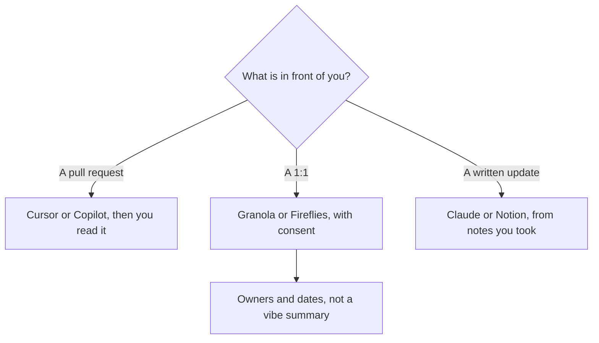

**An engineering manager should buy the tool that matches the artifact they already touch: the diff, the 1:1 note, or the written update.** An agent that merges code the manager did not read is not a management tool. It is a risk. This page is the manager's week. The individual contributor's coding choice is [Cursor vs Claude Code vs Codex](/blog/cursor-vs-claude-code-vs-codex-2026/). The product partner's stack is [best AI tools for product managers](/blog/best-ai-tools-for-product-managers-2026/).

Prices are US list prices excluding tax. Coding seats were recorded October 16, 2026, with ChatGPT's Codex rows from the October 24 matrix. Published October 24, 2026. We did not measure team throughput.

## The manager's three jobs

| Job | Start here | First paid step | The limit |
|---|---|---|---|
| Read a change without living in the editor all day | [Cursor](/tools/cursor/) or [GitHub Copilot](/tools/github-copilot/) | Cursor Plus is $8/month. Copilot Pro is $10 with $15 of credits | You still read the diff. The tool does not approve it |
| A coding agent in the terminal, on the writing seat you already want | [Claude Code](/tools/claude-code/) | Included with Claude Pro at $20, or $17 billed annually | No free Claude Code. Usage is shared with chat |
| Coding inside the ChatGPT seat | [Codex](/tools/openai-codex/) on [ChatGPT](/tools/chatgpt/) Plus | Plus is $20. Go at $8 is only lightweight tasks | Pro from $100 is capacity after Plus actually runs out |
| The 1:1 and the staff meeting | [Granola](/tools/granola/) or [Fireflies](/tools/fireflies-ai/) | Granola Business is $14/user. Fireflies Pro is $10/user annual | Consent first. One bot, not two |
| The update, the decision log, the promo packet notes | [Notion AI](/tools/notion-ai/) and [Claude](/tools/claude/) | Notion Business is $20/seat. Claude Pro is $20 | The model formats. You own the judgment |

The coding comparison for the manager who still ships is [ChatGPT vs Claude for coding](/blog/chatgpt-vs-claude-for-coding-2026/). The invoice for the editor is [Cursor pricing explained](/blog/cursor-pricing-explained-2026/). Copilot's seat is [GitHub Copilot pricing explained](/blog/github-copilot-pricing-explained-2026/).

## The diff

Managers get in trouble when they ask an agent to "summarize this PR" and repeat the summary in review. Use the summary as a map, then open the files it names. If the summary mentions a file you do not open, you do not understand the change.

Cursor Plus at $8 is enough for a manager who reads more than they write, on The X Subscription. Premium at $30 is 4× usage, which is not a count of reviews. Copilot Pro at $10 is the easier finance conversation if the company is already on GitHub. Copilot Business at $19 adds pooled credits and IP indemnity. Claude Code is the right add when you already pay for Claude and you want the agent in the terminal for a spike. It is a poor add if you only needed a paragraph about a pull request. Chat can do that on Claude Free, with usage limits, until the limit is the issue.

Do not buy ChatGPT Pro at $100 so a manager can sound technical. Plus includes the Codex row. Pro is what you buy when Plus stops a workday. The ladder is [ChatGPT Go vs Plus vs Pro](/blog/chatgpt-go-vs-plus-vs-pro-2026/).

## The 1:1 and the update

[Granola](/tools/granola/) fits a manager who already types. Business at $14 keeps history past Basic's 30 days. [Fireflies](/tools/fireflies-ai/) fits a team that wants a bot on the calendar. Pro annual is $10. Monthly is $18, which is the toggle to fix before you add a second product. Tell the report the meeting is recorded. The field guide is [Fireflies alternatives](/blog/fireflies-alternatives-2026/) and [how to summarize meetings with AI](/blog/how-to-summarize-meetings-with-ai-2026/).

Take the decisions into [Notion AI](/tools/notion-ai/). A 1:1 note that stays in the notetaker will not be the promo conversation six months later. Business at $20 a seat is the full Notion AI tier. The comparison with a tracker is [Notion AI vs ClickUp Brain](/blog/notion-ai-vs-clickup-brain-2026/).

Write the weekly update in [Claude](/tools/claude/) from the decision log, not from memory. Pro is $20, or $17 billed annually. Ask for decisions, risks, and asks. Delete any metric you did not paste. A sprint retro that should feed the update is [how to run a retro with AI](/blog/how-to-run-a-retro-with-ai-2026/). The release the update points at is [how to write release notes with AI](/blog/how-to-write-release-notes-with-ai-2026/).

Performance language is the line to keep human. The model can format feedback you wrote about the work. It should not score a person, infer attitude, or draft a rating from a transcript. If a sentence would be uncomfortable to say in the 1:1, it does not go in the doc.

## FAQ

### What should an engineering manager pay for first?

The place the week actually breaks. A manager who cannot follow pull requests starts with Copilot Pro or Cursor Plus. A manager who loses 1:1s starts with Granola or Fireflies. A manager who can do both and suffers on the Friday update starts with Claude or Notion. One seat, then a second only after the first is in use.

### Is Claude Code worth it if I do not code every day?

Usually no. Claude chat on Pro, or even Free, can explain a change you paste. Claude Code is for a sprint in the repository. Max at $100 is capacity for people who hit Pro limits, not a management tier.

### Can AI write performance reviews?

It can format observations you recorded. It cannot fairly evaluate someone from a calendar. Keep the judgment, the examples, and the rating with the manager. Do not paste a stack of private notes and ask for a score.

### How many bots belong on a staff meeting?

One, with consent. Two notetakers do not make a better record. They make a noisy guest list. Put the actions in Notion the same day.

## Last verified

October 16, 2026 for Cursor, Copilot, Claude, Notion, and Fireflies prices. October 24, 2026 for the ChatGPT Codex rows and for Granola Business at $14 as used in those articles. Published October 24, 2026.

**Sources:** [Cursor pricing](https://cursor.com/help/account-and-billing/pricing), [GitHub Copilot](https://github.com/features/copilot), [Claude pricing](https://claude.com/pricing).

*Published by Andrew for [AI Tools Optimizer](https://aitoolsoptimizer.com).*

[Cursor](/tools/cursor/) and [Claude Code](/tools/claude-code/) are in the [coding directory](/tools/category/coding/). Directory pages may use affiliate links. A purchase through them may earn us a commission at no extra cost to you.
