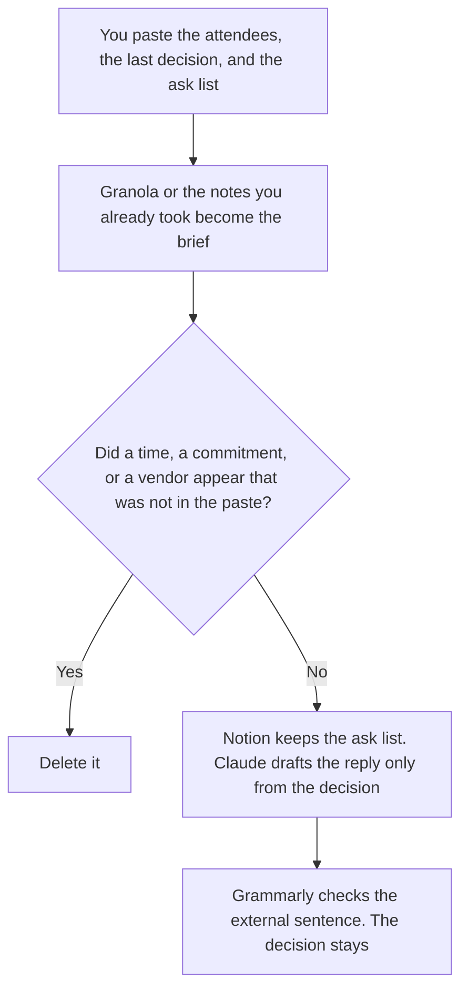

**An executive assistant should use AI to draft a pre-meeting brief from facts they already have, keep the running list of asks, and write a reply only from a decision the executive already made.** The model does not invent a commitment, a time, or a vendor. The office announcement, the vendor list, and a flyer are [best AI tools for office managers](/blog/best-ai-tools-for-office-managers-2026/). The project row and a date a project manager set are [best AI tools for project coordinators](/blog/best-ai-tools-for-project-coordinators-2026/). This page is the executive's day: the brief, the list, and the reply.

A change note to several audiences is [best AI tools for change managers](/blog/best-ai-tools-for-change-managers-2026/). That note is not a reply the assistant sends in the executive's name.

Granola's prices are the October 24, 2026 pricing-page read in [Granola pricing explained](/blog/granola-pricing-explained-2026/). Claude's prices are the October 24 read of claude.com/pricing recorded in [Claude pricing explained](/blog/claude-pricing-explained-2026/). Notion and Grammarly prices are from directory pages checked October 16, 2026. A live fetch of Grammarly's plans URL returned HTTP 401 on October 24. Published October 24, 2026. We did not score calendars or inboxes.

## The assistant's three files

| The job | Start here | First paid step | The limit |
|---|---|---|---|
| A brief before the meeting, from facts you already have | [Granola](/tools/granola/) | Business is $14 a user a month for briefs and history past 30 days | Basic is $0 and does not include briefs. It does not put a bot in the call |
| The running list of asks, owners, and dates | [Notion AI](/tools/notion-ai/) | Business is $20 a seat a month | Plus at $10 is not the full AI tier. A date you did not write stays out |
| The reply, from a decision the executive made | [Claude](/tools/claude/) | Pro is $17 a month billed annually, or $20 monthly | No commitment that was not in the paste |
| The sentence that leaves the company | [Grammarly](/tools/grammarly/) | Pro is $12 a member a month billed annually, or $30 monthly | The decision and the time do not move |

A brief that says the executive "will approve on Thursday" has added a commitment. If the decision is missing, the line says Decision not set. An ask without an owner you pasted says Owner not set. It does not assign one. Basic Granola keeps 30 days of history and does not include pre-meeting briefs on the October 24 compare table. Business at $14 is the brief. You do not need Enterprise at $35 unless you need SSO or the workspace-wide training opt-out. That cut is [Granola Business pricing explained](/blog/granola-business-pricing-explained-2026/).

The reply is not the announcement. If the company needs one sentence in Slack, email, and the intranet, that writing choice is [Claude vs ChatGPT for internal announcements](/blog/claude-vs-chatgpt-for-internal-announcements-2026/). The assistant still does not invent the fact.

## What you are paying for

**Granola Business** is the brief and the archive past 30 days. Capture is bot-free on every card. The review is [Granola review](/blog/granola-review-2026/).

**Notion Business** is the ask list: who asked, what they asked, the date the executive set, and whether it is still open. The invoice is [Notion AI pricing explained](/blog/notion-ai-pricing-explained-2026/).

**Claude Pro** holds the decision sentence so a later reply does not soften it. The review is [Claude review](/blog/claude-review-2026/).

**Grammarly Pro** is the external sentence. The October 16 card says Pro is $12 a member a month billed annually or $30 monthly. The invoice is [Grammarly pricing explained](/blog/grammarly-pricing-explained-2026/).

A prompt that holds the line:

"Draft the brief and the reply from the attendees, the decision, and the asks I pasted. If a decision is missing, write Decision not set. If an owner is missing, write Owner not set. Do not add a time. Do not add a commitment."

## What not to automate

Do not let a model accept a meeting the executive has not accepted. Do not send a reply that adds a promise. Do not put the vendor list, which is the office manager's file, into the executive's brief unless you pasted that vendor. The assistant owns the draft. The executive owns the decision.

## FAQ

### How is this different from an office manager's stack?

That page is the office announcement, the vendor contact list, and a one-page flyer. This page is the executive's brief, the running list of asks, and a reply in the executive's name. A front-desk fact can be pasted into a brief if the executive needs it. The assistant does not become the office manager by formatting the sentence.

### How is this different from a project coordinator?

The coordinator keeps a status row and a date a project manager set. The assistant keeps the asks aimed at one executive, and the reply that executive already decided. A project date can appear in the brief only if you pasted it. The assistant does not mark the project on track.

### How is this different from a change manager?

The change manager formats one update per audience from a decision, often with a deck. The assistant is closer to the calendar and the inbox: the brief before the meeting, and one reply. If the reply is really a change announcement, use that page. Do not send it as a personal note that hides the decision.

### Who may send the reply?

The executive, or the assistant after the executive has accepted the exact decision sentence. Decision not set stays unsent. Owner not set stays off the list. A formatted paragraph is not a commitment.

## Last verified

October 24, 2026 for Granola's pricing page and for Claude, via the posts cited above. October 16, 2026 for Notion and Grammarly. Published October 24, 2026. Grammarly's plans URL returned HTTP 401 on October 24.

**Sources:** [Granola pricing](https://www.granola.ai/pricing), [Notion pricing](https://www.notion.com/pricing), [Claude pricing](https://claude.com/pricing), [Grammarly pricing](https://www.grammarly.com/plans).

*Published by Andrew for [AI Tools Optimizer](https://aitoolsoptimizer.com).*

[Granola](/tools/granola/) is in the [meetings directory](/tools/category/meetings-transcription/). Directory pages may use affiliate links. A purchase through them may earn us a commission at no extra cost to you.
