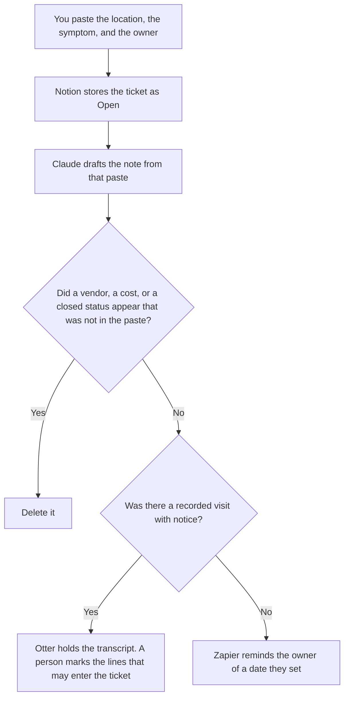

**Facilities ops should use AI to format a work ticket from a report a person already wrote, a visit note from lines they marked, and a reminder on a date they set.** The model does not close a ticket, invent a vendor, or decide a room is safe. The general ops shelf is [best AI tools for ops teams](/blog/best-ai-tools-for-ops-teams-2026/). The seat review, when the issue is access rather than a building, is [best AI tools for IT admins](/blog/best-ai-tools-for-it-admins-2026/).

A checklist for a person who is leaving, which is not a work order, is [how to write an AI offboarding checklist with AI](/blog/how-to-write-an-ai-offboarding-checklist-with-ai-2026/). A site walk is not that list.

Notion, Otter, and Zapier prices are from directory pages checked October 16, 2026. Claude's prices are the October 24, 2026 read of claude.com/pricing recorded in [Claude pricing explained](/blog/claude-pricing-explained-2026/). A live fetch of Zapier's pricing page returned HTTP 401 on October 24, in the agent-budget article, so the Zapier figure stays on the directory record. Published October 24, 2026. We did not score buildings or vendors.

## The ops week

| The job | Start here | First paid step | The limit |
|---|---|---|---|
| The ticket register | [Notion AI](/tools/notion-ai/) | Business is $20 a seat a month | Plus at $10 is not the full AI tier |
| The note from a report you wrote | [Claude](/tools/claude/) | Pro is $17 a month billed annually, or $20 monthly | No vendor you did not name |
| A visit that ran as a conversation you recorded with notice | [Otter](/tools/otter-ai/) | Pro is $8.33 a user a month billed annually | 90 minutes per conversation on that plan |
| A reminder on a date you stored | [Zapier](/tools/zapier/) | Professional is $19.99 a month billed annually, 750 tasks | The Zap does not close the ticket |

Otter Basic is free: 300 minutes a user a month, and 30 minutes per conversation. A long walkthrough can pass 30 minutes. Pro is $8.33 a user a month billed annually, or $16.99 monthly, with 1,200 minutes and 90 minutes per conversation. Business is $19.99 annual, or $30 monthly, with unlimited meetings and 4 hours per conversation, on the October 16 card. Promotions were on the page that day. They are not the list prices. The invoice is [Otter.ai pricing explained](/blog/otter-ai-pricing-explained-2026/). Tell the other person the conversation is recorded before Otter joins.

A cost that is not on a quote says Cost not attached. A room that was not in the report says Location not in the report. The model does not estimate a repair.

## What you are paying for

**Notion Business** is the register: location, symptom, owner, status, next date. The invoice is [Notion AI pricing explained](/blog/notion-ai-pricing-explained-2026/).

**Claude Pro** drafts the note. Team standard seats are $20 a seat a month billed annually, or $25 monthly, when the note is a company record, as recorded in [Claude Team pricing explained](/blog/claude-team-pricing-explained-2026/). The review is [Claude review](/blog/claude-review-2026/).

**Otter Pro** is the visit, when you need the longer conversation cap. The review is [Otter.ai review](/blog/otter-ai-review-2026/). A transcript is not a closed ticket.

**Zapier Professional** reminds a person of a date you stored. It does not dispatch a vendor. The ladder is [Zapier pricing explained](/blog/zapier-pricing-explained-2026/).

A prompt that holds the line:

"Draft the facilities note from the location, the symptom, and the owner I pasted. Leave the status as Open. If the cost is missing, write Cost not attached. Do not add a vendor. Do not mark the ticket closed."

## What not to automate

Do not paste badge photos or access codes so a note "has the door." Do not let a Zap assign a contractor. Do not mark a room safe because the summary sounded calm. The owner closes the ticket. Open stays open.

## FAQ

### How is this different from the ops-teams page?

That page is the general operating cadence: the memo, the metric, the handoff. This page is a place: a location, a symptom, a visit, a ticket. The same lead may use both. The templates stay different so a weekly ops note does not close a work order.

### How is this different from the IT-admin page?

IT admins review seats and accounts. Facilities ops reviews a room, a visit, and a repair ticket. A badge that does not open a door can be both. The access change belongs on the IT checklist. The work ticket belongs here. Do not revoke a seat from a facilities note.

### Do I need Otter for every ticket?

No. A ticket can be a paste into Notion and Claude. Otter is the step when a walkthrough was a conversation you recorded with notice, and you will mark lines before they enter the ticket. Pro at $8.33 annual is the seat when the conversation can pass 30 minutes. A two-line report does not need a bot.

### Who may close a ticket?

The owner named on the row, after the work they required is done. A formatted note is not a close. Cost not attached stays until a person attaches a quote. A reminder is not a dispatch.

## Last verified

October 16, 2026 for Notion, Otter, and Zapier. October 24, 2026 for Claude, via the pricing article. Published October 24, 2026. Zapier's pricing page returned HTTP 401 on October 24, as recorded in the agent-budget article. This page did not refetch Otter's pricing URL on October 24.

**Sources:** [Notion pricing](https://www.notion.com/pricing), [Claude pricing](https://claude.com/pricing), [Otter pricing](https://otter.ai/pricing), [Zapier pricing guide](https://zapier.com/blog/zapier-pricing/).

*Published by Andrew for [AI Tools Optimizer](https://aitoolsoptimizer.com).*

[Otter](/tools/otter-ai/) is in the [meetings directory](/tools/category/meetings-transcription/). Directory pages may use affiliate links. A purchase through them may earn us a commission at no extra cost to you.
