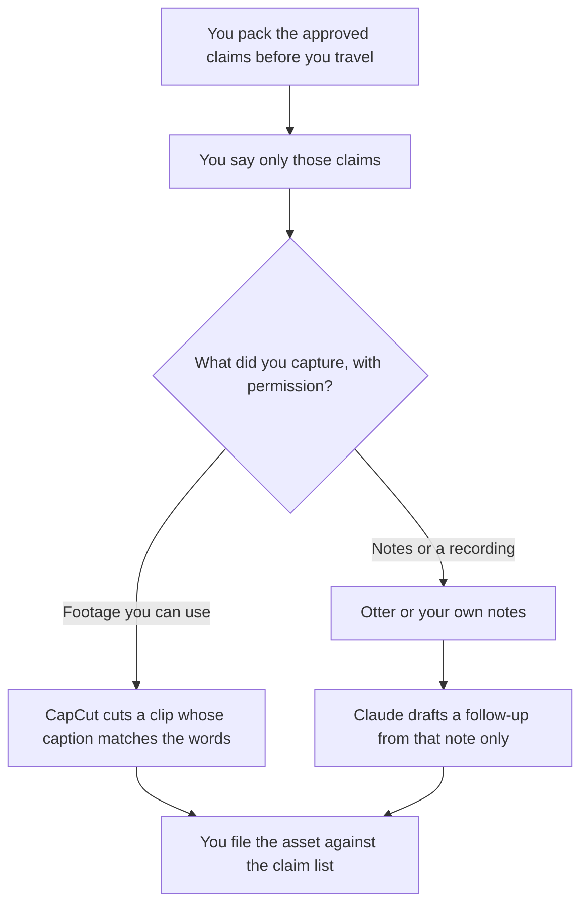

**A field marketer should use AI to keep a talk track inside the claims the company already approved, cut a phone clip from footage they have rights to, and write a follow-up only from notes they took.** The team system for the booth, the run of show, and the CRM is [best AI tools for field marketing](/blog/best-ai-tools-for-field-marketing-2026/). This page is the person in three cities who needs a script, a clip, and a sentence they can say out loud. The always-on program is [best AI tools for demand gen](/blog/best-ai-tools-for-demand-gen-2026/).

The one-slot assignment before a trip is [how to create a content calendar brief with AI](/blog/how-to-create-a-content-calendar-brief-with-ai-2026/). The note from a conversation you were allowed to record is [Otter vs tl;dv for meeting notes](/blog/otter-vs-tl-dv-for-meeting-notes-2026/).

Prices are US list prices excluding tax from directory pages checked October 16, 2026. A live fetch of several pricing pages returned HTTP 401 on October 24, 2026. Published October 24, 2026. We did not score events or pipeline.

## The field marketer's week

| The job | Start here | First paid step | The limit |
|---|---|---|---|
| A talk track you reuse in each city | [ChatGPT](/tools/chatgpt/) | Plus is $20 a month | The track may not add a discount or a local stat |
| A vertical clip from footage you shot | [CapCut](/tools/capcut/) | Pro is $19.99 a month, or $179.99 a year | Checkout can differ by region. The caption matches the words |
| A one-pager you can print on the road | [Canva](/tools/canva/) | Pro is $18 a month or $180 a year for one person | Real type. No generated logo |
| Notes from a dinner you were allowed to record | [Otter](/tools/otter-ai/) | Pro is $8.33 a user a month billed annually, or $16.99 monthly | 90 minutes a conversation on Pro. You correct the owners |
| The follow-up email from those notes | [Claude](/tools/claude/) | Pro is $20 a month, or $17 billed annually | If the note is thin, the email is short |

The function page owns the booth system: Notion for the run of show, Gamma for a leave-behind, HubSpot for the list. Use that page when you are designing the event. Use this page when you are the person standing in the room. A talk track that quietly becomes a cold-email sequence has changed jobs. The sequence page is demand gen.

## What you are paying for

**ChatGPT Plus at $20** holds the talk track in a project: the claims, the not-this lines, and a 60-second version. Go at $8 may include ads, which is a poor fit for a script you will say next to a logo. Free can draft one pass. The review is [ChatGPT review](/blog/chatgpt-review-2026/).

**CapCut Pro** is the phone editor. Free covers basic cuts. Ultra has no dollar on the directory card, so this page does not invent one. The clip still has to be footage you can publish. The comparison with a transcript editor is [Descript vs CapCut for podcast clips](/blog/descript-vs-capcut-for-podcast-clips-2026/).

**Canva Pro** is the one-pager and the badge you print at a hotel business center, if you are allowed to. Do not generate a product photo and call it the product. A concept still is [Midjourney vs Krea for concept art](/blog/midjourney-vs-krea-for-concept-art-2026/), and it stays a concept.

**Otter Pro** is the USD seat when you record with consent and need more than Basic's 30-minute conversations. Promotions were running on October 16. Treat them as temporary. The invoice is [Otter.ai pricing explained](/blog/otter-ai-pricing-explained-2026/).

**Claude Pro** writes the follow-up. It does not remember the dinner. You paste the note. The review is [Claude review](/blog/claude-review-2026/).

A prompt that holds the line:

"Write a 60-second talk track from the claims I pasted. Do not add a discount, a customer, or a city statistic. Then stop. I will paste notes later if I need a follow-up, and that follow-up may use only those notes."

## What not to automate

Do not generate attendees. Do not email a badge scan your policy does not allow. Do not ask the model for a local market size to make the talk sound specific. Do not dub a customer's voice into a recap clip. The factual check is [how to fact-check AI writing](/blog/how-to-fact-check-ai-writing-2026/).

## FAQ

### How is this different from the field-marketing roundup?

That page is the event system: the run of show, the leave-behind, and the CRM. This page is the marketer who travels and has to stay inside the claims with a script, a clip, and a note. Use both if you do both jobs. Do not let the personal chat become a second claim list.

### Can I live in the free plans?

ChatGPT Free can hold one paste. CapCut Free can teach the timeline. Otter Basic fits short calls inside 300 minutes and 30 minutes each. Canva Free can set type. The paid step is the one you repeat every week: Plus for the track, Pro for the clips or the notes. Buy that step when the free cap is the thing you hit, not before the first trip.

### What if I cannot record?

Then Otter is the wrong tool for that dinner. Write the note yourself, and paste only that note into Claude. A follow-up that remembers a sentence you did not write down is the sentence to delete.

### Who approves the talk track?

The person who owns the claim list, before you travel. A project that "improves" the track in the taxi has left the approved set. Save the approved version. Diff against it when you get home.

## Last verified

October 16, 2026 for ChatGPT, CapCut, Canva, Otter, and Claude. Published October 24, 2026. Live pricing fetches returned HTTP 401 that day.

**Sources:** [ChatGPT pricing](https://chatgpt.com/pricing/), [CapCut pricing](https://www.capcut.com/pricing), [Canva pricing](https://www.canva.com/pricing/), [Otter pricing](https://otter.ai/pricing), [Claude pricing](https://claude.com/pricing).

*Published by Andrew for [AI Tools Optimizer](https://aitoolsoptimizer.com).*

[CapCut](/tools/capcut/) is in the [video directory](/tools/category/video/). Directory pages may use affiliate links. A purchase through them may earn us a commission at no extra cost to you.
