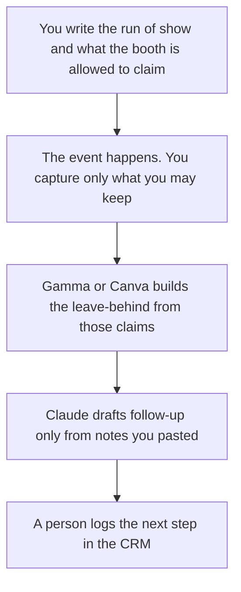

**Field marketing should use AI to format a run of show, a leave-behind, and a follow-up from notes the team actually took.** The always-on acquisition program is a different page. This page is the event, the booth, and the week after. We did not score pipeline.

The always-on shelf is [best AI tools for demand gen](/blog/best-ai-tools-for-demand-gen-2026/). The broader marketing shelf is [best AI tools for marketers](/blog/best-ai-tools-for-marketers-2026/). The map from one event recording to later assets is [how to create a content repurposing plan with AI](/blog/how-to-create-a-content-repurposing-plan-with-ai-2026/).

Prices are US list prices excluding tax from directory pages checked October 16, 2026. HubSpot Starter was a limited-time offer. Published October 24, 2026.

## The field job

| The job | Start here | First paid step | The limit |
|---|---|---|---|
| The run of show, the booth checklist, the follow-up owners | [Notion AI](/tools/notion-ai/) | Business is $20 a seat a month | The page is the record. The chat is the draft |
| A leave-behind deck from facts you may say | [Gamma](/tools/gamma/) | Plus is $9 a seat a month, 1,000 credits | Free credits do not refresh. You delete invented prices |
| A one-page sign, a badge, a simple booth graphic | [Canva](/tools/canva/) | Pro is $18 a month or $180 a year for one person | Real type and legal lines go in the layout |
| A follow-up email from notes you paste | [Claude](/tools/claude/) | Pro is $20 a month, or $17 billed annually | The model does not invent a conversation you did not have |
| A recap cut from footage you own | [Descript](/tools/descript/) | Hobbyist is $16 a person a month billed annually | Free is 60 media minutes. You still have the rights |
| The list of people who asked for a follow-up | [HubSpot](/tools/hubspot/) | Free CRM. Starter was a promo | Do not upload a badge scan the attendee did not agree to |

Field marketing owns the room and the local follow-up. Demand gen owns the always-on program and the spend that is not tied to a date on a calendar. A booth tour that quietly becomes a cold-email sequence has changed jobs. Say so, and use the demand-gen page for that sequence.

## What you are paying for

**Notion Business at $20 a seat** holds the run of show: times, owners, the claim list, and the follow-up deadline. If the show and the CRM disagree on who owns a lead, the signed source wins. The record rule is [what a system of record for AI is](/blog/what-is-a-system-of-record-for-ai-2026/).

**Gamma Plus at $9 a seat** is the fast leave-behind. Pro is $18 a seat with 4,000 credits. The sales version of this choice is [Gamma vs Beautiful.ai for sales decks](/blog/gamma-vs-beautiful-ai-for-sales-decks-2026/). A booth deck still cannot invent a customer logo or a discount.

**Canva Pro at $18 a month**, or $180 a year, is the sign and the one-pager you will print. Business is $25 per person a month or $250 a year. The AI allowance is larger on paid plans. The invoice detail is [Canva Magic Studio pricing explained](/blog/canva-magic-studio-pricing-explained-2026/). A generated pack shot is a concept. The print file still needs a person, which is the point of [Midjourney vs Flux for packaging](/blog/midjourney-vs-flux-for-packaging-2026/) when the booth includes a physical product.

**Claude Pro** writes the follow-up from the note: what the person asked, what you promised, and the next step you offered. If the note is thin, the email is short. The review is [Claude review](/blog/claude-review-2026/). A case study later, with permission, is [how to write a case study with AI](/blog/how-to-write-a-case-study-with-ai-2026/).

**Descript Hobbyist at $16 a person annually** edits the recap. Creator is $24 annually. Do not dub attendees. A localization pass, if the recap must travel, is [HeyGen vs Synthesia for localization](/blog/heygen-vs-synthesia-for-localization-2026/).

**HubSpot's free CRM** stores the people you are allowed to contact. The badge-scan policy is yours. The invoice, including the promo caveat, is [HubSpot pricing explained](/blog/hubspot-pricing-explained-2026/).

A prompt that holds the line:

"Draft a follow-up from the notes I pasted for this one person. Mention only the topic they raised. Do not add a meeting they did not ask for. If a next step is missing, write Missing. Do not invent a discount."

## What not to automate

Do not generate a list of attendees from a prompt. Do not email people who did not opt in, and do not ask the model how to evade a consent rule. Do not let a deck claim a local statistic you did not paste. The factual check is [how to fact-check AI writing](/blog/how-to-fact-check-ai-writing-2026/).

## FAQ

### Is field marketing the same as demand gen?

Demand gen is the always-on program. Field marketing is tied to a place and a date: the event, the booth, the dinner, the week-after note. Use the demand-gen page for sequences and spend. Use this page for the room.

### Can AI design the booth?

It can draft a one-pager and a slide. A booth structure, a print spec, and a venue rule are vendor documents. Canva holds the graphic. It does not book the hall.

### What if we only sponsor and do not scan badges?

Then the CRM row is the people who asked you to write, and nobody else. A thin list is a successful compliance outcome. Do not backfill it with names from a program PDF.

### Do we need a video tool for every event?

No. Descript matters when you have footage you own and a recap you will edit. A still leave-behind is enough for a small dinner. The repurposing plan says which events become video. The others stay as notes.

## Last verified

October 16, 2026 for Notion AI, Gamma, Canva, Claude, Descript, and HubSpot. HubSpot Starter was a promotion. Published October 24, 2026.

**Sources:** [Notion pricing](https://www.notion.com/pricing), [Gamma pricing](https://gamma.app/pricing), [Canva pricing](https://www.canva.com/pricing), [Claude pricing](https://claude.com/pricing), [Descript pricing](https://www.descript.com/pricing).

*Published by Andrew for [AI Tools Optimizer](https://aitoolsoptimizer.com).*

[Canva](/tools/canva/) is in the [design directory](/tools/category/design/). Directory pages may use affiliate links. A purchase through them may earn us a commission at no extra cost to you.
