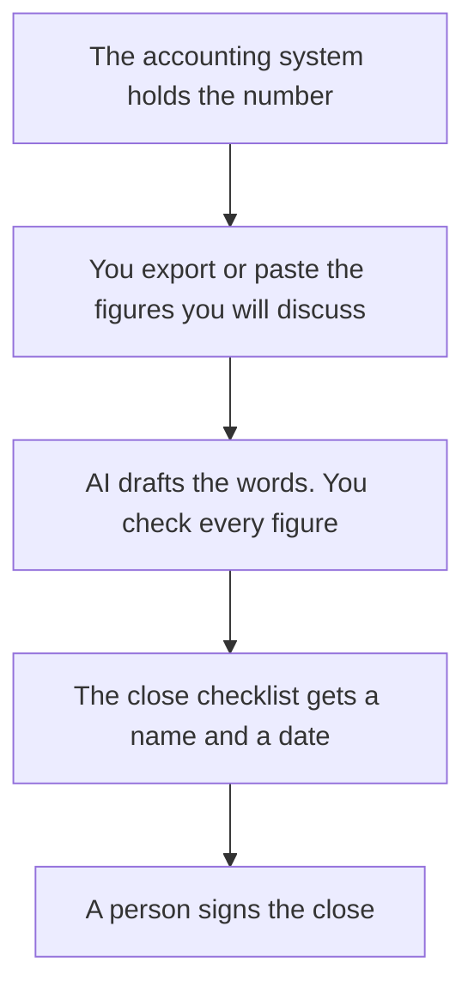

**Finance ops should use AI to format a close checklist and to narrate numbers a person already calculated.** It should not file a tax return, pick an investment, invent a variance, or move money. This page is the workflow around the books: the checklist, the memo, and the export. Your accounting system remains the ledger. Your accountant owns tax treatment. AI Tools Optimizer does not prepare filings or give investment advice.

The invoice paperwork, which is a cousin and still needs a human on the amount, is [how to automate invoices with AI](/blog/how-to-automate-invoices-with-ai-2026/). The habit of labeling software spend is [what AI cost attribution is](/blog/what-is-ai-cost-attribution-2026/). The place a figure is allowed to live is [what a system of record for AI is](/blog/what-is-a-system-of-record-for-ai-2026/).

Prices are US list prices excluding tax from directory pages checked October 16, 2026. Microsoft's Copilot Business figure was recorded as a promotion. Published October 24, 2026. We did not score forecasts.

## The finance-ops job

| The job | Start here | First paid step | The limit |
|---|---|---|---|
| A variance memo from a table you paste | [Claude](/tools/claude/) or [ChatGPT](/tools/chatgpt/) | Claude Pro is $20, or $17 billed annually. ChatGPT Plus is $20 | Every figure in the memo must be in the paste |
| The close checklist the team reopens | [Notion AI](/tools/notion-ai/) | Business is $20 a seat. Plus at $10 is not the full AI tier | The checklist does not post a journal entry |
| A notebook on data you already trust | [Hex](/tools/hex/) | Professional is $36 an editor a month. Team is $75 | The agent writes queries. You still own the table |
| A narrative inside Excel, if that is where the sheet lives | [Microsoft Copilot](/tools/microsoft-copilot/) | Copilot Business was listed from $18 a user a month paid yearly, promotional, originally $21 | A promotional price is not a contract until checkout shows it |
| Filing an approved checklist row | [Zapier](/tools/zapier/) | Professional is $19.99 a month billed annually for 750 tasks | It does not pay a vendor |

## What each seat is allowed to do

**The memo.** Claude Pro is the long-table seat. Put last month's memo structure in a Project: what changed, what did not, what is unexplained. ChatGPT Plus is enough for a shorter note. Business at $20 a user a month billed annually, for two or more users, does not train on business data by default. A personal Plus seat is the wrong place for a full trial balance if your review says so. The ladder is [ChatGPT Go vs Plus vs Pro](/blog/chatgpt-go-vs-plus-vs-pro-2026/).

A prompt that holds the line asks for words only: "Use only these rows. If a variance is not in the table, write Not in the export. Do not recommend a tax treatment, a security, or a payment." The check is [how to fact-check AI writing](/blog/how-to-fact-check-ai-writing-2026/). The person who sends the memo is [what human-in-the-loop AI is](/blog/what-is-human-in-the-loop-ai-2026/).

**The checklist.** Notion Business holds the close steps: reconcile, export, review, sign. The agent can draft a status from boxes you ticked. It cannot tick the box because a paragraph sounded finished. The card is [Notion AI pricing explained](/blog/notion-ai-pricing-explained-2026/).

**The notebook.** Hex Professional includes the Hex agent, up to five published apps, and medium compute. Team at $75 adds unlimited apps and scheduled runs. Larger compute on Team and Enterprise runs from $0.32 an hour on the card. Use Hex to query a warehouse table your data team already trusts. Do not use it to invent a forecast and then read the chart in the board meeting as actuals. The card is [Hex pricing explained](/blog/hex-pricing-explained-2026/). The path from a published number back to a query is [what AI data lineage is](/blog/what-is-ai-data-lineage-2026/).

**The sheet.** Microsoft Copilot is free with a Microsoft account. Microsoft 365 Premium is $19.99 a month for heavy personal use. Copilot Business was recorded at $18 a user a month paid yearly as a promotion, originally $21. It can help inside Excel. You still verify the cell. The directory tells you to confirm the offer. This page repeats that.

**The filing path.** Zapier can drop an approved export into the folder the close uses. It should not change a bank detail or send a payment. The invoice loop with the same boundary is the how-to linked above. The map is [Zapier vs Make vs n8n](/blog/zapier-vs-make-vs-n8n/).

## What this team does not buy an AI seat to do

Do not ask a model which stock, fund, or vendor to buy. Do not ask it how to treat tax. Do not let it email a number that was not in the export. Do not let an agent close the books. A narrative of a variance you calculated is the job. A generated explanation of a variance you did not calculate is how a close goes wrong in prose that sounds calm.

The RevOps neighbor, which explains a funnel rather than the books, is [best AI tools for RevOps](/blog/best-ai-tools-for-revops-2026/). Keep the funnel number and the ledger number in the systems that already own them.

## FAQ

### Can AI do the monthly close?

It can format the checklist and the memo. A person ticks the steps and signs. The accounting system posts the entries. If a step is "AI reviewed it," the step is not done.

### Is Hex a replacement for the general ledger?

No. Hex is a notebook and an app on data you bring. The ledger is the system of record. A pretty app on a stale export is still a stale export.

### Which seat should a three-person finance ops team buy first?

Claude or ChatGPT, for the memo you rewrite from scratch every month, on a plan your security review accepts. Notion Business if the checklist is the pain. Hex if a data person is already writing SQL for the same ten questions. Microsoft 365 only if the sheet already lives there.

### Can the model categorize expenses?

It can propose categories from a list you provide, on a sample a person reviews. It should not recode the ledger unattended. The first wrong tax-looking category will get copied for a year.

## Last verified

October 16, 2026 for Claude, ChatGPT, Notion, Hex, Microsoft Copilot, and Zapier prices named above. Copilot Business at $18 was a promotional figure on the card. Published October 24, 2026.

**Sources:** [Claude pricing](https://claude.com/pricing), [Hex](https://hex.tech), [Microsoft Copilot](https://copilot.microsoft.com).

*Published by Andrew for [AI Tools Optimizer](https://aitoolsoptimizer.com).*

[Hex](/tools/hex/) is in the [data and analytics directory](/tools/category/data-analytics/). Directory pages may use affiliate links. A purchase through them may earn us a commission at no extra cost to you.
