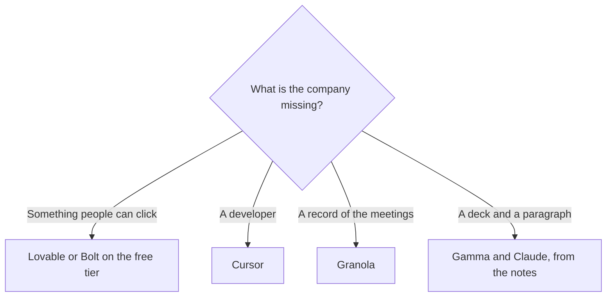

**A founder should pay for the tool that moves the company this month: a prototype someone can click, notes from the conversations that change the plan, or a narrative a co-founder can edit.** The one-person operating list, calendar and support and the weekly offer, is [best AI tools for solopreneurs](/blog/best-ai-tools-for-solopreneurs-2026/). This page is the build-and-raise list, including the moment a developer joins and the chat-built app has to become a repository.

Prices are US list prices excluding tax. Bolt, Replit, Cursor, and Granola figures below were read October 24, 2026, as recorded in the pricing articles linked here. Lovable, Gamma, Claude, and Canva are from directory pages checked October 16, 2026. Published October 24, 2026. Nothing here is a fundraising score.

## The founder job

| Job | Start here | First paid step | Stop when |
|---|---|---|---|
| A web app from a conversation, shared with a co-founder | [Lovable](/tools/lovable/) | Pro is $25/month for 100 credits, or $250/year. Free is 5 credits a day, up to 30 a month | A developer needs the repo. Move to Cursor |
| A larger free build, with hosting in the tab | [Bolt.new](/tools/bolt-new/) | Pro is $25 month to month, or $18/month billed annually | The token meter on a growing project surprises you. Read the invoice article |
| The code, once someone will maintain it | [Cursor](/tools/cursor/) | Plus is $8/month or $80/year. Premium is $30 if you need cloud agents | You are still describing an app and nobody will read a diff |
| Investor and customer calls, no bot | [Granola](/tools/granola/) | Business is $14/user/month for history past 30 days | You need a bot the whole company shares. Look at Fathom |
| A leave-behind deck | [Gamma](/tools/gamma/) | Plus is $9/seat/month | The firm requires a locked PowerPoint template |
| The narrative, from notes you paste | [Claude](/tools/claude/) | Pro is $20/month, or $17 billed annually | The facts are not in the notes. The model will fill them |
| A one-page site and a simple brand kit | [Canva](/tools/canva/) | Pro is $18/month or $180/year | The site is the product. Use Lovable or Bolt |

The builder switch list is [Lovable alternatives](/blog/lovable-alternatives-2026/). Bolt's card is [Bolt.new pricing explained](/blog/bolt-new-pricing-explained-2026/). Cursor's ladder, including what Plus withholds, is [Cursor pricing explained](/blog/cursor-pricing-explained-2026/).

## The prototype, then the repo

Start on a free tier. Lovable's daily credits are enough to see if the product is describable. Bolt's free plan includes 1 million tokens a month and a 300,000 daily cap, which is the more generous weekend build, with Bolt branding still on the site. Pay for Lovable Pro when several people should share one credit pool. Pay for Bolt Pro when you need the domain and the daily cap gone, and you will keep it long enough that $18 a month annually ($216 a year) beats $25 month to month.

[Replit](/tools/replit/) is the third door: a cloud IDE with a free Starter plan and one published app that comes down after 30 days. The paid pairs on the October 24 page are in [Replit Agent pricing explained](/blog/replit-agent-pricing-explained-2026/). Use Replit when you want the environment, not only the chat.

The week a developer joins, export the project and open it in Cursor. Plus at $8 is the new-customer entry and it fences off cloud agents and third-party models. Premium at $30 is the plan when those features are the work. A founder who will not read the diff should not be the only person merging agent output. The side-project steps are [how to use Cursor for a side project](/blog/how-to-use-cursor-for-a-side-project-2026/). Product managers prototyping beside a founder can use the same builders. Their list is [best AI tools for product managers](/blog/best-ai-tools-for-product-managers-2026/).

## The conversations and the story

Granola Basic is free and bot-free, with 30 days of history. Business at $14 is the plan if the round will last longer than a month and you need the archive, the briefs, and the model picker. A founder who takes ten calls a week will hit the history cap. The invoice is [Granola pricing explained](/blog/granola-pricing-explained-2026/). Paste the kept lines, the decisions and the open questions, into the narrative. Do not ask a model to remember the meeting it did not attend.

Claude Pro is the drafting seat for the investor note and the homepage, from those lines. The method is [how to write a blog post with Claude](/blog/how-to-write-a-blog-post-with-claude-2026/). A voice card, even a short one, keeps the homepage and the deck from sounding like two companies. The steps are [how to create a brand voice with AI](/blog/how-to-create-a-brand-voice-with-ai-2026/). Gamma Plus at $9 is the deck. Canva Pro at $18 is the kit and the simple page. A founder does not need Jasper at $59 a seat until a second writer is producing in a stored voice. That switch is [Jasper alternatives](/blog/jasper-alternatives-2026/).

## A lean founder stack

Two people, pre-seed, no full-time developer: Bolt or Lovable on the free tier until a prototype is worth showing, Granola Basic, Claude or ChatGPT for the note, Canva Free until a brand kit is actually blocking a launch. Add one paid seat when a cap stops a task you are already doing. Add Cursor when the code has an owner. A "founder OS" that bills five subscriptions in week one is how the runway moves into software you will not open during a raise.

## FAQ

### What AI tool should a founder buy first?

None, until a free tier blocks a real task. The first paid seat is usually the prototype host, once the demo is worth a domain, or the notetaker, once 30 days of history is not enough. The narrative can stay on a free or $20 chat seat.

### Is a no-code app enough to raise on?

It is enough to show. It is a weak place to put customer data or payments until someone can read the generated code. Use the clickable build for the conversation. Move the repository to Cursor, or hire the person who will, before the product holds anything sensitive.

### Do founders need a separate research tool?

When the memo cites a public number, yes: open the page, or use Perplexity and then open the page. The comparison is [Perplexity vs ChatGPT vs Gemini for search](/blog/perplexity-vs-chatgpt-vs-gemini-for-search-2026/). A founder note full of unsourced market sizes is a draft, and investors have seen that draft.

### How is this different from the solopreneur list?

The solopreneur list runs the company a single person already operates: offer, calendar, support, recording. This list is the company being built: prototype, calls that change the plan, deck, and the handoff to a developer. Use both if you are one person doing all of it, and pay for the job that is late.

## Last verified

October 24, 2026 for Bolt, Cursor, Granola, and the Replit price pairs, via the pricing articles. October 16, 2026 for Lovable, Gamma, Claude, and Canva. Published October 24, 2026.

**Sources:** [Lovable pricing](https://lovable.dev/pricing), [Bolt.new pricing](https://bolt.new/pricing), [Cursor pricing](https://cursor.com/help/account-and-billing/pricing), [Granola pricing](https://www.granola.ai/pricing).

*Published by Andrew for [AI Tools Optimizer](https://aitoolsoptimizer.com).*

[Lovable](/tools/lovable/) and [Cursor](/tools/cursor/) are in the [coding directory](/tools/category/coding/). [Granola](/tools/granola/) is in the [meetings directory](/tools/category/meetings-transcription/). Directory pages may use affiliate links. A purchase through them may earn us a commission at no extra cost to you.
