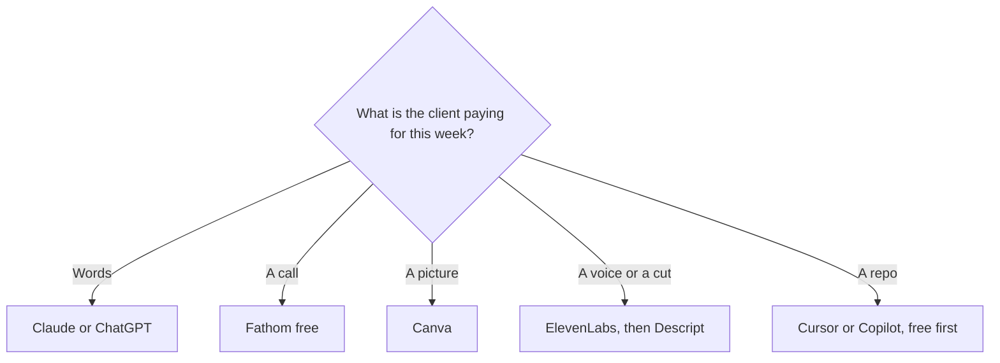

**A freelancer should pay for the tool that touches the deliverable a client is waiting on, and keep everything else on a free plan.** The failure mode is five subscriptions that each demo well and none of which are open on Thursday. This page is one tool per client job, with a stack that can stay near $30 a month.

Prices are US list prices excluding tax, from vendor pages checked October 16, 2026, published here on October 24, 2026. A live refetch of those pages that day did not return numbers. The "one subscription" map, if you want to pay for only one, is [which AI subscription is worth paying for](/blog/which-ai-subscription-is-worth-paying-for/).

The catalogs: [productivity](/tools/category/productivity-notes/), [writing](/tools/category/writing/), [meetings](/tools/category/meetings-transcription/), [design](/tools/category/design/), and [coding](/tools/category/coding/).

## One job, one bill

| Client job | Use | Pay when |
|---|---|---|
| Proposals, emails, and the first draft | [Claude](/tools/claude/) or [ChatGPT](/tools/chatgpt/) | The free cap hits during a work week. Claude Pro is $20/month or $17 annual. ChatGPT Plus is $20. Go is $8 |
| A last pass on grammar in the browser | [Grammarly](/tools/grammarly/) | You want full-sentence rewrites. Pro is $12/month billed annually, or $30 monthly. Avoid the monthly price |
| Notes from a sales call | [Fathom](/tools/fathom/) | You need advanced summaries. Premium is $16/month annually or $20 monthly. The free plan already records without a cap on the page we checked |
| A one-page proposal or a workshop deck | [Gamma](/tools/gamma/) | Free credits run out, and they do not refresh. Plus is $9/seat/month |
| Social images and simple client graphics | [Canva](/tools/canva/) | You need the brand kit. Pro is $18/month or $180/year. Free is enough for many freelancers |
| A voiceover you will invoice | [ElevenLabs](/tools/elevenlabs/) | The audio will be published. Starter is $6/month and is the first commercial-license plan |
| Cut a talking-head deliverable | [Descript](/tools/descript/) | You publish. Hobbyist is $16/month annually. Free is 60 media minutes |
| A small code or automation project | [Cursor](/tools/cursor/) or [GitHub Copilot](/tools/github-copilot/) | Free no longer covers the session. Cursor Plus is $8. Copilot Pro is $10 |
| Research you will cite to the client | [Perplexity](/tools/perplexity/) | You do it most days. Pro is $17/month billed annually. Free covers light use |

## The $30 stack

This is a list of prices, not a bundle you must buy.

- Claude Pro or ChatGPT Plus at $20, for the words.
- ElevenLabs Starter at $6, only in months you deliver audio.
- Fathom's free plan for calls.
- Canva's free plan for images.
- Perplexity's free plan for anything you will cite.

That is $26 in a month with a voiceover, and $20 in a month without one. Grammarly Free covers the embarrassing typos. Gamma's non-refreshing free credits cover an occasional deck. You add Plus on Gamma or Pro on Canva in the month a client requires the brand kit or a second deck.

Do not add [Jasper](/tools/jasper/), [Surfer SEO](/tools/surfer-seo/), and a meeting bot in the same month you are still finding clients. Those are marketing-team tools. If the freelance work is marketing, use [best AI tools for marketers](/blog/best-ai-tools-for-marketers-2026/) for the specialist layer, and keep this page as the overhead layer.

## Proposals and client email

Paste the client's brief, the price, and the constraints into Claude or ChatGPT. Ask for a short proposal with the price in the first screen and a list of what is not included. Then you edit the scope. The model will try to add work you did not offer. Delete it. A workflow for longer writing is [how to write a blog post with Claude](/blog/how-to-write-a-blog-post-with-claude-2026/). The model choice for prose is [ChatGPT vs Claude for writing](/blog/chatgpt-vs-claude-for-writing-2026/).

[Grammarly](/tools/grammarly/) Pro is worth $12 a year, per month, if you live in email and you want rewrites everywhere you type. It is not worth $30 on the monthly plan. The decision write-up is [is Grammarly Pro worth it](/blog/is-grammarly-pro-worth-it-2026/). [Wispr Flow](/tools/wispr-flow/) Pro at $12/month on the annual bill is the alternative if your hands are the bottleneck and you would rather dictate. The free tier is capped by words per week.

## Meetings, decks, and design

[Fathom](/tools/fathom/) free is the default notetaker because the free plan includes unlimited recordings and transcripts on the pricing page we used. [Otter](/tools/otter-ai/) Basic is the alternative when you want a familiar app and you can live with 300 minutes and 30 minutes per conversation. Pro on Otter is $8.33 per user on annual billing. Pay for a notetaker only when the free limits change a call you are billing for. The roundup is [best AI meeting notetakers](/blog/best-ai-meeting-notetakers/).

Gamma Plus at $9 beats a Sunday in PowerPoint for a freelance proposal. Canva is the better tool when the deliverable is a post, a one-pager with a logo, or a set of sizes. [Adobe Express](/tools/adobe-express/) Premium at $9.99 is the pick if the client is already in Adobe's world. You do not need both Canva Pro and Express Premium.

## Audio, video, and code

Voice work needs a license, not just a nice sample. ElevenLabs Free does not include commercial use. Starter does. The explainer is [ElevenLabs pricing explained](/blog/elevenlabs-pricing-explained-2026/). Edit the spoken file in Descript if the client paid for a cut. The steps are [how to edit podcasts with Descript](/blog/how-to-edit-podcasts-with-descript-2026/). [CapCut](/tools/capcut/) stays free until the social template is the job.

Code, for freelancers who ship a small tool or a site, starts on Cursor Free or Copilot Free. The side-project habit is [how to use Cursor for a side project](/blog/how-to-use-cursor-for-a-side-project-2026/). Pay $8 or $10 when the free tier stops a build you are invoicing. Do not start on a $100 tier because a launch thread said to.

[Perplexity](/tools/perplexity/) is how you check a claim before it enters a client deliverable. Pro is optional. Publishing an unsourced paragraph because the draft sounded confident is the expensive mistake, and it does not show up on a subscription invoice.

Scheduling, if the calendar is the business problem, is [Motion](/tools/motion/) Pro AI at $19/seat after a trial. It is a planner. It is not required to send a proposal.

## FAQ

### What is the best AI for a freelancer?

The assistant you will use on the proposal, which is Claude or ChatGPT, plus the free plans for notes, design, and research. Add a paid specialist only in the month that specialist produces the invoice.

### How much should a freelancer spend on AI?

Twenty dollars covers a serious writing seat. Six more covers a commercial voice month. Past that, add a tool when a client deliverable is blocked, and cancel it when the deliverable type goes away. Annual plans are for tools you used three months in a row.

### Do I need Notion AI or ClickUp?

Only if the client work already lives in [Notion](/tools/notion-ai/) or [ClickUp](/tools/clickup-brain/). Otherwise it is another place to file things. The comparison, for when a team appears, is [Notion AI vs ClickUp Brain](/blog/notion-ai-vs-clickup-brain-2026/).

### Is there a free way to handle meeting notes?

Yes. Fathom's free plan, on the pricing page we checked, includes unlimited recordings and transcripts. Use it until you need the paid summary features.

## Last verified

October 16, 2026 for prices. Published October 24, 2026. Pricing pages did not return a fresh fetch that day.

**Sources:** [Claude pricing](https://claude.com/pricing), [Fathom](https://www.fathom.ai), [Canva pricing](https://www.canva.com/pricing/), [ElevenLabs pricing](https://elevenlabs.io/pricing), [Cursor pricing](https://cursor.com/help/account-and-billing/pricing), [Grammarly Pro cost](https://support.grammarly.com/hc/en-us/articles/115000090011-How-much-does-Grammarly-Pro-cost).

Directory pages may use affiliate links. A purchase through them may earn us a commission at no extra cost to you.
