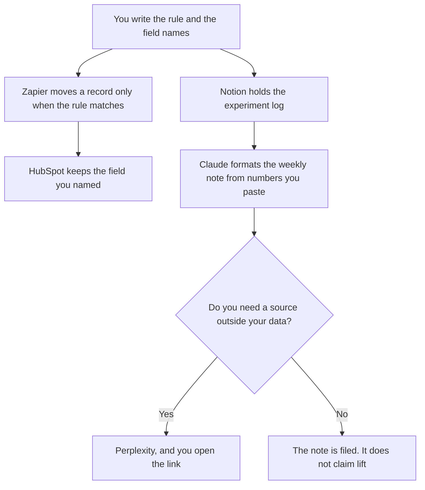

**A growth ops lead should use AI to keep an experiment log true, to run an automation only when a rule they wrote matches, and to describe a CRM field they already named.** The campaign, the brief, and the list a person will send are the growth team's job: [best AI tools for growth teams](/blog/best-ai-tools-for-growth-teams-2026/). This page is the person who makes the system hold still. An agent that emails a bought list is not ops.

The cap on a model feature you might add later is [what an AI request budget is](/blog/what-is-ai-request-budget-2026/). The note when a number is near its limit is [how to write a capacity plan note with AI](/blog/how-to-write-a-capacity-plan-note-with-ai-2026/).

Prices are US list prices excluding tax from directory pages checked October 16, 2026. HubSpot's Starter figure was a limited-time offer on that card. Published October 24, 2026. We did not score experiments, and this page does not promise lift.

## The ops job

| The job | Start here | First paid step | The limit |
|---|---|---|---|
| The experiment log: hypothesis, owner, date, result you pasted | [Notion AI](/tools/notion-ai/) | Business is $20 a seat a month | The model may not write the result |
| A handoff that fires only on a rule | [Zapier](/tools/zapier/) | Professional is $19.99 a month billed annually | Free is 100 tasks a month. A path is not a strategy |
| The CRM field map | [HubSpot](/tools/hubspot/) | Free CRM. Starter was advertised from $7 or $10 a seat | The field name is yours. The AI does not invent a property |
| The weekly note from numbers you pasted | [Claude](/tools/claude/) | Pro is $20 a month, or $17 billed annually | No growth rate you did not supply |
| A cited read of a vendor's doc | [Perplexity](/tools/perplexity/) | Pro is $17 a month billed annually | Open the citation. A vendor page is not a result |

The growth team page owns the brief and the outbound list. If your week is a campaign, use that page. If your week is the log, the zap, and the field, stay here. A zap that "helps" by emailing people who did not match the rule has left ops and become a send. Stop it.

## What you are paying for

**Notion Business at $20** is the log. Plus at $10 is the workspace without the full AI surface the pricing article describes. Do not buy Business only to format one row if the team already has it. The invoice is [Notion AI pricing explained](/blog/notion-ai-pricing-explained-2026/).

**Zapier Professional at $19.99** billed annually is the first paid task tier on the directory card. Paths do not count as tasks, on that same card's pricing article. A task that calls a model once per row can spend a budget you meant for something else. The invoice is [Zapier pricing explained](/blog/zapier-pricing-explained-2026/).

**HubSpot** is the CRM. Credits for its AI features are listed at $10 per 1,000 on the directory card. The Starter promo is not a permanent price. The invoice is [HubSpot pricing explained](/blog/hubspot-pricing-explained-2026/).

**Claude Pro** writes the weekly note. It does not pull the warehouse. You paste the numbers. The review is [Claude review](/blog/claude-review-2026/).

**Perplexity Pro** is the cited scan when a vendor changed a field name and you need the page. The invoice is [Perplexity pricing explained](/blog/perplexity-pricing-explained-2026/).

A prompt that holds the line:

"Format an experiment log row from the hypothesis, owner, date, and result I pasted. Do not write a result. Do not estimate lift. If the result is missing, write Result missing and stop."

## What not to automate

Do not generate leads. Do not let a zap create a CRM property you did not name. Do not ask the model why a test won. The result is the number you pasted, or it is missing. The factual check on any sentence that will be forwarded is [how to fact-check AI writing](/blog/how-to-fact-check-ai-writing-2026/).

## FAQ

### How is this different from the growth team roundup?

That page is the brief, the research, the page, and the list. This page is the system under those campaigns: the log, the automation rule, and the field. One person sometimes does both. The tools still should not share a prompt that both writes the ad and edits the CRM.

### Can the zap include an AI step?

Yes, inside a request budget you wrote, and only on rows that already match the rule. The model does not decide who is a lead. The rule does. Then the model may format a field you named.

### Is HubSpot's $7 price current?

It was a limited-time offer on the October 16 card, at $7 or $10 a seat depending on the plan. Quote the cart. Free CRM is the row that does not depend on the promo.

### Who changes a field?

The ops owner, in a change the growth team can see. A model that "cleans" a property by renaming it has broken the log. The log and the CRM must use the same name.

## Last verified

October 16, 2026 for Notion, Zapier, HubSpot, Claude, and Perplexity. Published October 24, 2026.

**Sources:** [Notion pricing](https://www.notion.com/pricing), [Zapier pricing](https://zapier.com/blog/zapier-pricing/), [HubSpot pricing](https://www.hubspot.com/pricing), [Claude pricing](https://claude.com/pricing), [Perplexity pricing](https://www.perplexity.ai/pro).

*Published by Andrew for [AI Tools Optimizer](https://aitoolsoptimizer.com).*

[Zapier](/tools/zapier/) is in the [automation and agents directory](/tools/category/automation-agents/). Directory pages may use affiliate links. A purchase through them may earn us a commission at no extra cost to you.
