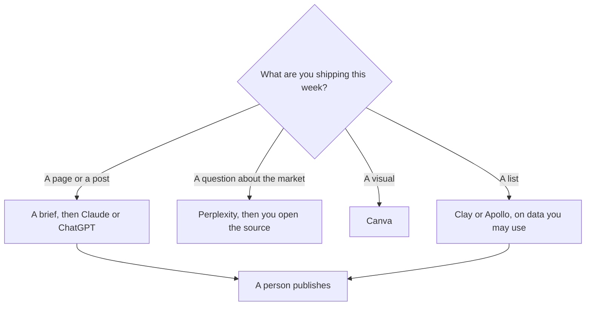

**A growth team should buy the tool that matches the artifact: a brief, a cited scan, a page, or a list a person will send.** An agent that emails a bought list because a prompt said "scale acquisition" is not a growth system. The broader marketing shelf is [best AI tools for marketers](/blog/best-ai-tools-for-marketers-2026/). The assignment before the draft is [how to build a content brief with AI](/blog/how-to-build-a-content-brief-with-ai-2026/).

Prices are US list prices excluding tax from directory pages checked October 16, 2026. HubSpot's Starter figure was a limited-time offer on that card. Published October 24, 2026. We did not score campaigns, and this page does not promise pipeline.

## The artifact, then the tool

| The artifact | Start here | First paid step | The limit |
|---|---|---|---|
| The brief and the draft | [Claude](/tools/claude/) or [ChatGPT](/tools/chatgpt/) | Claude Pro is $20, or $17 billed annually. ChatGPT Plus is $20. Go is $8 | You approve the claim before it ships |
| A cited scan of a market | [Perplexity](/tools/perplexity/) | Pro is $17 a month billed annually | You open the links |
| The landing page or the social set | [Canva](/tools/canva/) | Pro is $180 a year for one person. Business is $250 a person a year | A template still needs your offer |
| A list built from data you are allowed to use | [Clay](/tools/clay/) or [Apollo](/tools/apollo-io/) | Clay Launch is $167 a month billed annually. Apollo Basic is $49 a seat a month annually | The directory's price is not a license to scrape |
| The CRM you already run | [HubSpot](/tools/hubspot/) | Free CRM. Starter was listed from $7 a seat a month as a limited-time offer | $7 is not a permanent quote |
| Sending, after a person writes the note | [Instantly](/tools/instantly/) | Growth outreach is $47 a month. No permanent free plan on the card | A human owns the claims in the mail |

## Keep the stack small

**Words.** Claude Pro holds a Project of offers, prohibitions, and the style rules. ChatGPT Plus is the right $20 if that chat is already where drafts start. Do not pay for both until one fails a real brief. The seat math against a wiki is [Notion AI vs ChatGPT Plus cost](/blog/notion-ai-vs-chatgpt-plus-cost-2026/). The research choice, when the sources are files or Gmail, is [Gemini vs Claude for research](/blog/gemini-vs-claude-for-research-2026/).

**Evidence.** Perplexity Pro is the cited-search seat. Enterprise Pro is $40 a user a month if you need admin. The habit is [how to use Perplexity for market research](/blog/how-to-use-perplexity-for-market-research-2026/). A statistic without a link does not go on the page. The check is [how to fact-check AI writing](/blog/how-to-fact-check-ai-writing-2026/).

**The page.** Canva Pro is one person. A growth pod of four needs Business if they all need paid features: 4 × $250 = $1,000 a year. The invoice is [Canva Magic Studio pricing explained](/blog/canva-magic-studio-pricing-explained-2026/). A deck for a webinar is a different artifact: [how to create a webinar script with AI](/blog/how-to-create-a-webinar-script-with-ai-2026/).

**The list.** Clay Launch at $167 a month billed annually is a real budget line, not a starter toy. The card is [Clay pricing explained](/blog/clay-pricing-explained-2026/). Apollo Basic is $49 a seat a month billed annually, and the free plan lists 900 credits a seat a year. Instantly's Growth outreach plan is $47 a month, and the directory does not list a permanent free plan. The cold-email workflow, if you use that tool, is [how to write cold emails with Instantly](/blog/how-to-write-cold-emails-with-instantly-2026/). Send only to people you are allowed to contact. The draft still needs a human. That is [what human-in-the-loop AI is](/blog/what-is-human-in-the-loop-ai-2026/).

**The CRM.** HubSpot's free tools are the place to start if you do not have a CRM. The $7 Starter line was a limited-time offer on October 16, 2026. Confirm the current checkout before you put $7 in a yearly plan. The customer row is the record. A generated email is not. The definition is [what a system of record for AI is](/blog/what-is-a-system-of-record-for-ai-2026/).

Revops, which is the handoff after a lead exists, is [best AI tools for RevOps](/blog/best-ai-tools-for-revops-2026/). Sales, which is the conversation, is [best AI tools for sales teams](/blog/best-ai-tools-for-sales-teams-2026/).

## FAQ

### What should a growth team buy first?

The brief tool you will actually open, which is Claude or ChatGPT at the free tier until a limit hurts. Perplexity Free or Pro when the work is cited research. Canva Free until you need the paid assets. Clay or Instantly only when a person can name the list and the send. Do not buy the list tool first.

### Can AI run experiments?

It can draft the variant and the brief. It cannot declare a winner from a number you did not export. Paste the result you measured. If you do not have one, say the test has not been read.

### Is Clay required?

No. Clay is for teams who will use the data credits on purpose. At $167 a month on the annual Launch price, a small team with a spreadsheet and a careful process should stay on the spreadsheet until the manual work is the bottleneck.

### What about ads?

Canva can prepare a creative. An ad account is a separate spend, and this page does not set a budget or a bidding strategy. The creative still has to match a claim you can support.

## Last verified

October 16, 2026 for Claude, ChatGPT, Perplexity, Canva, Clay, Apollo, HubSpot's recorded Starter offer, and Instantly. Published October 24, 2026.

**Sources:** [Claude pricing](https://claude.com/pricing), [Perplexity](https://www.perplexity.ai), [Canva pricing](https://www.canva.com/pricing/).

*Published by Andrew for [AI Tools Optimizer](https://aitoolsoptimizer.com).*

[Perplexity](/tools/perplexity/) is in the [research and search directory](/tools/category/research-search/). Directory pages may use affiliate links. A purchase through them may earn us a commission at no extra cost to you.
