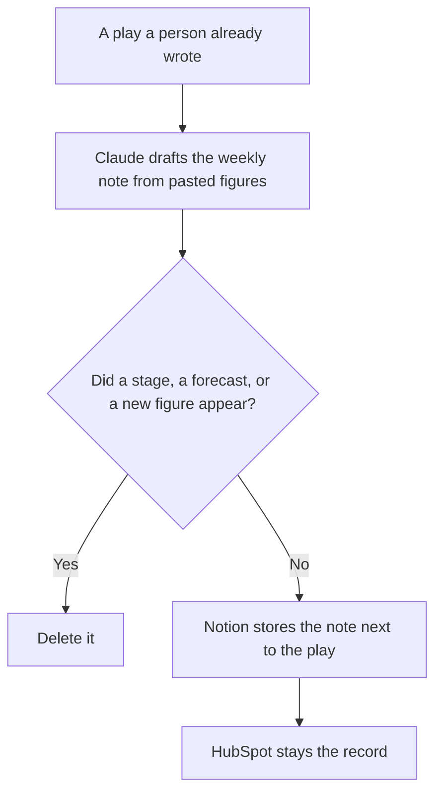

**GTM ops should use AI to draft the weekly motion note from figures they already pasted, keep the playbook in one page, and leave the CRM amount where it is.** The model does not name a stage, invent pipeline, or decide that a play worked. Enrichment, sequences, and the route between tools are [best AI tools for RevOps](/blog/best-ai-tools-for-revops-2026/). Stage definitions are [best AI tools for sales ops](/blog/best-ai-tools-for-sales-ops-2026/). This page is the motion's written play and the exception when a step you already defined did not happen.

The partner packet, when the motion is a renewal, is [how to create a partner renewal brief with AI](/blog/how-to-create-a-partner-renewal-brief-with-ai-2026/). The partner queue itself is [best AI tools for partner ops](/blog/best-ai-tools-for-partner-ops-2026/).

Claude's prices are from claude.com/pricing on October 24, 2026. Notion, HubSpot, and Relevance AI prices are from directory pages checked October 16, 2026. HubSpot's Starter figure was labeled limited-time. Published October 24, 2026. We did not score pipeline. This page is not a forecast.

## The GTM ops week

| The job | Start here | First paid step | The limit |
|---|---|---|---|
| The motion note, from numbers you pasted | [Claude](/tools/claude/) | Pro is $17 a month billed annually, or $20 monthly | No figure that was not in the paste. No "the play worked" |
| The playbook and the exception log | [Notion AI](/tools/notion-ai/) | Business is $20 a seat a month | Plus at $10 is not the full AI tier |
| The opportunity amount | [HubSpot](/tools/hubspot/) | Free tools are $0. Starter was $7 or $10 a seat on a limited-time offer | The record wins. A generated sentence does not edit the amount |
| An agent that drafts from tools you connected | [Relevance AI](/tools/relevance-ai/) | Pro is $19 a month billed annually, or $29 monthly. The free plan is retired | 2,500 Actions a month and $20 of Vendor Credits on that Pro row. The agent does not change a stage |

RevOps on the other page owns the list, the credits, and the route. Sales ops owns the stage names. GTM ops owns the play and the exception: the step was supposed to happen, the figure you pasted says it did or it did not, and nobody rewrites the CRM to make the note prettier. If you are still waterfalling data providers, you are on the RevOps page.

## What you are paying for

**Claude Pro** is the weekly note in a Project, so this week's headings match last week's. The annual charge is $200 up front. The review is [Claude review](/blog/claude-review-2026/).

**Notion Business** holds the playbook, the exception log, and the link to the cell. The chat is not the system of record. The invoice is [Notion AI pricing explained](/blog/notion-ai-pricing-explained-2026/).

**HubSpot's free tools** are the CRM if you do not already have one. Confirm the $7 or $10 Starter line before you put it in an annual plan. It was a limited-time offer on October 16. The invoice is [HubSpot pricing explained](/blog/hubspot-pricing-explained-2026/).

**Relevance AI Pro** is the no-code agent when a person wants a draft assembled from tools, on a meter of Actions and Vendor Credits. Team is $234 a month billed annually, or $349 monthly, on that card, with a higher Action allowance. The invoice is [Relevance AI pricing explained](/blog/relevance-ai-pricing-explained-2026/). An agent that updates the opportunity has left GTM ops and entered the CRM. Do not give it that write.

**Gong** is custom pricing: a per-user license plus a platform fee, on the October 16 card, with no public list price. Use it when the exception has to cite a call your company already records. Do not invent a Gong seat price. The invoice is [Gong pricing explained](/blog/gong-pricing-explained-2026/). This page does not repeat vendor case-study percentages.

A prompt that holds the line:

"Draft the weekly motion note from the play name and the figures I pasted. If a step has no figure, write Figure missing. Do not say the play worked. Do not recommend a stage change."

## What not to automate

Do not let an agent create pipeline to fill a gap in the note. Do not backfill a lead source from a job title. Do not paste a rep's compensation so the exception "looks real." The capacity gap, when the question is whether demand fits the team, is [best AI tools for revenue ops analysts](/blog/best-ai-tools-for-revenue-ops-analysts-2026/).

## FAQ

### How is this different from RevOps?

RevOps owns enrichment, the contact database, sequences, and the route that moves a row. GTM ops owns the written play and the weekly exception when a defined step did not happen. If the route is wrong, fix it on the RevOps page before you publish a note that blames the play.

### How is this different from sales ops?

Sales ops owns stage names and the fields that move a deal. GTM ops reads those stages. It does not rename them in a narrative so the week looks cleaner.

### Do I need Relevance and HubSpot?

You need the CRM that holds the amount. Relevance is optional, for a draft an agent assembles, on an Action meter you can read. If the agent and the CRM disagree, the CRM amount stays, and the agent draft is wrong until a person checks the cell.

### Who may say a play stays on?

The owner of the motion. A tidy weekly note is not a decision to scale spend, cut a channel, or change a quota.

## Last verified

October 24, 2026 for Claude. October 16, 2026 for Notion, HubSpot, Relevance AI, and Gong. Published October 24, 2026.

**Sources:** [Claude pricing](https://claude.com/pricing), [Notion pricing](https://www.notion.com/pricing), [HubSpot pricing](https://www.hubspot.com/pricing), [Relevance AI](https://relevanceai.com).

*Published by Andrew for [AI Tools Optimizer](https://aitoolsoptimizer.com).*

[HubSpot](/tools/hubspot/) is in the [marketing directory](/tools/category/marketing-seo/). Directory pages may use affiliate links. A purchase through them may earn us a commission at no extra cost to you.
