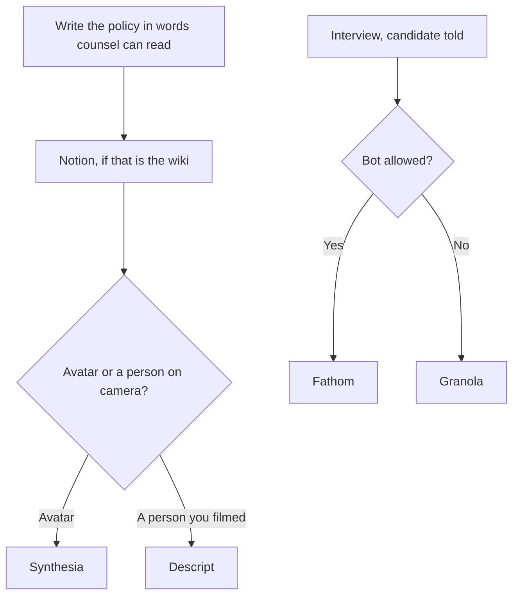

**HR teams need a handbook people can find, a training video they can update, and interview notes a candidate was told about.** They do not need a model that scores an employee or ranks a resume. This directory does not include an HRIS. Keep the system of record you already run. Use the tools below for the writing, the video, and the notes around it.

A model drafts from a policy you supply. It does not know your jurisdiction. This page is not legal advice. Have counsel read anything an employee must follow. The hiring-side neighbor, which is the recruiter's stack rather than the HR team's, is [best AI tools for recruiters](/blog/best-ai-tools-for-recruiters-2026/).

Prices are US list prices excluding tax from directory pages checked October 16, 2026, except where a sentence names a later read.

## One job, one starting tool

| HR job | Start here | First paid step | Leave it when |
|---|---|---|---|
| A handbook or a policy page the team can find | [Notion AI](/tools/notion-ai/) | Business $20/seat/month for full Notion AI | The record lives in the HRIS |
| A first draft from a policy you already wrote | [Claude](/tools/claude/) or [ChatGPT](/tools/chatgpt/) | Claude Pro $20/month ($17 annual) or ChatGPT Plus $20 | You needed counsel, not a clearer sentence |
| A proofread before employees see it | [Grammarly](/tools/grammarly/) | Pro $12/member/month billed annually, or $30 monthly | The rule itself is wrong |
| A training video without a camera | [Synthesia](/tools/synthesia/) | Starter $29/month, or the yearly presentation of $19 | You will film a person instead |
| A training video you did film | [Descript](/tools/descript/) | Hobbyist $16/person/month annual | You need an avatar, not an edit |
| Interview notes, bot allowed, candidate informed | [Fathom](/tools/fathom/) | Free for unlimited recordings. Premium $16/month annual | The candidate will not accept a bot |
| Interview notes, no bot | [Granola](/tools/granola/) | Business $14/user/month past 30 days of history | You needed a live transcript |
| A live transcript of a short loop | [Otter](/tools/otter-ai/) | Pro $8.33/user/month annual if you pass 30 minutes | The meeting is longer than the plan's cap |
| Scheduling the loop | [Reclaim.ai](/tools/reclaim-ai/) | Starter $10/seat/month. Lite is free | You need the HRIS scheduler |

## The handbook and the policy

Paste the rule you mean into Claude or ChatGPT. Ask for a plainer version that does not add benefits, deadlines, or exceptions you did not write. Delete any sentence that creates a promise. The editing standard is [how to write a blog post with Claude](/blog/how-to-write-a-blog-post-with-claude-2026/). Grammarly is the pass after that. Free covers the grammar basics. Pro at $12 a member a month billed annually is the tone seat. The buying note is [is Grammarly Pro worth it](/blog/is-grammarly-pro-worth-it-2026/).

Put the approved page where employees already look. [Notion](/tools/notion-ai/) Business at $20 a seat is the full Notion AI plan, including the agent features on that tier. Plus at $10 does not include that full set. The ladder is [Notion AI pricing explained](/blog/notion-ai-pricing-explained-2026/). If the company runs projects in ClickUp, the comparison is [Notion AI vs ClickUp Brain](/blog/notion-ai-vs-clickup-brain-2026/). ClickUp Brain² starts at $9 a user a month on the directory page. Do not stand up a second wiki to get an AI button.

Do not ask a model to "write an employee score" or to infer performance from messages. That is a different, riskier product, and it is not a recommendation on this page.

## Training video

[Synthesia](/tools/synthesia/) is the avatar path for a module you would otherwise postpone because nobody can film. Basic is free and watermarked, with 10 minutes. Starter is $29 a month, shown as $19 on yearly billing, with 1,250 credits. One-click translation, SCORM, and SSO are Enterprise lines on the page we checked. The bill is [Synthesia pricing explained](/blog/synthesia-pricing-explained-2026/). The steps are [how to make training videos with Synthesia](/blog/how-to-make-training-videos-with-synthesia-2026/).

If you filmed a person, edit the recording in [Descript](/tools/descript/). Hobbyist at $16 annual is watermark-free 1080p. Business at $50 annual is the plan with translation and dubbing in 30+ languages. The bill is [Descript pricing explained](/blog/descript-pricing-explained-2026/). Script the module from the approved handbook page, not from a model's guess at your policy.

## Interviews and the calendar

Tell the candidate. Fathom Free is unlimited recordings when a bot is acceptable. Granola is the path when a bot would make a candidate cautious. Otter is the live transcript, with a 30-minute cap on Basic and a 90-minute cap on Pro. Those caps are [Otter pricing explained](/blog/otter-ai-pricing-explained-2026/). The comparison is [Otter vs Fireflies vs Fathom](/blog/otter-vs-fireflies-vs-fathom-2026/). The no-bot split is [Granola vs Fathom](/blog/granola-vs-fathom-2026/).

The notes feed a scorecard a person fills in. They do not feed an automated hire or no-hire. The recruiter article says the same thing and is the page to send a sourcer who also needs outbound.

[Reclaim](/tools/reclaim-ai/) Lite is free and includes scheduling links. Starter is $10 a seat a month. Yearly billing saves 20% on the page we checked. Use it to protect focus time around interview loops on Google or Outlook. It does not replace the HRIS if offers and stages live there.

## A small HR stack

One HR generalist: the assistant you already pay for, Notion or the wiki you have, Synthesia Basic until a module is real, Fathom Free or Granola Basic, Grammarly Free. Add Synthesia Starter when you will publish without a watermark. Add Otter Pro or Fathom Premium when the free cap, not a demo, gets in the way. Add Reclaim Starter when scheduling links on Lite are not enough.

That is a writing and video layer beside the HRIS. It is not a talent-intelligence suite.

## FAQ

### What AI tool should HR buy first?

A writing seat and a place for the handbook. Training video and a notetaker come after you have a policy worth recording and a candidate who has been told about notes.

### Can AI screen employees or candidates?

A person can use a model to summarize notes against criteria they wrote. A model should not be the decision. Talk to counsel before any automated feature touches candidates or performance. This page does not recommend a score.

### Synthesia or Descript for training?

Synthesia when nobody is on camera and an avatar is acceptable. Descript when you filmed a person and want to edit the transcript. Starter versus Hobbyist is $29 versus $16 annual, and the products are not substitutes.

### Is Otter's free plan enough for interviews?

Enough for a conversation under 30 minutes, inside 300 minutes a month. A typical hour-long interview needs a paid Otter cap or a different notetaker.

## Last verified

October 16, 2026 for the plan prices named above. Published October 24, 2026.

**Sources:** [Notion pricing](https://www.notion.com/pricing), [Synthesia pricing](https://www.synthesia.io/pricing), [Descript pricing](https://www.descript.com/pricing), [Fathom pricing](https://www.fathom.ai/pricing), [Otter pricing](https://otter.ai/pricing), [Reclaim pricing](https://reclaim.ai/pricing).

*Published by Andrew for [AI Tools Optimizer](https://aitoolsoptimizer.com).*

Directory pages for these tools may use affiliate links. A purchase through them may earn us a commission at no extra cost to you.
