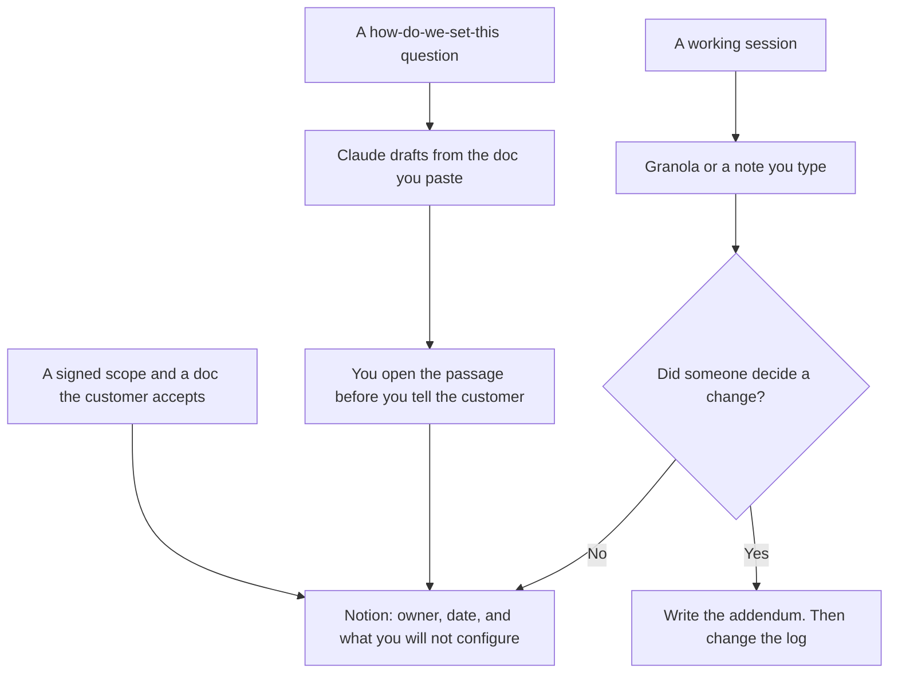

**An implementation consultant should use AI to keep three things true after the contract is signed: the project log names an owner and a date, the call note matches what was said, and a configuration answer cites a doc the customer already accepted.** The pre-sales demo is a different job. The program manager's portfolio is a different job. This page is the delivery: the environment, the decision, and the thing you will not configure.

The pre-sales shelf is [best AI tools for solutions engineers](/blog/best-ai-tools-for-solutions-engineers-2026/). The multi-project shelf is [best AI tools for program managers](/blog/best-ai-tools-for-program-managers-2026/). The spec you are implementing, and any change to it, starts at [how to draft a product spec with AI](/blog/how-to-draft-a-product-spec-with-ai-2026/) and [how to write a product spec addendum with AI](/blog/how-to-write-a-product-spec-addendum-with-ai-2026/).

Prices are US list prices excluding tax from directory pages checked October 16, 2026. Published October 24, 2026. We did not score on-time delivery or customer satisfaction.

## The delivery job

| The job | Start here | First paid step | The limit |
|---|---|---|---|
| The project log and the decision record | [Notion AI](/tools/notion-ai/) | Business is $20 a seat a month | Plus at $10 is not the full AI tier |
| Notes from the working session | [Granola](/tools/granola/) | Business is $14 a user a month | Basic is free, with 30 days of history |
| A written answer from docs you paste | [Claude](/tools/claude/) | Pro is $20 a month, or $17 billed annually | It may not invent a setting or an SLA |
| The readout the sponsor will open | [Gamma](/tools/gamma/) | Plus is $9 a seat a month | The slide matches the log, or it waits |
| A change in a repo you are allowed to touch | [Cursor](/tools/cursor/) | Plus is $8 a month, or $80 a year | You still read the diff and run the test |
| The plan of record, if it already lives in ClickUp | [ClickUp Brain](/tools/clickup-brain/) | Brain² from $9 a user a month | It is an add-on. The ClickUp plan is separate |

A setting the model remembered from another tenant is how implementations drift. The paste is this customer's doc. The answer cites it or says the doc is silent. Silence goes to the vendor or to the product owner. It does not become a confident guess. That failure is [what an AI hallucination is](/blog/what-is-ai-hallucination-2026/). The check is [how to fact-check AI writing](/blog/how-to-fact-check-ai-writing-2026/).

## What to pay for

**The log.** Notion Business. Fields worth having: decision, owner, customer approver, environment, date, and the list of things out of scope. Free's AI trial is not a system of record. The invoice is [Notion AI pricing explained](/blog/notion-ai-pricing-explained-2026/). The idea is [what a system of record for AI is](/blog/what-is-a-system-of-record-for-ai-2026/).

**The call.** Granola Business at $14 when you need history past 30 days and you do not want a bot in the customer's meeting. If a bot is allowed and the customer agreed, [Fathom](/tools/fathom/) Free records on the directory card, and Premium is $16 a month billed annually. One notetaker. The split is [Granola vs Fathom](/blog/granola-vs-fathom-2026/). A standup-style internal huddle is a different comparison: [Otter vs Fireflies for standups](/blog/otter-vs-fireflies-for-standups-2026/).

**The answer.** Claude Pro, in a Project that holds only documents this engagement may see. Do not mix two customers in one Project. ChatGPT Business at $20 a user a month billed annually, minimum two, is the admin step if the firm already works there and policy requires it. The capacity split is [Claude Pro vs Max](/blog/claude-pro-vs-max-2026/).

**The readout.** Gamma Plus at $9. The sponsor deck contains decisions from the log, not a new roadmap. If they want PowerPoint, [Plus AI](/tools/plus-ai/) Basic is $10 a user a month billed annually.

**The repo.** Cursor Plus at $8 when the statement of work includes a script or a config file in git. Run the test. The testing seat, if the team standard is GitHub instead, is [Cursor vs GitHub Copilot for tests](/blog/cursor-vs-github-copilot-for-tests-2026/).

**ClickUp.** Unlimited is $7 a user a month billed yearly on the card. Business is $12 yearly. Brain² starts at $9 a user a month on top. Everything AI is $28 and adds the notetaker. Buy Brain if ClickUp is already the plan. Do not move the log to ClickUp so you can try the model.

If the engagement includes training the customer's users, that academy is [best AI tools for customer education](/blog/best-ai-tools-for-customer-education-2026/). A partner who sells and implements needs the selling packet too: [how to write a partner enablement kit with AI](/blog/how-to-write-a-partner-enablement-kit-with-ai-2026/).

A prompt that holds the line:

"Answer this configuration question from the pasted doc only. Quote the step. If the doc does not specify the setting, write Not in the doc. Do not borrow a default from another product. List what the customer must approve before this changes production."

The consultant who tells the customer is [what human-in-the-loop AI is](/blog/what-is-human-in-the-loop-ai-2026/).

## What not to automate

Do not paste one customer's data into another customer's Project. Do not let a readout promise a go-live date the log does not contain. Do not generate training screenshots from production data. Use the demo tenant the contract allows. The demo script, when you are still selling, is [how to create a demo script with AI](/blog/how-to-create-a-demo-script-with-ai-2026/). Delivery starts when that script is no longer the scope.

## FAQ

### How is this different from a solutions engineer?

Solutions engineering proves the product can fit, before the signature. Implementation makes the fit real, after it. Some people do both. The tools overlap. The record should not: a POC note and a cutover plan are different pages, even if both live in Notion.

### Do I need Cursor if I do not write code?

No. Many implementations are configuration in the vendor's admin screen. Claude and the log cover that. Cursor is for a repo the statement of work names. Leave it off the invoice until then.

### Can Granola replace the decision log?

No. A transcript is evidence. The log is the decision, with an approver. Paste the accepted line into Notion. Do not link a raw transcript as the system of record. Someone will treat a side comment as scope.

### What belongs in "will not configure"?

The items the contract or the spec put out of scope, in the customer's words. The model may format that list. It may not delete an item because the workaround seems easy. Easy work still changes the date and the bill.

## Last verified

October 16, 2026 for Notion AI, Granola, Fathom, Claude, Gamma, Plus AI, Cursor, and ClickUp. Published October 24, 2026.

**Sources:** [Notion pricing](https://www.notion.com/pricing), [Claude pricing](https://claude.com/pricing), [Cursor pricing](https://cursor.com/help/account-and-billing/pricing), [Gamma pricing](https://gamma.app/pricing).

*Published by Andrew for [AI Tools Optimizer](https://aitoolsoptimizer.com).*

[Notion AI](/tools/notion-ai/) is in the [productivity and notes directory](/tools/category/productivity-notes/). Directory pages may use affiliate links. A purchase through them may earn us a commission at no extra cost to you.
