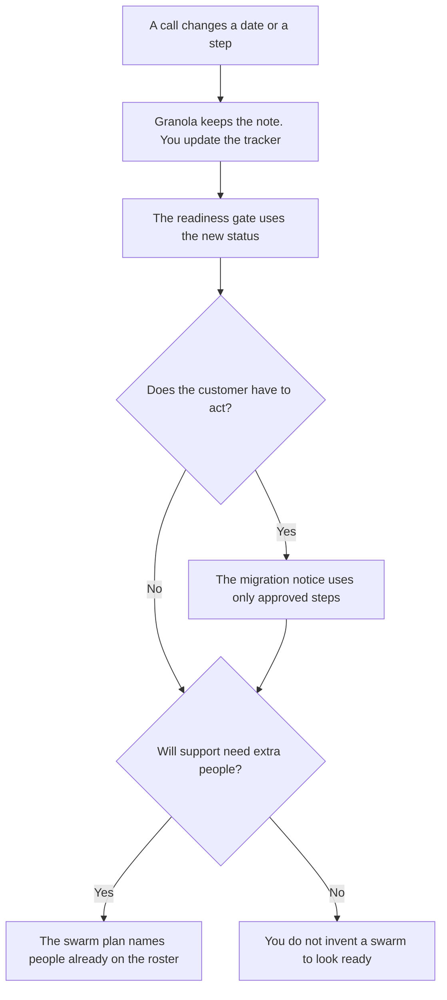

**An implementation manager should use AI to keep three documents aligned: the launch readiness gate, the customer migration notice, and the support swarm plan, each built from rows a person already accepted.** The model does not say go, and it does not configure the customer's environment. The person in the environment is [best AI tools for implementation consultants](/blog/best-ai-tools-for-implementation-consultants-2026/). This page is the manager across those environments: the date, the blocker, and the notice.

The gate is [how to create a launch readiness checklist with AI](/blog/how-to-create-a-launch-readiness-checklist-with-ai-2026/). The notice is [how to write a customer migration notice with AI](/blog/how-to-write-a-customer-migration-notice-with-ai-2026/). The roster is [how to create a support swarm plan with AI](/blog/how-to-create-a-support-swarm-plan-with-ai-2026/).

Claude's prices are from claude.com/pricing on October 24, 2026. Notion, ClickUp, and Granola prices are from directory pages checked October 16. Published October 24, 2026. We did not score on-time delivery.

## The implementation manager's week

| The job | Start here | First paid step | The limit |
|---|---|---|---|
| The gate the launch owner opens | [Notion AI](/tools/notion-ai/) | Business is $20 a seat a month | A row stays "not yet" until a person changes it |
| Notices that must use the same verbs | [Claude](/tools/claude/) | Pro is $17 a month billed annually, or $20 monthly | No step the customer was not given |
| The tracker status | [ClickUp Brain](/tools/clickup-brain/) | Brain² from $9 a user a month, on top of a ClickUp plan | The tracker status wins if the prose disagrees |
| The call where a date moved | [Granola](/tools/granola/) | Business is $14 a user a month. Basic is $0 with 30 days of history | The note is not the gate. A person updates the row |

Consultants on the other page own one customer's log, the call, and a configuration answer from docs the customer accepted. Managers own the set of those projects: which one is blocked, which notice has not gone out, and whether support is staffed. If you are writing the config steps, you are on their page. If you are deciding the portfolio is not ready, you are here. The multi-project program view, when the work is a portfolio of programs rather than implementations, is [best AI tools for program managers](/blog/best-ai-tools-for-program-managers-2026/).

## What you are paying for

**Notion Business** is the gate and the notice in one wiki. AI Meeting Notes are on that tier, on the October 16 card. The invoice is [Notion AI pricing explained](/blog/notion-ai-pricing-explained-2026/).

**Claude Pro** is the Project that holds the approved verbs for every notice in the quarter. Max starts at $100 a month on the October 24 page if you already live there. A notice does not require Max. The review is [Claude review](/blog/claude-review-2026/).

**ClickUp Brain²** is the add-on when the dates already live in ClickUp. Unlimited is $7 a user a month yearly on that card. Business is $12 yearly. The Brain line is extra. The invoice is [ClickUp Brain pricing explained](/blog/clickup-brain-pricing-explained-2026/).

**Granola Business** keeps history past Basic's 30 days, which matters when a migration date moved six weeks ago and the note is the evidence. The invoice is [Granola pricing explained](/blog/granola-pricing-explained-2026/). The action rows after the call, if they must land on a page, are [Notion AI vs ChatGPT for meeting actions](/blog/notion-ai-vs-chatgpt-for-meeting-actions-2026/).

A prompt that holds the line:

"Update the readiness summary from the statuses I pasted. If any row is not yet, the summary is Not yet. Do not add a blocker. Do not say go."

## What not to automate

Do not let a model mark a customer live. Do not send the migration notice from a call summary. Do not staff a swarm with names that were not on the roster. The product task list, which is longer than the gate, is [how to create a product launch checklist with AI](/blog/how-to-create-a-product-launch-checklist-with-ai-2026/).

## FAQ

### How is this different from the consultant page?

Consultants own the configuration and the project log for the customer in front of them. Managers own the gate across customers: the date, the notice, and the support plan. A beautiful config with no notice is not ready if the customer has to move.

### How is this different from a program manager?

Program managers track a portfolio of programs. Implementation managers track environments that are being turned on, moved, or handed to support. If the artifact is a migration notice, you are here. If the artifact is a cross-team dependency with no customer move, start on the program page.

### Do I need ClickUp and Notion?

No. Use the tracker the dates already live in, and one page for the gate. Two trackers are how a date moves in one tool and not the other.

### Who may say go?

The launch owner named on the gate. The manager can show that every row is ready. They do not get to skip a "not yet" because the notice reads well.

## Last verified

October 24, 2026 for Claude. October 16, 2026 for Notion, ClickUp, and Granola. Published October 24, 2026.

**Sources:** [Notion pricing](https://www.notion.com/pricing), [Claude pricing](https://claude.com/pricing), [ClickUp Brain](https://clickup.com/brain), [Granola pricing](https://www.granola.ai/pricing).

*Published by Andrew for [AI Tools Optimizer](https://aitoolsoptimizer.com).*

[Notion AI](/tools/notion-ai/) is in the [productivity and notes directory](/tools/category/productivity-notes/). Directory pages may use affiliate links. A purchase through them may earn us a commission at no extra cost to you.
