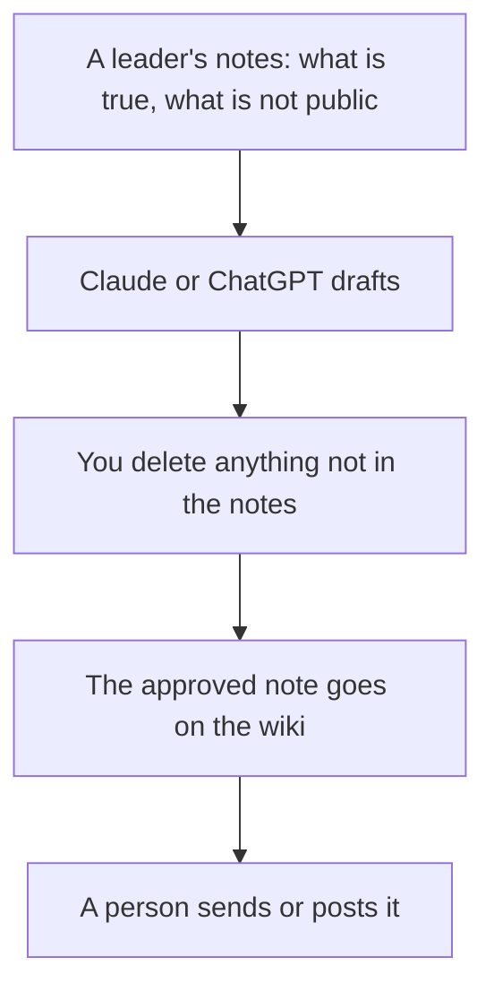

**Internal comms should use AI to draft an announcement from notes a leader already approved, then keep the wiki as the place the fact lives.** The model should not send a company-wide email, and it should not invent a policy, a layoff detail, or a date. The mechanics of the words are [how to create a style guide with AI](/blog/how-to-create-a-style-guide-with-ai-2026/). The weekly team note, which is a person's status and not a company announcement, is [how to write a status update with AI](/blog/how-to-write-a-status-update-with-ai-2026/).

Prices are US list prices excluding tax from directory pages checked October 16, 2026. Microsoft's business Copilot figure was recorded as a promotion. Fathom's team price was read October 24, 2026. Published October 24, 2026. We did not score engagement.

## The piece, then the tool

| The piece | Start here | First paid step | The limit |
|---|---|---|---|
| The draft of a note or a speech | [Claude](/tools/claude/) or [ChatGPT](/tools/chatgpt/) | Claude Pro is $20, or $17 billed annually. ChatGPT Plus is $20 | A leader approves the facts |
| The wiki people will search next month | [Notion AI](/tools/notion-ai/) | Business is $20 a seat. Plus at $10 is not the full AI tier | The page has an owner |
| The edit, after the facts are frozen | [Grammarly](/tools/grammarly/) | Free for grammar. Pro is $12 a member a month billed annually | It will not catch a wrong policy |
| You already live in Microsoft 365 | [Microsoft Copilot](/tools/microsoft-copilot/) | Copilot Business from $18 a user a month paid yearly, recorded as promotional. The directory says it had been $21 | Confirm the renewal price |
| The all-hands deck | [Gamma](/tools/gamma/) | Plus is $9 a seat a month | The slides follow the approved script |
| The all-hands recording, if a bot is allowed | [Fathom](/tools/fathom/) | Free lists unlimited recordings. Team is $15 a user annually, minimum 2 | The transcript is not the memo |

## How the seats fit a comms team

**The draft.** Claude Pro is the better first seat when the source is a long memo or a Project of past notes. ChatGPT Plus is the better first seat when the team already drafts there. Five Plus seats are 5 × $20 = $100 a month and do not include admin. ChatGPT Business is $20 a user annually, or $25 monthly, for two or more users, and does not train on business data by default. Internal notes are a reason to read that line before you paste them into a personal Free account. The seat math is [Notion AI vs ChatGPT Plus cost](/blog/notion-ai-vs-chatgpt-plus-cost-2026/). The email-shaped version is [ChatGPT vs Claude for email](/blog/chatgpt-vs-claude-for-email-2026/).

**The wiki.** Notion Business is the AI tier if the handbook lives in Notion. An agent that answers from the handbook is only as current as the page. Name an owner. The card is [Notion AI pricing explained](/blog/notion-ai-pricing-explained-2026/). If the work tracker is ClickUp instead, Brain² starts at $9 a user a month on top of a ClickUp plan. The comparison is [Notion AI vs ClickUp Brain](/blog/notion-ai-vs-clickup-brain-2026/). The record, either way, is [what a system of record for AI is](/blog/what-is-a-system-of-record-for-ai-2026/).

**The edit.** Grammarly Pro is the pass for grammar and tone. It is the wrong tool to ask what the policy is. The card is [Grammarly pricing explained](/blog/grammarly-pricing-explained-2026/).

**Microsoft 365.** If the company already writes in Word, Outlook, and Teams, Copilot is the assistant in those apps. The directory lists Microsoft 365 Copilot Business from $18 a user a month paid yearly, and it labels that figure promotional against an earlier $21. Bundles on the same card: Business Standard with Copilot from $23.50, and Business Premium with Copilot at $32 a user a month paid yearly. Quote the promotional $18 only with the date. The renewal may differ. Consumer Personal at $9.99 is not a company rollout.

**The room.** Gamma Plus builds the deck from the outline you approved. The script workflow is [how to create a webinar script with AI](/blog/how-to-create-a-webinar-script-with-ai-2026/). The card is [Gamma pricing explained](/blog/gamma-pricing-explained-2026/). Fathom is the recording if the room consents to a bot. The memo is still a document a person posts. The card is [Fathom pricing explained](/blog/fathom-pricing-explained-2026/).

HR teams, who own a different set of documents, are [best AI tools for HR teams](/blog/best-ai-tools-for-hr-teams-2026/). This page does not write job descriptions or performance reviews. The job-description workflow, if that is the task, is [how to write a job description with AI](/blog/how-to-write-a-job-description-with-ai-2026/).

## FAQ

### What should internal comms buy first?

Claude or ChatGPT, on a plan your security review accepts, and a page in the wiki you already have. Grammarly Free until tone rewrites are weekly. Gamma or Fathom when the all-hands is the actual pain. Microsoft Copilot when the draft already happens inside Microsoft 365. One path, not all of them.

### Can AI send the company newsletter?

It can draft it. A person sends it, after a leader has seen the claims. An auto-send will eventually announce something that was still a draft. The approval is [what human-in-the-loop AI is](/blog/what-is-human-in-the-loop-ai-2026/).

### How do we keep the voice consistent?

A short style guide and two sample notes in the Project. The how-to is linked above. A 30-page brand book generated in one sitting will not be what people follow.

### What about sensitive news?

Do not paste it into a consumer tool to "see how it sounds." Write it with the people who are allowed to know, in the system your counsel already approved. AI can tighten a paragraph they have cleared. It should not be the first place the paragraph exists.

## Last verified

October 16, 2026 for Claude, ChatGPT, Notion, Grammarly, Microsoft Copilot's recorded prices, Gamma, and ClickUp. October 24, 2026 for Fathom Team. Published October 24, 2026.

**Sources:** [Claude pricing](https://claude.com/pricing), [Notion pricing](https://www.notion.com/pricing), [Microsoft Copilot](https://copilot.microsoft.com).

*Published by Andrew for [AI Tools Optimizer](https://aitoolsoptimizer.com).*

[Notion AI](/tools/notion-ai/) is in the [productivity and notes directory](/tools/category/productivity-notes/). Directory pages may use affiliate links. A purchase through them may earn us a commission at no extra cost to you.
