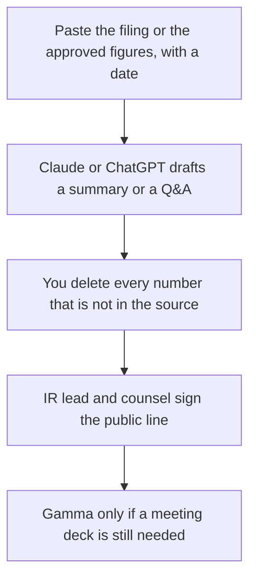

**An investor-relations team should use AI to draft three artifacts from sources they already have: a plain-language read of a filing, a Q&A list that quotes that filing, and a short holding statement that does not add news.** The model can shorten text you paste. It cannot give investment advice, predict a stock, invent a metric, or speak for the company. If a figure is not in the filing or in a number finance has approved, the draft says Missing. Counsel and the IR lead still sign what goes out.

This page is communications support. It is not a recommendation to buy or sell any security. A private company's fundraising story is a different room: [how to create a pitch deck with AI](/blog/how-to-create-a-pitch-deck-with-ai-2026/) and [best AI tools for founders](/blog/best-ai-tools-for-founders-2026/). Summarizing a contract you may upload, which is also not advice, is [Claude vs ChatGPT for legal summaries](/blog/claude-vs-chatgpt-for-legal-summaries-2026/).

Prices are US list prices excluding tax from directory pages checked October 16, 2026. Published October 24, 2026. We did not score disclosure quality. Your disclosure counsel outranks this page.

## The IR job this stack will touch

| The job | Start here | First paid step | The limit |
|---|---|---|---|
| Read a long filing you are allowed to upload | [Claude](/tools/claude/) | Pro is $20 a month, or $17 billed annually | It may not add a metric the filing does not contain |
| A Project the team reopens for the quarter | [ChatGPT](/tools/chatgpt/) | Business is $20 a user a month billed annually, minimum two | Plus is a personal seat |
| Find the company's own filing page | [Perplexity](/tools/perplexity/) | Pro is $17 a month billed annually | Open the filing. A citation is not the 10-Q |
| A readout after the words are frozen | [Gamma](/tools/gamma/) | Plus is $9 a seat a month | Slides do not create disclosure |
| The line edit | [Grammarly](/tools/grammarly/) | Pro is $12 a member a month billed annually | It will not know Reg FD |

A sentence that "the company expects" a result nobody approved is [a hallucination](/blog/what-is-ai-hallucination-2026/) with a ticker attached. The check is [how to fact-check AI writing](/blog/how-to-fact-check-ai-writing-2026/).

## What to pay for

**The long document.** Claude Pro. The directory lists a context window up to 1 million tokens depending on the model. Use it to list what the filing says, with section pointers, and to mark questions the filing does not answer. Claude Team has no public per-seat dollar on the card. The review is [Claude review](/blog/claude-review-2026/). The container is [Claude Projects vs ChatGPT Projects](/blog/claude-projects-vs-chatgpt-projects-2026/).

**The shared quarter folder.** ChatGPT Business when more than one person will touch unreleased material. The card says Business does not train on business data by default. Plus at $20 is the individual step for a public filing you could have emailed. The ladder is [ChatGPT Go vs Plus vs Pro](/blog/chatgpt-go-vs-plus-vs-pro-2026/).

**The primary source link.** Perplexity Pro, then click through to the filing or the press release on the company's own site. Do not cite the answer engine in a public IR note. The review is [Perplexity review](/blog/perplexity-review-2026/).

**The spoken leave-behind, after approval.** Gamma Plus at $9, or $108 a year. Every figure on a slide still traces to the approved source. The invoice is [Gamma pricing explained](/blog/gamma-pricing-explained-2026/).

**The copy edit.** Grammarly Pro at $12 a member a month billed annually, or $144 a year. It will not clear disclosure.

A prompt that holds the line:

"Summarize this filing for an internal IR reader. Every figure needs the section I can check. Draft Q&A only from questions I listed. If the filing is silent, write Silent. Do not predict the stock, do not give investment advice, and do not add forward-looking language I did not paste."

The person who releases the language is [what human-in-the-loop AI is](/blog/what-is-human-in-the-loop-ai-2026/).

## What not to automate

Do not generate earnings guidance. Do not draft a reply to an investor that adds a fact the release did not contain. Do not turn a model opinion into a quote from the CEO. Do not upload material nonpublic information into a personal free account. Use the company plan your counsel already approved, or do not upload it.

A public incident statement is a different template, with its own clock. That workflow is [how to write a status page update with AI](/blog/how-to-write-a-status-page-update-with-ai-2026/). The finance neighbors who own the actual close are [best AI tools for finance ops](/blog/best-ai-tools-for-finance-ops-2026/).

## FAQ

### Can AI write the earnings release?

It can draft from figures and phrases finance and counsel have already approved. It should not be the author of a new metric. The release is a disclosure document. Treat the model as a typist with a section checklist.

### Is this investment advice?

No. Nothing here recommends a security, a valuation, or a trade. The tools draft language from sources you provide. Your obligations depend on your market and your counsel.

### Which model is safer for a filing?

We did not measure safety. We can say where the file should sit: a company plan with the training and admin defaults you need, not a personal free chat. Claude Pro and ChatGPT Business are the paid steps on the cards above. Safety also means a human diff against the filing.

### Can we use AI on the earnings call?

Only from an approved script and an approved Q&A. A live model in the CEO's ear is a disclosure incident waiting for a surprise question. Prep the document. Leave the call to the people who are allowed to speak.

## Last verified

October 16, 2026 for Claude, ChatGPT, Perplexity, Gamma, and Grammarly. Claude Team has no public per-seat dollar on the directory card. This page is not investment advice. Published October 24, 2026.

**Sources:** [Claude pricing](https://claude.com/pricing), [ChatGPT pricing](https://chatgpt.com/pricing/), [Perplexity pricing](https://www.perplexity.ai/hub/pricing).

*Published by Andrew for [AI Tools Optimizer](https://aitoolsoptimizer.com).*

[Claude](/tools/claude/) is in the [chatbots and assistants directory](/tools/category/chatbots-assistants/). Directory pages may use affiliate links. A purchase through them may earn us a commission at no extra cost to you.
