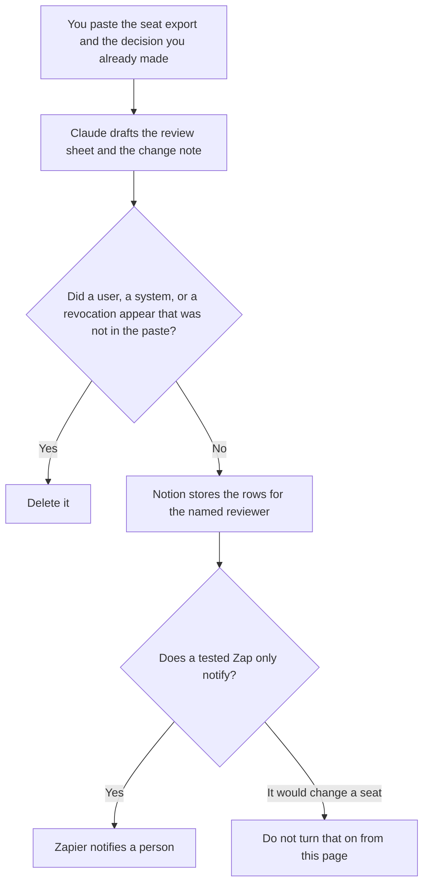

**An IT admin should use AI to format an access review from an export a person already pulled, a change note from a decision a person already made, and a notification from a step a person already defined.** The model does not revoke a seat, invent a user, or close a ticket. The engineer who runs the pipeline is [best AI tools for DevOps teams](/blog/best-ai-tools-for-devops-teams-2026/). The person who writes the security procedure is [best AI tools for security ops docs](/blog/best-ai-tools-for-security-ops-docs-2026/).

The sheet itself is [how to create an AI access review with AI](/blog/how-to-create-an-ai-access-review-with-ai-2026/). The list of tools a workflow may call is [what an AI tool allowlist is](/blog/what-is-ai-tool-allowlist-2026/).

Claude's prices are from claude.com/pricing on October 24, 2026. Notion, Zapier, and GitHub Copilot prices are from directory pages checked October 16, 2026. A live fetch of Zapier's pricing page and of the Copilot plan page returned HTTP 401 on October 24, so those figures stay on the directory record. Published October 24, 2026. We did not score account hygiene.

## The admin week

| The job | Start here | First paid step | The limit |
|---|---|---|---|
| The review sheet and the change note | [Claude](/tools/claude/) | Pro is $17 a month billed annually, or $20 monthly | No seat you did not export |
| The register the next admin opens | [Notion AI](/tools/notion-ai/) | Business is $20 a seat a month | Plus at $10 is not the full AI tier |
| A notice after a person marks a row | [Zapier](/tools/zapier/) | Professional is $19.99 a month billed annually, 750 tasks | The Zap does not decide remove |
| A script diff you already own | [GitHub Copilot](/tools/github-copilot/) | Business is $19 a user a month | You review the diff. The model does not merge it |

A review that says a departed employee is "probably fine" is not a review. If the export has no person on a seat, the row says Person not on the export. The admin does not ask the model whom to remove. The named reviewer marks keep, remove, or not reviewed. An admin carries remove out in the system that owns the seat.

## What you are paying for

**Claude Pro** holds the column names so this quarter's review matches the last one. Team standard seats are $20 a seat a month billed annually, or $25 monthly, when the note is a company record, as recorded in [Claude Team pricing explained](/blog/claude-team-pricing-explained-2026/). The review is [Claude review](/blog/claude-review-2026/).

**Notion Business** is the register: system, seat, person, decision, export date. The invoice is [Notion AI pricing explained](/blog/notion-ai-pricing-explained-2026/).

**Zapier Professional** is the notice, on the October 16 card. Team at $69 a month billed annually is the row with shared connections and SAML SSO. There is no separate Central price on that card. The Central name is [Zapier Central pricing explained](/blog/zapier-central-pricing-explained-2026/). The task ladder is [Zapier pricing explained](/blog/zapier-pricing-explained-2026/).

**GitHub Copilot Business** is $19 a user a month when you are changing a script you own, and you will read the diff. Enterprise at $39 is a different credit line. The article is [GitHub Copilot Enterprise pricing explained](/blog/github-copilot-enterprise-pricing-explained-2026/). The review sheet does not require a coding seat.

A prompt that holds the line:

"Draft the access review from the export I pasted. Leave every decision as Not reviewed. If the person is missing, write Person not on the export. Do not add a seat. Do not mark remove."

## What not to automate

Do not paste passwords or recovery codes so a row "can be checked" inside a chat. Do not let a Zap disable an account because a model marked remove. Do not skip the allowlist because the seats look tidy. The reviewer marks the row. The admin changes the seat. A script still gets a human diff.

## FAQ

### How is this different from the DevOps page?

That page is the pipeline, the deploy, and the service. This page is seats, the review export, and the notice a person already defined. The same admin may touch both on a small team. The templates stay different so a deploy note does not become a revocation.

### How is this different from the security-ops docs page?

That page is the procedure you are willing to publish. This page is the weekly or quarterly list of who still has access. A procedure can say that a review happens. It does not replace the export. If the export date is old, both pages should say so.

### Do I need Copilot to review access?

No. The sheet is Claude and Notion. A coding seat matters when a script you already own needs a diff. The diff is reviewed by a person. Business at $19 is the company coding seat on the October 16 card. A personal Pro seat is a different decision.

### Who may remove a seat?

The reviewer your process names, in the system that owns the seat. A formatted sheet is not a removal. Not reviewed stays not reviewed. A missing person stays missing until a human reads the export.

## Last verified

October 24, 2026 for Claude. October 16, 2026 for Notion, Zapier, and GitHub Copilot. Published October 24, 2026. Zapier's pricing page and the Copilot plan page returned HTTP 401 on October 24.

**Sources:** [Claude pricing](https://claude.com/pricing), [Notion pricing](https://www.notion.com/pricing), [Zapier pricing guide](https://zapier.com/blog/zapier-pricing/), [GitHub Copilot](https://github.com/features/copilot).

*Published by Andrew for [AI Tools Optimizer](https://aitoolsoptimizer.com).*

[Zapier](/tools/zapier/) is in the [automation and agents directory](/tools/category/automation-agents/). Directory pages may use affiliate links. A purchase through them may earn us a commission at no extra cost to you.
