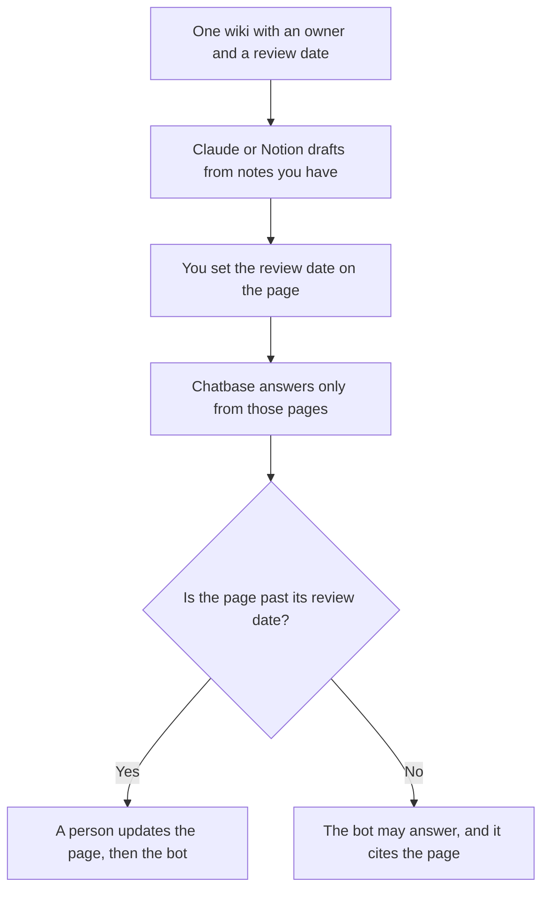

**A knowledge manager should use AI to draft a page in the wiki that is already the home, cite a file with a date, and answer employees from those pages only.** A second brain that nobody owns will fork the policy. We did not score whose search feels smarter. The build steps are [how to build an internal wiki with AI](/blog/how-to-build-an-internal-wiki-with-ai-2026/). The writers who draft the articles are [best AI tools for technical writers](/blog/best-ai-tools-for-technical-writers-2026/).

The clock on a page is [what retrieval freshness is](/blog/what-is-retrieval-freshness-2026/). The bot that should wait until the article exists is [how to build a knowledge-base chatbot](/blog/how-to-build-a-knowledge-base-chatbot-2026/).

Prices are US list prices excluding tax from directory pages checked October 16, 2026. Published October 24, 2026. We did not measure findability.

## The knowledge job

| The job | Start here | First paid step | The limit |
|---|---|---|---|
| The wiki of record, with an owner and a review date | [Notion AI](/tools/notion-ai/) | Business is $20 a seat a month, the tier with the agent. Plus is $10 and is not that full AI tier | One home. Do not also edit the policy in a chat |
| A long file people must cite, not chat about | [Gemini Notebook](/tools/gemini-notebook/) | Free with a Google account. Higher limits from Google AI Plus at $4.99 | The notebook knows the file you uploaded, not the web |
| A public page you still have to open | [Perplexity](/tools/perplexity/) | Pro is $17 a month billed annually | Open the link. Write the date. A snippet is not the page |
| An employee bot on the approved articles | [Chatbase](/tools/chatbase/) | Hobby is $32 a month billed yearly, 700 message credits | The bot is as fresh as the last upload |
| A draft of a page from notes you supply | [Claude](/tools/claude/) | Pro is $20 a month, or $17 billed annually | The notes are the source. The wiki is the record |

Start with the home. Add the bot after the top articles have owners. A bot on an empty wiki will answer from whatever was uploaded, including a draft.

## What the invoices are

**Notion.** Free includes a trial of Notion AI. Business at $20 a seat is the row with Notion Agent and search across connected apps. Custom Agents are $10 per 1,000 credits on Business and Enterprise. If the company already lives in ClickUp, the docs decision is [Notion AI vs ClickUp for docs](/blog/notion-ai-vs-clickup-for-docs-2026/). Do not migrate a wiki to chase a sidebar.

**Gemini Notebook** is the reading room for a PDF, a policy export, or a research packet. It is free with a Google account. Replace the file when the source changes. The notebook will not notice a new version on a website by itself.

**Perplexity Pro at $17 a month billed annually** is how you fetch a public source with a link. It is the wrong system of record. Paste the accepted paragraph into Notion, with the URL and the date. The invoice is [Perplexity pricing explained](/blog/perplexity-pricing-explained-2026/).

**Chatbase Hobby at $32 a month billed yearly** is the first paid bot: 700 message credits, 10 MB of training content. Standard is $120 billed yearly. Point it at the articles you would defend. A question the articles do not answer should hand off. The handoff is [how to create a support escalation matrix with AI](/blog/how-to-create-a-support-escalation-matrix-with-ai-2026/) when the audience is customers. Employees need the same silence-and-handoff rule.

**Claude Pro** is the drafting seat. The review is [Claude review](/blog/claude-review-2026/). A page that adds a policy the notes did not contain is [what an AI hallucination is](/blog/what-is-ai-hallucination-2026/).

A prompt that holds the line:

"Draft a wiki page from these notes only. Include an owner line and a review date I will fill if I left them blank. Do not add a policy. If a section has no note, write Missing. Cite no external fact."

The person who publishes is [what human-in-the-loop AI is](/blog/what-is-human-in-the-loop-ai-2026/).

## What not to automate

Do not buy a second wiki because the first one is messy. Name an owner and archive the duplicate pages. Do not let a bot and a person maintain two copies of the refund rule. Do not upload a confidential page into a personal account your policy forbids. [ChatGPT](/tools/chatgpt/) Plus at $20 can draft a page. Business at $20 a user a month billed annually is the seat when the notes are confidential and a personal login is not allowed.

## FAQ

### Is Notion enough without a bot?

Yes. Most teams need the page, the owner, and the date before they need Chatbase. Add the bot when the same questions arrive every week and the articles already answer them.

### Can Perplexity be the knowledge base?

It can find a public page. It should not be the place your internal policy lives. Internal knowledge has a home you control, with a review date. Perplexity is a lookup with a citation you still open.

### What about a graph of entities?

A graph is a model you maintain. The explainer is [what a knowledge graph in AI is](/blog/what-is-a-knowledge-graph-in-ai-2026/). You do not need one to give every policy an owner. Start with the wiki.

### How small can the first wiki be?

The pages people already ask for, each with an owner and a date. Twenty current pages beat two hundred stale ones. The bot waits until those twenty exist.

## Last verified

October 16, 2026 for Notion AI, Gemini Notebook, Perplexity, Chatbase, Claude, and ChatGPT. Published October 24, 2026.

**Sources:** [Notion pricing](https://www.notion.com/pricing), [Perplexity pricing](https://www.perplexity.ai/pro), [Chatbase pricing](https://www.chatbase.co/pricing).

*Published by Andrew for [AI Tools Optimizer](https://aitoolsoptimizer.com).*

[Notion AI](/tools/notion-ai/) is in the [productivity and notes directory](/tools/category/productivity-notes/). Directory pages may use affiliate links. A purchase through them may earn us a commission at no extra cost to you.
