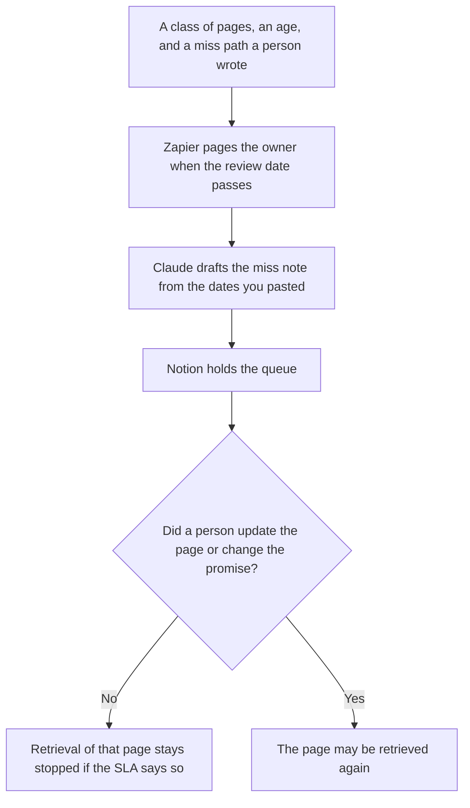

**Knowledge ops should use AI to keep a freshness SLA someone already wrote, draft the miss note from the dates they pasted, and page the owner when a review date passes.** The model does not decide that a page is still true. The wiki home, the source file, and the employee bot are a sibling job: [best AI tools for knowledge managers](/blog/best-ai-tools-for-knowledge-managers-2026/). This page is the operating clock: the age you promised, the queue of pages that missed it, and the reminder that does not rewrite the article.

The promise itself is [what an AI retrieval freshness SLA is](/blog/what-is-ai-retrieval-freshness-sla-2026/). The property it measures is [what retrieval freshness is](/blog/what-is-retrieval-freshness-2026/). The build of the wiki, before the clock matters, is [how to build an internal wiki with AI](/blog/how-to-build-an-internal-wiki-with-ai-2026/).

Claude's prices are from claude.com/pricing on October 24, 2026. Notion, Perplexity, and Zapier prices are from directory pages checked October 16, 2026. Published October 24, 2026. We did not measure findability.

## The knowledge ops week

| The job | Start here | First paid step | The limit |
|---|---|---|---|
| The SLA page and the miss queue | [Notion AI](/tools/notion-ai/) | Business is $20 a seat a month | Plus at $10 is not the full AI tier. One queue. Do not keep a second in chat |
| The miss note, from dates you pasted | [Claude](/tools/claude/) | Pro is $17 a month billed annually, or $20 monthly | No sentence that says the page is still accurate |
| A public canonical URL you still open | [Perplexity](/tools/perplexity/) | Pro is $17 a month billed annually | Write the date you opened it. A snippet is not the page |
| The reminder when a review date passes | [Zapier](/tools/zapier/) | Professional is $19.99 a month billed annually, 750 tasks | The task pages a person. It does not edit the article |

Knowledge managers on the other page own the home and the bot. Knowledge ops owns the promise and the miss. If you are still choosing which wiki to use, you are on their page. If the wiki exists and a page is past the age you promised, you are here. A boost that hides a stale page is [what an AI retrieval boost is](/blog/what-is-ai-retrieval-boost-2026/). The boost does not meet the SLA.

## What you are paying for

**Notion Business** holds the SLA text, the class of pages it covers, and the queue. Free includes a trial of Notion AI on the October 16 card. The chat is not the queue. The invoice is [Notion AI pricing explained](/blog/notion-ai-pricing-explained-2026/).

**Claude Pro** writes the miss note. The annual price is $200 up front. The review is [Claude review](/blog/claude-review-2026/). A note that adds a policy the page does not contain is a failed miss note. Delete the policy.

**Perplexity Pro** is how you open a public source when the canonical copy might have moved. It is the wrong system of record for an internal policy. The invoice is [Perplexity pricing explained](/blog/perplexity-pricing-explained-2026/).

**Zapier Professional** is the clock. Free is 100 tasks a month on that card. A filter step does not, by itself, mean the content is true. The invoice is [Zapier pricing explained](/blog/zapier-pricing-explained-2026/). If you run the same clock on a euro-priced product, do not convert the price. Name the currency on the invoice.

A prompt that holds the line:

"Draft the freshness miss note from the page id, the review date, and the age limit I pasted. If any field is missing, write Missing. Do not say the content is still correct. Do not change the age limit."

## What not to automate

Do not let a reminder rewrite the page. Do not silence the clock because the queue is long. Do not upload a confidential policy into a personal Zapier or Perplexity account your rules forbid. The schema you refuse to widen when a retrieved field does not fit is [what an AI output schema lock is](/blog/what-is-ai-output-schema-lock-2026/).

## FAQ

### How is this different from the knowledge manager page?

That page owns the wiki, the file people cite, and the bot on approved articles. This page owns the age promise, the miss queue, and the reminder. If the bot and the SLA disagree, the page is updated or the bot stops. The bot does not win by being available.

### Do I need Zapier if Notion has a date?

You need a clock a person will actually see. A date field nobody is paged about is a label. Zapier is one way to page them. A different automation product is fine if you can name the task and the owner. The date still does not prove the sentences are true.

### Can Perplexity be the knowledge base?

No. It can fetch a public page with a link you open. Internal knowledge stays in the wiki you control. Paste the accepted sentence back into Notion with the URL and the date you checked it.

### Who may waive the SLA?

The owner named on the promise, with an end date. A clean miss note is not a waiver. A model that says the old page is "close enough" is not the owner.

## Last verified

October 24, 2026 for Claude. October 16, 2026 for Notion, Perplexity, and Zapier. Published October 24, 2026.

**Sources:** [Notion pricing](https://www.notion.com/pricing), [Claude pricing](https://claude.com/pricing), [Perplexity pricing](https://www.perplexity.ai/pro), [Zapier pricing](https://zapier.com/pricing).

*Published by Andrew for [AI Tools Optimizer](https://aitoolsoptimizer.com).*

[Notion AI](/tools/notion-ai/) is in the [productivity and notes directory](/tools/category/productivity-notes/). Directory pages may use affiliate links. A purchase through them may earn us a commission at no extra cost to you.
