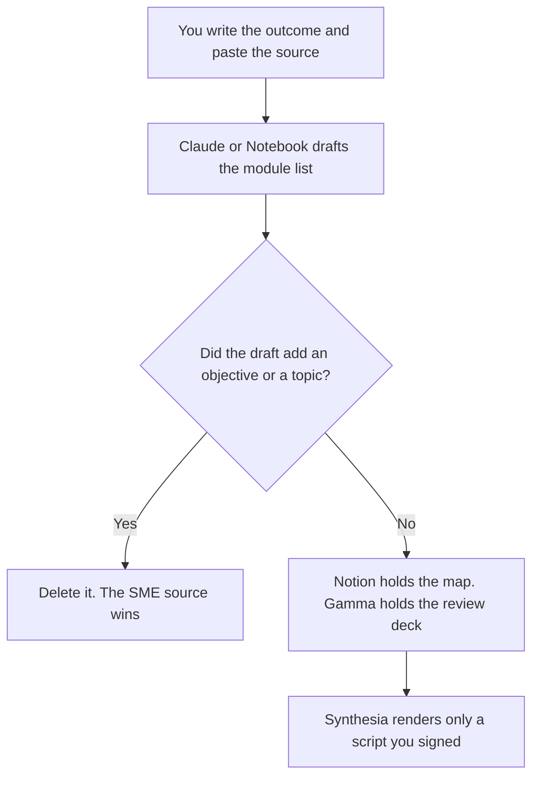

**A learning designer should use AI to format objectives, a module outline, and a practice check from source material a subject expert already approved.** The teacher in the room is a different page. The customer academy is a different page. This page is the person who designs the course: the outcome, the sequence, and the assessment. We did not score whether anyone learned. The model does not set the learning objective.

The classroom shelf is [best AI tools for teachers](/blog/best-ai-tools-for-teachers-2026/). The customer-course shelf is [best AI tools for customer education](/blog/best-ai-tools-for-customer-education-2026/). A study guide a learner builds from their own notes is [ChatGPT vs Gemini for study guides](/blog/chatgpt-vs-gemini-for-study-guides-2026/).

Prices are US list prices excluding tax from directory pages checked October 16, 2026. Published October 24, 2026. This page is not an accessibility certification and not education-law advice. Your organization's policy decides what may touch learner data.

## The design job

| The job | Start here | First paid step | The limit |
|---|---|---|---|
| Objectives and an outline from a source you paste | [Claude](/tools/claude/) | Pro is $20 a month, or $17 billed annually | The objective is yours. The model formats the sequence |
| The curriculum map and the version of the outline | [Notion AI](/tools/notion-ai/) | Business is $20 a seat a month | A module the model added does not enter the map |
| A packet of SME docs the outline must follow | [Gemini Notebook](/tools/gemini-notebook/) | Free with a Google account. AI Plus is $4.99 a month | The outline may use only the uploads |
| A lesson deck for a review meeting | [Gamma](/tools/gamma/) | Plus is $9 a seat a month, 1,000 credits | The deck quotes the outline. It does not add a topic |
| A course video from a script you froze | [Synthesia](/tools/synthesia/) | Starter is $29 a month billed monthly. The card also shows $19 a month with yearly | The script is the lesson. The avatar does not teach a new fact |

If you are the teacher writing tomorrow's lesson for your own class, start with the teachers page. MagicSchool is free for individual teachers, and Plus is $8.33 a user a month billed annually. Brisk is free for an individual teacher, and the school plans are custom. Those are delivery tools. They are the wrong first purchase when the job is a curriculum someone else will teach.

## What you are paying for

**Claude Pro** turns a source packet and an outcome into a sequence of modules. It can mark a module Missing when the source is silent. It cannot decide that a topic is "essential." The review is [Claude review](/blog/claude-review-2026/). The person who accepts the outline is [what human-in-the-loop AI is](/blog/what-is-human-in-the-loop-ai-2026/).

**Notion Business** is the map: outcome, modules, source links, and the owner of each module. A pretty outline in a chat is not the curriculum. The record rule is [what a system of record for AI is](/blog/what-is-a-system-of-record-for-ai-2026/).

**Gemini Notebook** is the seat when the SME handed you PDFs. Free comes with a personal Google account. Google AI Plus at $4.99 a month raises the limits on that card. Google AI Pro at $19.99 is the 5x row. Do not paste learner personal data into a notebook your policy forbids.

**Gamma Plus** is the review deck for stakeholders who will open a link. The slides may not introduce a module the map does not contain. The ladder is [Gamma pricing explained](/blog/gamma-pricing-explained-2026/). If the review has to be PowerPoint, the file-format pair is [Plus AI vs Gamma](/blog/plus-ai-vs-gamma-2026/).

**Synthesia Starter** is the video seat after the script is frozen. Basic is free, with a watermark, 500 credits, and about 10 minutes of video on the card. A course that must be unwatermarked and downloadable is the paid row. The credit math is [Synthesia pricing explained](/blog/synthesia-pricing-explained-2026/). Presenter video against HeyGen is [Synthesia vs HeyGen for training](/blog/synthesia-vs-heygen-for-training-2026/).

A prompt that holds the line:

"Draft a module outline from the outcome and the source I pasted. Every module needs a source line. If the source does not cover it, write Missing. Do not add an objective. Do not write quiz answers. Do not mention a learner by name."

A quiz, after the outline is accepted, is [how to create training quizzes with AI](/blog/how-to-create-training-quizzes-with-ai-2026/). The answer key is still yours.

## What not to automate

Do not generate a course from a job title and a vibe. Do not let an avatar say a policy the SME did not sign. Do not drop learner records into a consumer chat to "personalize" the path. Personalization that needs learner data is a policy question first. Khanmigo, at $4 a month for families and free for teachers, is a tutor for learners. It is not the design seat.

## FAQ

### Is a learning designer a teacher?

On this site, teachers deliver a class. Learning designers design the course, the practice, and the materials someone else may deliver. If you do both, keep two lists. The teachers page is the classroom tools. This page is the design system.

### Is this customer education?

Customer education is the academy your customers take. The tools can overlap, especially video. The owner, the source of truth, and the catalog differ. Use the customer-education page when the learner is a customer. Use this page when you are designing the learning itself.

### Can AI write the learning objectives?

It can format an objective you already decided: who does what, under what condition, to what standard. An objective the model invented from a topic name is a wish. Write the verb yourself.

### Do we need Synthesia on day one?

No. The outline and the source check come first. Video is a render of a script you would still stand behind as a document. A free Synthesia watermark is a reason to wait, not a reason to skip the script.

## Last verified

October 16, 2026 for Claude, Notion AI, Gemini Notebook, Gamma, and Synthesia. MagicSchool and Brisk figures are the same directory check, for the classroom contrast. Published October 24, 2026.

**Sources:** [Claude pricing](https://claude.com/pricing), [Notion pricing](https://www.notion.com/pricing), [Gemini Notebook](https://workspace.google.com/products/gemini-notebook/), [Gamma pricing](https://gamma.app/pricing), [Synthesia pricing](https://www.synthesia.io/pricing).

*Published by Andrew for [AI Tools Optimizer](https://aitoolsoptimizer.com).*

[Claude](/tools/claude/) is in the [chatbots and assistants directory](/tools/category/chatbots-assistants/). Directory pages may use affiliate links. A purchase through them may earn us a commission at no extra cost to you.
