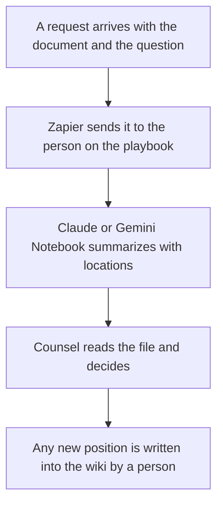

**These tools run a legal-ops workflow: an intake form, a playbook of positions counsel already approved, and a summary of a file with places a lawyer can check.** They do not practice law. This page is not legal advice. A model that "reviews a contract" is drafting notes a lawyer still has to read. If you need a legal conclusion, an enforceable position, or a customer-facing policy, that work belongs to counsel.

The startup folder version of this idea, for a company that is still assembling templates, is [best AI tools for startup legal ops](/blog/best-ai-tools-for-startup-legal-ops-2026/). This page is the operating cadence after counsel exists: the queue, the playbook, and the handoff. The people-ops neighbor, which is a different team, is [best AI tools for people ops](/blog/best-ai-tools-for-people-ops-2026/).

The document habit is [what RAG is](/blog/what-is-rag-explained-2026/). The long-file habit is [Claude vs Gemini for long documents](/blog/claude-vs-gemini-for-long-documents-2026/). The claim check is [how to fact-check AI writing](/blog/how-to-fact-check-ai-writing-2026/).

Prices are US list prices excluding tax from directory pages checked October 16, 2026. Published October 24, 2026. We did not score contracts, and the directory does not list a contract-lifecycle product. This page does not invent a price for one.

## The legal-ops job, without a legal conclusion

| The job | Start here | First paid step | Stop before |
|---|---|---|---|
| The playbook of positions counsel approved | [Notion AI](/tools/notion-ai/) | Business is $20 a seat a month | Treating the wiki page as the signed agreement |
| A summary of one file, with locations counsel can open | [Claude](/tools/claude/) | Pro is $20 a month, or $17 billed annually | Asking whether a clause is enforceable |
| A notebook over a packet of files you uploaded | [Gemini Notebook](/tools/gemini-notebook/) | Free with a Google account. Higher limits from $4.99 a month | Uploading a file you are not allowed to place there |
| Plain language on text counsel already approved | [Grammarly](/tools/grammarly/) | Pro is $12 a member a month billed annually | Changing the meaning of an approved sentence |
| Routing intake to the right person | [Zapier](/tools/zapier/) | Professional is $19.99 a month billed annually for 750 tasks | Letting the route decide the legal answer |

## What each seat is for

**The playbook.** Notion Business is the AI tier if the approved positions live in Notion. Plus at $10 is not that tier. Write positions as "counsel approved this sentence on this date," not as "the AI recommends." Custom Agents are extra, at $10 per 1,000 credits. Leave them off until a person owns the text they might post. The card is [Notion AI pricing explained](/blog/notion-ai-pricing-explained-2026/). The record is [what a system of record for AI is](/blog/what-is-a-system-of-record-for-ai-2026/).

**The summary.** Claude Pro holds a long file in a Project. Ask for headings and page or clause markers that exist in the file. If the marker is not there, the draft says so. [ChatGPT](/tools/chatgpt/) Plus at $20 can do a similar pass. Business is $20 a user a month billed annually, for two or more users, and does not train on business data by default. A contract does not belong on a consumer seat you have not reviewed. The container is [Claude Projects vs ChatGPT Projects](/blog/claude-projects-vs-chatgpt-projects-2026/).

**The packet.** Gemini Notebook is free with a Google account in supported countries and cites the sources you uploaded. Google AI Plus at $4.99 adds more notebooks. Use it to move around a packet. Use counsel to decide. The study-shaped version of the same product is [Gemini Notebook study workflows](/blog/gemini-notebook-study-workflows/).

**The words around the work.** Grammarly Pro edits text counsel has already approved, such as a customer explanation of a process. It is not a substitute for the approval. Free is enough for a spelling pass.

**The queue.** Zapier can file an intake form into the channel legal ops already uses. It should route on fields the requester filled in, such as "vendor contract" or "NDA," that you defined. It should not classify legal risk on its own. The map is [Zapier vs Make vs n8n](/blog/zapier-vs-make-vs-n8n/). The credit alternative, if you prefer a visual scenario, is [Make pricing explained](/blog/make-pricing-explained-2026/).

Untrusted text inside a file the model reads is a reason to keep tool permissions narrow. The defensive concepts, with no attack steps, are [what a prompt injection defense is](/blog/what-is-a-prompt-injection-defense-2026/). The person who sends anything outside the team is [what human-in-the-loop AI is](/blog/what-is-human-in-the-loop-ai-2026/).

## What not to automate

Do not publish a model's clause opinion as the company position. Do not let an agent sign, send, or accept a redline. Do not drop a privileged file into a personal chatbot. Do not buy a tool because it says "legal AI" if this directory does not list a price you can verify. The startup article linked above uses the same restraint for a smaller folder.

## FAQ

### Is this legal advice?

No. It is a description of documentation and routing tools. Counsel decides the legal question. If you do not have counsel, this page does not fill that role.

### How is this different from the startup legal-ops list?

That list is the folder and the checklist for a young company. This list assumes a playbook and an intake queue that counsel already stands behind. The tools overlap. The operating rule is stricter: nothing customer-facing leaves without a person who is allowed to approve it.

### Can AI compare two contract versions?

It can draft a list of textual differences you then check against the files. A difference list is not a risk rating. Ask for the location of each change. Open the location.

### Where should intake live?

In the system your team already trusts, with Zapier or a native form in front of it. The playbook names who receives which request type. The model does not invent a new queue.

## Last verified

October 16, 2026 for Notion, Claude, ChatGPT, Gemini Notebook, Grammarly, and Zapier prices named above. No contract-lifecycle price is recorded in the directory. Published October 24, 2026. This page is not legal advice.

**Sources:** [Notion AI](https://www.notion.com/product/ai), [Claude pricing](https://claude.com/pricing), [Zapier pricing](https://zapier.com/pricing).

*Published by Andrew for [AI Tools Optimizer](https://aitoolsoptimizer.com).*

[Notion AI](/tools/notion-ai/) is in the [productivity and notes directory](/tools/category/productivity-notes/). Directory pages may use affiliate links. A purchase through them may earn us a commission at no extra cost to you.
