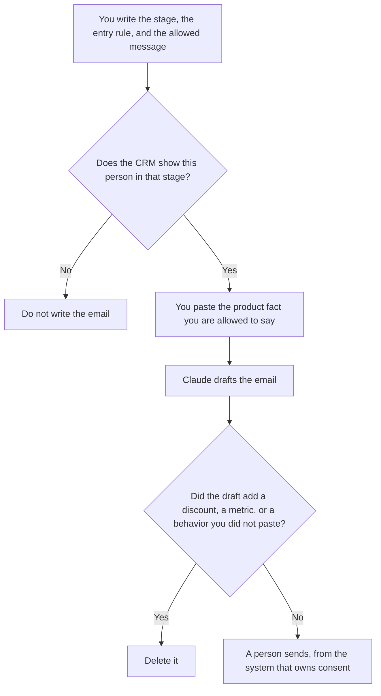

**A lifecycle marketer should use AI to keep a stage map, draft an email from a product fact you already have, and line-edit that email without adding an offer.** Onboarding, activation, and win-back are the stages. The model does not get to decide who is in a stage, and it does not get to invent a coupon. Acquisition and cold outbound are different pages. Customer success's book of accounts is a different page.

The always-on acquisition shelf is [best AI tools for demand gen](/blog/best-ai-tools-for-demand-gen-2026/). The promise in a customer email is [how to write customer emails with AI](/blog/how-to-write-customer-emails-with-ai-2026/). A shipped-feature note, which is one kind of lifecycle mail, is [how to create a feature announce email with AI](/blog/how-to-create-a-feature-announce-email-with-ai-2026/).

Prices are US list prices excluding tax from directory pages checked October 16, 2026. HubSpot Starter was a limited-time offer on that card. A live fetch of several pricing pages returned HTTP 401 on October 24, 2026. Published October 24, 2026. We did not score retention, activation, or deliverability.

## The lifecycle job

| The job | Start here | First paid step | The limit |
|---|---|---|---|
| The stage map: name, entry rule, message allowed | [Notion AI](/tools/notion-ai/) | Business is $20 a seat a month | A stage the model renamed is a second program |
| The email from a fact you paste | [Claude](/tools/claude/) | Pro is $20 a month, or $17 billed annually | No discount, no usage number, no "we noticed" |
| Who is actually in the stage | [HubSpot](/tools/hubspot/) | Free CRM. Starter was a promo at $7 or $10 a seat | Do not treat the promo as the lasting price |
| The line edit | [Grammarly](/tools/grammarly/) | Pro is $12 a member a month billed annually, or $30 monthly | A correct sentence can still be a false promise |
| A short reusable skeleton | [ChatGPT](/tools/chatgpt/) | Plus is $20 a month | Swap the fact. Keep the skeleton. Go at $8 may include ads |

Cold outbound is not a lifecycle stage. [Instantly](/tools/instantly/) Outreach Growth is $47 a month for sending, on a pricing-page read dated October 24, 2026. A credits plan is also $47 and is not that sender. The sequence you can defend is [how to write cold emails with Instantly](/blog/how-to-write-cold-emails-with-instantly-2026/). If the mail is to someone who has not opted into the product relationship, you are on that page, not this one.

## What you are paying for

**Notion Business at $20 a seat** holds the map. "Activated" that means a login in one row and a paid invoice in another is two stages. The model may format the row. It may not merge them. The place a definition is allowed to live once is [what a system of record for AI is](/blog/what-is-a-system-of-record-for-ai-2026/).

**Claude Pro** writes the email from the stage spec and the fact. A long Project can hold the words you are forbidden to use, including invented urgency. The review is [Claude review](/blog/claude-review-2026/).

**HubSpot's free CRM** is the record of who is in the stage, when that is your system. Starter at $7 or $10 a seat was labeled limited-time on the October 16 card. Professional and Enterprise were not a public sticker. The invoice is [HubSpot pricing explained](/blog/hubspot-pricing-explained-2026/). Extra credits were listed at $10 per 1,000. This page does not invent a Professional dollar.

**Grammarly Pro** is the line pass. Annual at $12 is the price to compare. Monthly at $30 is a different bill. It will not catch a coupon you did not mean to offer. The invoice is [Grammarly pricing explained](/blog/grammarly-pricing-explained-2026/).

**ChatGPT Plus** is the skeleton you reuse when the stage email is short and the fact changes every week. Business, at $20 a user a month billed annually with a two-user minimum, is the row when a personal account is against policy. The review is [ChatGPT review](/blog/chatgpt-review-2026/).

A prompt that holds the line:

"Draft one email for the lifecycle stage I named, using only the fact and the offer I pasted. If the offer is blank, do not create one. Do not mention behavior you were not given. Do not write a subject line that states a result I did not write."

## What not to automate

Do not let a model choose the segment. Do not write "we noticed you haven't…" unless that behavior is a field you pasted and your policy allows the mail. Do not generate a win-back discount to lift a draft. The send button stays with a person, in the tool that holds consent. A calendar of which lifecycle notes exist is still a brief with a date: [how to create a content calendar brief with AI](/blog/how-to-create-a-content-calendar-brief-with-ai-2026/).

## FAQ

### How is this different from demand gen?

Demand gen brings in people who are not yet in the product relationship you are writing about. Lifecycle writes to people already in a stage you defined, about a fact in the product. A cold sequence that uses lifecycle language is still cold. Use the Instantly workflow for that, and quote the Outreach tab.

### Can the model set the entry rule?

No. The entry rule is a field and a threshold a person who owns the lifecycle map has accepted. Paste it. A sentence that implies someone "should" be activated is the sentence to delete.

### Do we need Claude and ChatGPT?

Use Claude when the forbidden-line list is long and should stay in a Project. Use ChatGPT when the habit is a short skeleton and a weekly fact. One owner for the email that ships. The other tool can edit, and a person diffs.

### What about a usage number in the mail?

Only the number you exported and are allowed to show that person. The model does not remember last week's product analytics. If the export is missing, the sentence says Fact missing. A round number it invented is a false mail.

## Last verified

October 16, 2026 for Notion AI, Claude, HubSpot, Grammarly, and ChatGPT. Instantly's $47 Outreach Growth figure is from the pricing article's October 24, 2026 read. Published October 24, 2026.

**Sources:** [Notion pricing](https://www.notion.com/pricing), [Claude pricing](https://claude.com/pricing), [HubSpot pricing](https://www.hubspot.com/pricing), [Grammarly pricing](https://www.grammarly.com/plans), [ChatGPT pricing](https://chatgpt.com/pricing/).

*Published by Andrew for [AI Tools Optimizer](https://aitoolsoptimizer.com).*

[HubSpot](/tools/hubspot/) is in the [sales directory](/tools/category/sales/). Directory pages may use affiliate links. A purchase through them may earn us a commission at no extra cost to you.
