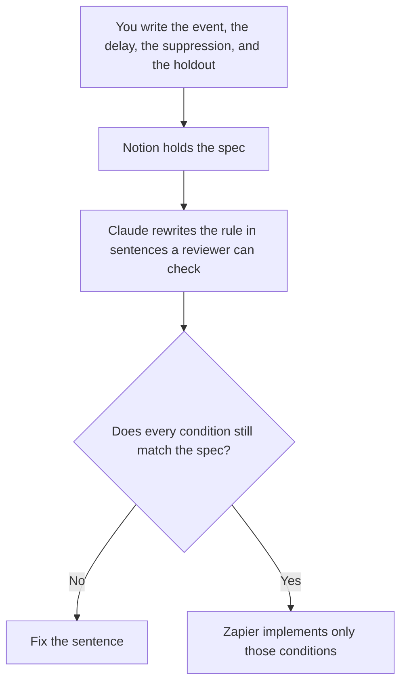

**Lifecycle ops should use AI to write the trigger spec, the suppression rule, and the holdout note, from conditions a person already approved.** The marketer who writes the email is a different job: [best AI tools for lifecycle marketers](/blog/best-ai-tools-for-lifecycle-marketers-2026/). This page is the person who says when a message is allowed to send, who must be left out, and which slice is the holdout. The sentence inside the email is [how to write customer emails with AI](/blog/how-to-write-customer-emails-with-ai-2026/).

A shipped-feature email, which still has to obey the trigger, is [how to create a feature announce email with AI](/blog/how-to-create-a-feature-announce-email-with-ai-2026/). The neighboring ops desk that watches experiments and capacity is [best AI tools for growth ops](/blog/best-ai-tools-for-growth-ops-2026/).

Prices are US list prices excluding tax from directory pages checked October 16, 2026. Published October 24, 2026. We did not score retention, deliverability, or holdout math.

## The ops job, not the copy job

| The job | Start here | First paid step | The limit |
|---|---|---|---|
| The trigger spec: event, delay, and stop condition | [Notion AI](/tools/notion-ai/) | Business is $20 a seat a month | The spec is the page. The chat is not what sends |
| A plain-language version of a rule you already wrote | [Claude](/tools/claude/) | Pro is $20 a month, or $17 billed annually | It may not add a segment |
| A Zap that must match the spec | [Zapier](/tools/zapier/) | Professional is $19.99 a month billed annually | The Zap does not invent a filter |
| The internal note about the holdout | [Grammarly](/tools/grammarly/) | Pro is $12 a member a month billed annually, or $30 monthly | It edits the note. It does not size the holdout |

The marketer page owns the stage map and the email. Use it when you are writing copy. Use this page when a message might send to the wrong people. A suppression rule that says "inactive users" is not a rule. The spec names the event, the window, and the field. If the field is missing, the spec says Field missing and nothing sends.

## What you are paying for

**Notion Business** is the spec the next person can audit. Do not keep the real rule in a chat thread. The invoice is [Notion AI pricing explained](/blog/notion-ai-pricing-explained-2026/).

**Claude Pro** turns the spec into a paragraph a reviewer can redline. Paste the conditions. Ask it to list any condition it cannot find in the paste. The review is [Claude review](/blog/claude-review-2026/).

**Zapier Professional** is the automation only after the spec is approved. A Zap that retries and also branches can double-send. Draw the stop. The invoice is [Zapier pricing explained](/blog/zapier-pricing-explained-2026/). The failure path for a tool that keeps erroring is [what an AI tool circuit breaker is](/blog/what-is-ai-tool-circuit-breaker-2026/).

**Grammarly Pro** cleans the holdout note: who is excluded, for how long, and who reads the result. It does not calculate the percentage. You do, from the export.

A prompt that holds the line:

"Restate the trigger using only the event, delay, suppression, and holdout I pasted. Do not add a segment. If a field name is missing, write Field missing and stop."

## What not to automate

Do not let a model define churn. Do not let a Zap add "people who might be interested." Do not email the holdout by accident because the suppression was in the doc and not in the tool. The doc and the Zap have to name the same fields. A person checks a sample before the first send.

## FAQ

### How is this different from the lifecycle marketer roundup?

That page is the stage, the product fact, and the email. This page is the send permission: trigger, suppression, and holdout. The marketer should not change the trigger inside the draft. The ops owner should not rewrite the offer.

### Do I need a marketing-automation suite?

You need the system that already sends the mail. This page does not price that suite, because the directory's starter offers move. The spec still has to exist in Notion or the wiki you already use, or the suite becomes the only copy of the rule.

### Can Zapier be the spec?

No. A Zap is an implementation. The spec is the page a second person can read without opening the Zap editor. If they disagree, the spec wins until you change it on purpose.

### Who sizes the holdout?

The person who owns the experiment, from a query they can rerun. A model can format the note. A round number it suggests is not a sample design.

## Last verified

October 16, 2026 for Notion, Claude, Zapier, and Grammarly. Published October 24, 2026.

**Sources:** [Notion pricing](https://www.notion.com/pricing), [Claude pricing](https://claude.com/pricing), [Zapier pricing](https://zapier.com/blog/zapier-pricing/), [Grammarly pricing](https://www.grammarly.com/plans).

*Published by Andrew for [AI Tools Optimizer](https://aitoolsoptimizer.com).*

[Zapier](/tools/zapier/) is in the [automation and agents directory](/tools/category/automation-agents/). Directory pages may use affiliate links. A purchase through them may earn us a commission at no extra cost to you.
