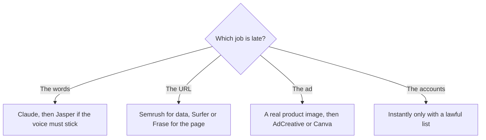

**A marketer needs a tool for the job that is late this week, not a platform that claims to do the quarter.** The jobs below are the ones that show up on a real marketing calendar: a brand-safe draft, a page that has to rank, an ad in ten sizes, a deck, and a list of accounts. Each row names one starting tool and the USD price that gets you into it.

Prices are US list prices excluding tax, from vendor pages checked October 16, 2026, published here on October 24, 2026. A live refetch of those pages that day did not return numbers. Nothing here is a performance score from a campaign we ran.

Browse the aisles if you want the full catalogs: [marketing and SEO](/tools/category/marketing-seo/), [writing](/tools/category/writing/), [design](/tools/category/design/), [image generation](/tools/category/image-generation/), and [video](/tools/category/video/).

## The calendar, with a price

| Marketing job | Start here | First paid step | Leave it for |
|---|---|---|---|
| A draft you will fact-check yourself | [Claude](/tools/claude/) or [ChatGPT](/tools/chatgpt/) | Claude Pro $20/month ($17 annual) or ChatGPT Plus $20 | A brand vault |
| On-brand copy with a saved voice | [Jasper](/tools/jasper/) | Pro $59/seat/month yearly, or $69 monthly | A single blog post |
| Optimize a draft for search | [Surfer SEO](/tools/surfer-seo/) | Standard $99/month yearly, 360 documents | Finding the keywords in the first place |
| A topic-to-publish loop for one site | [Frase](/tools/frase/) | Starter $39/month yearly, 10 articles | A full backlink suite |
| Keyword and competitor data | [Semrush](/tools/semrush/) | SEO plan $117.33/month yearly, or $139 monthly | Writing the article |
| AI-answer visibility | [Writesonic](/tools/writesonic/) | Starter $79/month yearly, 50 prompts tracked daily | A cheap blank-page writer |
| Ad sizes from a product image | [AdCreative.ai](/tools/adcreative-ai/) | Starter $39/month, or $20 billed yearly | The product photo itself |
| Everyday graphics | [Canva](/tools/canva/) | Pro $18/month or $180/year. Free is a real editor | A custom model of the product |
| A deck or a one-page leave-behind | [Gamma](/tools/gamma/) | Plus $9/seat/month, 1,000 credits | A branded PowerPoint system |
| Cold email infrastructure | [Instantly](/tools/instantly/) | Growth $47/month, 5,000 emails and 1,000 contacts | A list you do not have rights to email |

## Copy: chatbot first, Jasper when the voice is the product

Most marketing drafts do not need a $59 seat. [Claude](/tools/claude/) or [ChatGPT](/tools/chatgpt/) will produce a first pass you can edit, if you paste the offer, the audience, and the facts that must not move. The method is [how to write a blog post with Claude](/blog/how-to-write-a-blog-post-with-claude-2026/). The writing aisle, including cheaper editors, is [best AI writing assistants](/blog/best-ai-writing-assistants/).

Buy [Jasper](/tools/jasper/) when more than one person has to sound like the brand, and you want Brand Voices, Knowledge, and Audiences stored in the tool. Pro includes two voices, five knowledge assets, and three audiences. An agency with a voice per client will hit that wall and need a Business quote. The three-way with the tools people still call "AI writers" is [Jasper vs Copy.ai vs Writesonic](/blog/jasper-vs-copy-ai-vs-writesonic-2026/). [Copy.ai](/tools/copy-ai/) Chat, at $24/month on annual billing for five seats, is the shared chat. Its workflow plans start at $1,000/month. Do not wander into that tier for a newsletter.

## Search: data, then a score, then a quota

[Semrush](/tools/semrush/) is the research suite. The free account is one project and 10 reports a day, which is enough to see the product and not enough to run an agency. The SEO plan is the freelancer and small-team entry. Semrush One, which adds AI-search tracking, starts at $165.17/month on annual billing. Buy that when the AI-answer chart is a deliverable, not when you want a synonym tool.

[Surfer](/tools/surfer-seo/) scores and guides a document you are already writing. [Frase](/tools/frase/) caps articles and can publish to a CMS. Pick with [Surfer SEO vs Frase](/blog/surfer-seo-vs-frase-2026/). The category piece is [best AI SEO tools](/blog/best-ai-seo-tools-2026/). [Writesonic](/tools/writesonic/) is the visibility tracker across several answer engines, with articles as the fix. It is the wrong first tool for a new blog that has no measurement problem yet.

## Ads and design: do not generate the product

Make or photograph the product first. The steps are [how to generate product photos with AI](/blog/how-to-generate-product-photos-with-ai-2026/). Then place it. Canva Free covers a large share of social graphics. Pro is the brand kit and the resize. [Adobe Express](/tools/adobe-express/) Premium at $9.99/month is the alternative if you want [Adobe Firefly](/tools/adobe-firefly/) and Adobe Stock in a template editor.

[AdCreative.ai](/tools/adcreative-ai/) spends credits when you download, not when you preview. That is the right meter for a test of many sizes, and a bad meter if you download everything. The 7-day trial includes 10 credits. See [AdCreative.ai review](/blog/adcreative-ai-review-2026/).

For a presenter video, [HeyGen](/tools/heygen/) Creator is $29/month. For footage you shot, [CapCut](/tools/capcut/) or [Descript](/tools/descript/). Those are video jobs. They are in [best AI tools for YouTubers](/blog/best-ai-tools-for-youtubers-2026/) because the edit is the same even when the audience is a customer instead of a subscriber.

Gamma Plus at $9 is the fastest leave-behind. A stricter slide system is a different category: [best AI presentation makers](/blog/best-ai-presentation-makers/) and [Gamma vs Canva](/blog/gamma-vs-canva-presentations/).

## Outreach: the tool is not permission

[Instantly](/tools/instantly/) Growth at $47/month includes unlimited email accounts and warmup, with a cap of 5,000 emails and 1,000 contacts on that plan. [Clay](/tools/clay/) is the table you build when the list itself is the work. Launch starts at $167/month billed annually. Both assume you have a lawful basis to email the people in the list. The tool will not create one. A CRM with a free start, if the contacts are already customers, is [HubSpot](/tools/hubspot/).

Automation between these tools, when a lead should move without a person copying it, is [Zapier](/tools/zapier/) Professional at $19.99/month annually or [Make](/tools/make/) Core from $9/month annually. The comparison is [Zapier vs Make vs n8n](/blog/zapier-vs-make-vs-n8n/).

## A small-team stack that stays under a few hundred dollars

One writer: Claude Pro at $20 and Canva Free. Add Frase Starter at $39 when the blog is weekly. Add Semrush when someone is paid to do research, not before. Add Jasper when a second writer is drifting off the voice guide. Add AdCreative when you are spending on ads and the bottleneck is sizes, not the offer.

That sequence is the point. The suite demo is how a two-person team ends up with four seats and no published page.

## FAQ

### What AI tool should a marketing team buy first?

The assistant you will edit, Claude or ChatGPT, and Canva if you publish visuals. Add a specialist only when a job is repeating: search data, a content score, ad sizes, or a brand vault.

### Is Jasper better than ChatGPT for marketers?

Jasper is better when the requirement is a stored voice, knowledge, and a seat for each marketer. ChatGPT Plus is better when one person is drafting from a brief. Price them that way. Jasper Pro is about three times Plus, per seat.

### Do marketers need an AI video tool?

When the deliverable is a video. HeyGen for an avatar, CapCut or Descript for footage, [Runway](/tools/runway/) when you are generating the shot. A blog and a static ad do not require any of them.

### What about SEO and AI answers?

Semrush or Writesonic when you must report on it. Surfer and Frase when you must ship the page. Tracking without a page, and a page without a claim you can source, are the two failure modes.

## Last verified

October 16, 2026 for prices. Published October 24, 2026. Pricing pages did not return a fresh fetch that day.

**Sources:** [Jasper pricing](https://www.jasper.ai/pricing), [Surfer pricing](https://get.surferseo.com/surfer-pricing), [Frase pricing](https://www.frase.io/pricing), [Semrush pricing](https://www.semrush.com/pricing/), [AdCreative.ai](https://www.adcreative.ai), [Canva pricing](https://www.canva.com/pricing/), [Writesonic pricing](https://writesonic.com/pricing), [Instantly pricing](https://instantly.ai/pricing).

Directory pages for these tools may use affiliate links. A purchase through them may earn us a commission at no extra cost to you.
