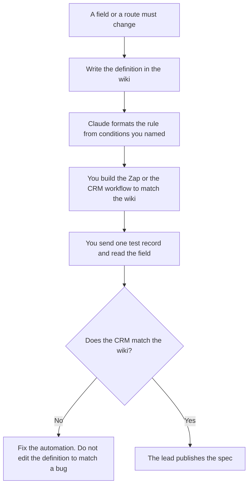

**A marketing ops lead should use AI to format a field definition, a routing rule, and the campaign name those systems must share.** The model may not invent a lifecycle trigger, a holdout, or a lead source. Triggers and suppressions are [best AI tools for lifecycle ops](/blog/best-ai-tools-for-lifecycle-ops-2026/). Experiments and capacity are [best AI tools for growth ops](/blog/best-ai-tools-for-growth-ops-2026/). The list and the first email are [best AI tools for demand gen](/blog/best-ai-tools-for-demand-gen-2026/).

The sentence inside an email, once the field is real, is [how to write customer emails with AI](/blog/how-to-write-customer-emails-with-ai-2026/). A field's meaning, written as one row, is [how to create a data dictionary entry with AI](/blog/how-to-create-a-data-dictionary-entry-with-ai-2026/).

Prices are US list prices excluding tax from directory pages checked October 16, 2026. A live fetch of vendor pricing pages on October 24, 2026 returned HTTP 401, so this page stays on the directory record. Published October 24, 2026. We did not score pipeline or deliverability. HubSpot's directory card says the Starter price is a limited-time offer. Confirm checkout.

## The lead's week

| The job | Start here | First paid step | The limit |
|---|---|---|---|
| The field and the campaign-name spec | [Notion AI](/tools/notion-ai/) | Business is $20 a seat a month | The CRM still has to match the wiki |
| The routing rule, in words | [Claude](/tools/claude/) | Pro is $20 a month, or $17 billed annually | No condition you did not paste |
| The automation that must follow the spec | [Zapier](/tools/zapier/) | Professional is $19.99 a month billed annually | A Zap that maps a blank field is a schema you accepted |
| The CRM the field lands in | [HubSpot](/tools/hubspot/) | Free tools exist. Starter is listed at $7 or $10 a seat a month as a limited-time offer | Credits are $10 per 1,000, on the directory card. Confirm the promo |

Lifecycle ops decides when a message may send. Demand gen decides who is on the list. Marketing ops decides the name of the field, the allowed values, and which system is allowed to write it. A campaign that goes out with a new UTM the spec does not list will be invisible in the report, and the model will not notice.

## What you are paying for

**Notion Business** is the spec: field name, allowed values, owner, and the campaign-name pattern. The invoice is [Notion AI pricing explained](/blog/notion-ai-pricing-explained-2026/).

**Claude Pro** drafts the routing rule as sentences a second person can review. It does not turn the rule on. The review is [Claude review](/blog/claude-review-2026/).

**Zapier Professional** is the first paid Zapier card on the directory, billed annually at $19.99. If a step continues when the campaign field is empty, you have decided empty is valid. Read [Zapier pricing explained](/blog/zapier-pricing-explained-2026/) before you treat the seat price as the whole bill. Tasks are the meter.

**HubSpot** is the system if the leads already live there. The directory records free tools, a Starter Customer Platform at $7 or $10 a seat a month as a limited-time offer, and credits at $10 per 1,000. Professional and Enterprise are on hubspot.com/pricing and were not given a dollar on that card. Do not quote $7 as the list price after the promotion ends. [Grammarly](/tools/grammarly/) Pro at $12 a member a month billed annually is the last pass on the internal note that tells the team the field changed. The invoice is [Grammarly pricing explained](/blog/grammarly-pricing-explained-2026/).

A prompt that holds the line:

"Format the routing rule from the fields and conditions I pasted. Do not add a condition. If an allowed value is missing, write Value missing and stop."

## What not to automate

Do not let a Zap create a new campaign value the spec does not list. Do not sync a field you have not defined. Do not paste a lead export into a chat to "clean the names." The cleanup rule belongs in the spec, and the records stay in the CRM. Field marketing's event work is [best AI tools for field marketers](/blog/best-ai-tools-for-field-marketers-2026/). It should use the same campaign names. It should not invent a parallel set.

## FAQ

### How is this different from lifecycle ops?

Lifecycle ops owns the trigger, the suppression, and the holdout. Marketing ops owns the field those rules read, and the route that fills the field. A beautiful trigger on an undefined field will fire on the wrong people.

### How is this different from demand gen?

Demand gen owns the list and the first email. Marketing ops owns the definition of a lead source and the name of the campaign. The email can be excellent and still be unreportable if the name is free text.

### Do I need HubSpot to use this page?

No. HubSpot is the CRM line if that is where the records are. The lead still needs a wiki for the spec and a draft for the rule. Do not quote the Starter promo if you do not run HubSpot.

### Who may add an allowed value?

The owner of the field. A new value in a form, a Zap, and a slide deck, added on the same afternoon by three people, is three values. The spec changes first.

## Last verified

October 16, 2026 for Notion, Claude, Zapier, HubSpot, and Grammarly. Published October 24, 2026.

**Sources:** [Notion pricing](https://www.notion.com/pricing), [Claude pricing](https://claude.com/pricing), [Zapier pricing](https://zapier.com/blog/zapier-pricing/), [HubSpot](https://www.hubspot.com/pricing).

*Published by Andrew for [AI Tools Optimizer](https://aitoolsoptimizer.com).*

[HubSpot](/tools/hubspot/) is in the [marketing and SEO directory](/tools/category/marketing-seo/). Directory pages may use affiliate links. A purchase through them may earn us a commission at no extra cost to you.
