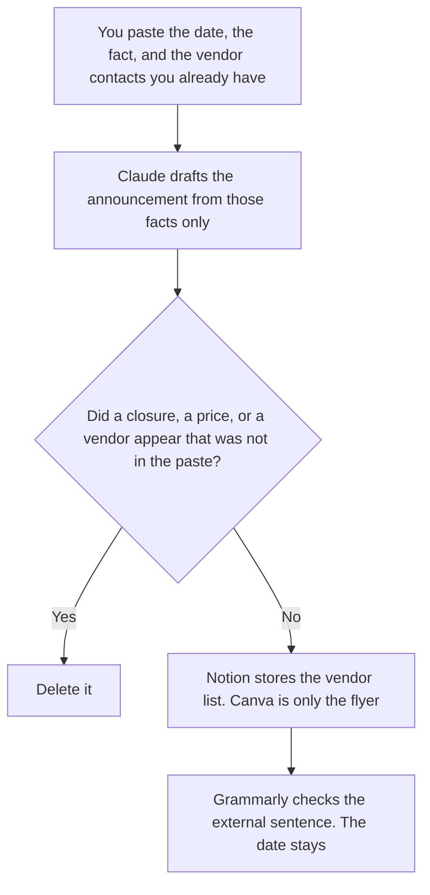

**An office manager should use AI to draft an announcement from facts they already have, keep the vendor contact list, and lay out a one-page flyer in a file one person owns.** The model does not invent a closure, a vendor, a price, or a policy. The work ticket for a building is [best AI tools for facilities ops](/blog/best-ai-tools-for-facilities-ops-2026/). Access to systems, rather than the office calendar, is [best AI tools for IT admins](/blog/best-ai-tools-for-it-admins-2026/). The general weekly stack is [best AI tools for ops teams](/blog/best-ai-tools-for-ops-teams-2026/).

A checklist for a person who is leaving is [how to write an AI offboarding checklist with AI](/blog/how-to-write-an-ai-offboarding-checklist-with-ai-2026/). That list is not an office announcement.

Claude's prices are the October 24, 2026 read of claude.com/pricing recorded in [Claude pricing explained](/blog/claude-pricing-explained-2026/). Notion and Grammarly prices are from directory pages checked October 16, 2026. Canva's seats are the October 16 directory card recorded in [Canva pricing explained](/blog/canva-pricing-explained-2026/). A later read of Canva's pricing page on October 24 did not return a new table, so this page keeps that record. A live fetch of Grammarly's plans URL returned HTTP 401 on October 24. Published October 24, 2026. We did not score offices or vendors.

## The office week

| The job | Start here | First paid step | The limit |
|---|---|---|---|
| The announcement, from the date and the fact you already set | [Claude](/tools/claude/) | Pro is $17 a month billed annually, or $20 monthly | No closure, no vendor, no price you did not paste |
| The vendor contact page the next person will open | [Notion AI](/tools/notion-ai/) | Business is $20 a seat a month | Plus at $10 is not the full AI tier |
| The sentence that goes outside the company | [Grammarly](/tools/grammarly/) | Pro is $12 a member a month billed annually, or $30 monthly | The date and the fact do not move |
| A one-page flyer one person will edit | [Canva](/tools/canva/) | Pro is $18 a month or $180 a year, for one person | Business is $250 a person a year when two or more people need the paid features |

An announcement that says the office is "closed for the season" has added a closure. If you did not write the status, the line says Status not set. A vendor row without a phone or email you pasted says Contact not on file. It does not look one up. The flyer repeats the date and the fact. It does not become the policy. The policy sentence, if you have one, is pasted. Grammarly may fix a comma. It may not soften a date.

Canva Pro is one person, on the card. Two people sharing a Pro login is the mistake that pricing article names. Business is $25 per person a month or $250 per person a year, with the admin controls the card describes. Enterprise is custom. A qualifying school or nonprofit path is on that article. It is not a coupon code. Free is $0 and does not include the 100 GB the paid Pro card lists.

## What you are paying for

**Claude Pro** holds the announcement facts so a later draft does not add a vendor. The review is [Claude review](/blog/claude-review-2026/).

**Notion Business** is the vendor list: name, contact, what they cover, the date you last checked. The invoice is [Notion AI pricing explained](/blog/notion-ai-pricing-explained-2026/).

**Grammarly Pro** is the external sentence. The October 16 card says Pro replaced the old Business plan and supports up to 149 seats, at $12 a member a month billed annually, $60 a quarter, or $30 monthly. Enterprise, via Superhuman Go, has no list price. The invoice is [Grammarly pricing explained](/blog/grammarly-pricing-explained-2026/). The Business-name cut is [Grammarly Business pricing explained](/blog/grammarly-business-pricing-explained-2026/).

**Canva Pro** is the flyer when one person edits it. The AI allowance is a separate meter: [Canva Magic Studio pricing explained](/blog/canva-magic-studio-pricing-explained-2026/). This page is the seat.

A prompt that holds the line:

"Draft the announcement from the date and the fact I pasted. Draft the vendor row only from the contacts I pasted. If a status is missing, write Status not set. If a contact is missing, write Contact not on file. Do not add a closure. Do not add a price."

## What not to automate

Do not let a model decide the office is closed. Do not publish a vendor phone the list does not contain. Do not put two people on one Canva Pro seat. The office manager owns the announcement. Facilities owns the work ticket. IT owns access.

## FAQ

### How is this different from facilities ops?

That page is a work ticket from a report a person wrote, a visit note, and a reminder on a date they set. This page is the announcement people read, the vendor contact list, and a flyer. A leak in a room is a facilities ticket. A note that the front desk has a new vendor contact is this page. Link them when one fact belongs on both. Do not merge the files.

### How is this different from an IT admin's access review?

The IT page is who can sign in. This page is the office fact and the vendor list. An announcement can tell people a system is down only if you pasted that fact from IT. The office manager does not grant access in the flyer.

### How is this different from a general ops-team stack?

The ops-team page is the weekly operating system for a team that is not tied to one building. This page is the office manager's three files: announcement, vendor list, flyer. A team ritual can live on the ops page. A visitor fact lives here, and only if you wrote it.

### Who may send the announcement?

The office manager who wrote the facts. Status not set stays unset. Contact not on file stays off the flyer. A formatted paragraph is not a closure.

## Last verified

October 24, 2026 for Claude, via the pricing article. October 16, 2026 for Notion, Grammarly, and Canva. Published October 24, 2026. Grammarly's plans URL returned HTTP 401 on October 24. Canva's October 24 reread did not replace the October 16 table.

**Sources:** [Claude pricing](https://claude.com/pricing), [Notion pricing](https://www.notion.com/pricing), [Grammarly pricing](https://www.grammarly.com/plans), [Canva pricing](https://www.canva.com/pricing/).

*Published by Andrew for [AI Tools Optimizer](https://aitoolsoptimizer.com).*

[Canva](/tools/canva/) is in the [design directory](/tools/category/design/). Directory pages may use affiliate links. A purchase through them may earn us a commission at no extra cost to you.
