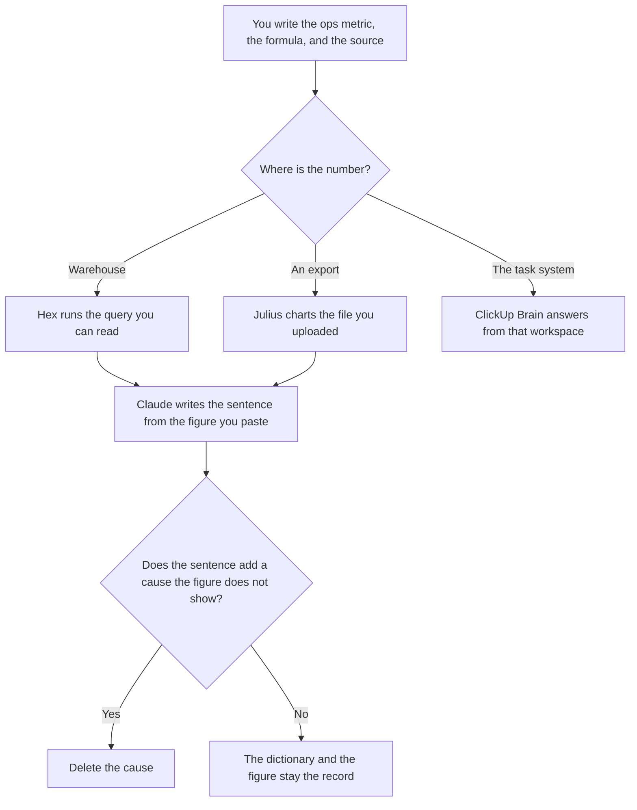

**An ops analyst should use AI to format a definition, a query or a file, and a sentence under an operational number the warehouse or the work tracker already produced.** Cycle time, queue age, backlog, and the share of items past a clock you wrote are the numbers. The model does not get to invent them, and it does not get to decide that a queue is healthy. Revenue definitions are a different job. Pipeline refreshes are a different job.

The revenue shelf is [best AI tools for RevOps analysts](/blog/best-ai-tools-for-revops-analysts-2026/). The refresh-and-row-count shelf is [best AI tools for data ops](/blog/best-ai-tools-for-data-ops-2026/). The general notebook habit is [best AI tools for data analysts](/blog/best-ai-tools-for-data-analysts-2026/). The place a metric is allowed to be defined once is [what a system of record for AI is](/blog/what-is-a-system-of-record-for-ai-2026/).

Prices are US list prices excluding tax from directory pages checked October 16, 2026. Published October 24, 2026. We did not score operational performance.

## The analyst's job

| The job | Start here | First paid step | The limit |
|---|---|---|---|
| The definition: name, formula, owner, source | [Notion AI](/tools/notion-ai/) | Business is $20 a seat a month | A metric the model renamed does not enter the dictionary |
| The warehouse query | [Hex](/tools/hex/) | Professional is $36 per editor a month | You read the query. Medium compute is included. Larger profiles are hourly |
| A CSV someone already exported | [Julius AI](/tools/julius-ai/) | Plus is $20 a month, or $16 billed annually | The file is the population. It is not the live queue |
| The sentence under a figure you trust | [Claude](/tools/claude/) | Pro is $20 a month, or $17 billed annually | Paste the number. The model does not remember last week |
| The tasks already live in ClickUp | [ClickUp Brain](/tools/clickup-brain/) | Brain is $9 a user a month, on top of a ClickUp plan | Brain can see ClickUp. It cannot see a warehouse you did not connect |

If your week is the CRM and the funnel, use the RevOps analyst page. If your week is whether the refresh ran, use the data-ops page. If your week is why the queue moved, use this one.

## What you are paying for

**Notion Business at $20 a seat** holds the dictionary. "Cycle time" that starts at ticket open in one row and at first response in another is two metrics. The model may format the row. It may not merge them. A named input shared by a report and a model is [what an AI feature store is](/blog/what-is-ai-feature-store-2026/).

**Hex Professional at $36 per editor** is the notebook when the warehouse is the source. Team is $75 per editor a month. The invoice, including hourly compute, is [Hex pricing explained](/blog/hex-pricing-explained-2026/).

**Julius Plus** is the path for an export. Do not ask it to estimate the tickets that were not in the file. The sheet path, when the export is Excel, includes [Microsoft Copilot](/tools/microsoft-copilot/) on a plan that unlocks Excel. Personal is $9.99 a month. The seat math is [Microsoft Copilot pricing explained](/blog/microsoft-copilot-pricing-explained-2026/).

**Claude Pro** writes the weekly sentence from figures you paste: what changed, by the definition, and what you are not claiming. A cause you did not test stays out. The review is [Claude review](/blog/claude-review-2026/).

**ClickUp Brain at $9** is worth it when the queue is ClickUp and people will open ClickUp to check the answer. Unlimited is $7 a user a month billed yearly, and Business is $12, on the directory. Brain is an add-on, not a substitute for the plan. Everything AI is $28 a user a month if you also need the notetaker and agents. If the number lives in the warehouse, Hex is the source and ClickUp is a view. Do not let them publish two cycle times.

A prompt that holds the line:

"Write the weekly ops note from the definitions and the figures I pasted. Use only those figures. Do not add a cause, a target, or a recommendation. If a definition and a figure disagree, write Conflict and stop."

## What not to automate

Do not auto-publish the sentence into a management deck. The figures in the deck have to be the ones you pasted. Do not let an assistant change a definition so a chart looks smoother. Do not treat a support SLA you have not signed as a metric the model may invent. The clock you are willing to publish belongs in the escalation table a person owns: [how to create a support escalation matrix with AI](/blog/how-to-create-a-support-escalation-matrix-with-ai-2026/).

## FAQ

### How is this different from the data analyst roundup?

That page is the habit: a CSV, a notebook, a sentence, for whoever asks questions of data. This page is the ops analyst whose metrics are queues, clocks, and backlogs, and whose dictionary has to match the way the operation actually runs. One person may do both. The failure mode here is a second definition of cycle time, not a missing chart type.

### Can the model set the target?

No. A target is a number a person who runs the operation has accepted. Paste it if you want it in the sentence, and label it as a target you supplied. A sentence that implies the queue "should" be shorter is the sentence to delete.

### Do we need Hex and ClickUp Brain?

Only if they answer different questions and you have named which number wins. Hex on the warehouse for the metric you report. ClickUp for "which tasks are sitting in this list." Two tools reporting cycle time is the drift.

### What about a finance close?

That is a different shelf. The books are [best AI tools for finance ops](/blog/best-ai-tools-for-finance-ops-2026/). An ops note that mixes a backlog count with revenue has left this page.

## Last verified

October 16, 2026 for Notion AI, Hex, Julius, Claude, ClickUp Brain, and Microsoft Copilot. Published October 24, 2026.

**Sources:** [Notion pricing](https://www.notion.com/pricing), [Hex pricing](https://hex.tech/pricing/), [Julius pricing](https://julius.ai/pricing), [Claude pricing](https://claude.com/pricing), [ClickUp Brain](https://clickup.com/brain).

*Published by Andrew for [AI Tools Optimizer](https://aitoolsoptimizer.com).*

[Hex](/tools/hex/) is in the [data and analytics directory](/tools/category/data-analytics/). Directory pages may use affiliate links. A purchase through them may earn us a commission at no extra cost to you.
