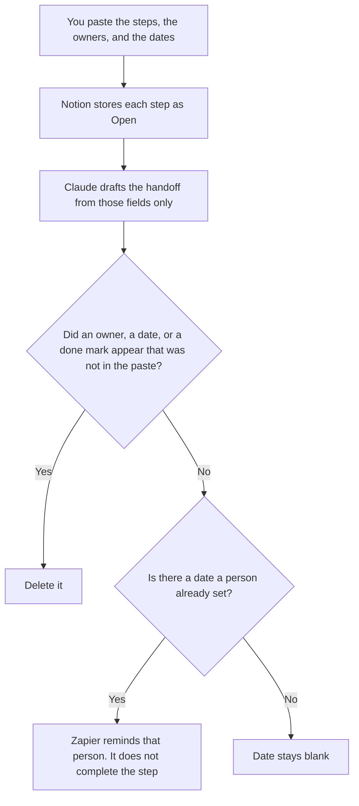

**An ops coordinator should use AI to format a checklist, a handoff note between teams, and a reminder on a date a person already set.** The model does not mark a step done, invent an owner, or choose the date. The person who defines cycle time and writes the sentence under a number is [best AI tools for ops analysts](/blog/best-ai-tools-for-ops-analysts-2026/). The canvas, the calendar product, and the internal tool are [best AI tools for ops teams](/blog/best-ai-tools-for-ops-teams-2026/). This page is the coordinator who keeps the list moving between people who already own the steps.

The standing grid of who may use which tool is [how to create a tool permission matrix with AI](/blog/how-to-create-a-tool-permission-matrix-with-ai-2026/). A weekly note that is not a checklist is [how to write a status update with AI](/blog/how-to-write-a-status-update-with-ai-2026/).

Claude's prices are the October 24, 2026 read of claude.com/pricing recorded in [Claude pricing explained](/blog/claude-pricing-explained-2026/). Notion and Zapier prices are from directory pages checked October 16, 2026. A live fetch of Zapier's pricing page returned HTTP 401 on October 24, 2026, so that figure stays on the directory record. ChatGPT's Plus price is the October 24 plan-page figure recorded in [ChatGPT pricing explained](/blog/chatgpt-pricing-explained-2026/). Published October 24, 2026. We did not score throughput.

## The coordinator's week

| The job | Start here | First paid step | The limit |
|---|---|---|---|
| The checklist and the owner on each step | [Notion AI](/tools/notion-ai/) | Business is $20 a seat a month | Plus at $10 is not the full AI tier |
| The handoff note from fields you already filled | [Claude](/tools/claude/) | Pro is $17 a month billed annually, or $20 monthly | No owner you did not paste |
| A reminder after a date a person set | [Zapier](/tools/zapier/) | Professional is $19.99 a month billed annually, 750 tasks | The Zap does not mark the step done |
| One checklist from a short paste | [ChatGPT](/tools/chatgpt/) | Plus is $20 a month | No step that was not in the paste |

A handoff that says the receiving team "has what they need" has added a status. If a field is missing, the line says Field not set. The reminder fires on the date you stored. It does not choose a new date when someone misses the first one. A missed date stays missed until a person writes the next one.

Zapier Free is 100 tasks a month and includes Tables in the core suite, on the October 16 card. Professional is the multi-step plan. Tables does not have a separate sticker on that card. The table article is [Zapier Tables pricing explained](/blog/zapier-tables-pricing-explained-2026/). The task article is [Zapier pricing explained](/blog/zapier-pricing-explained-2026/).

## What you are paying for

**Notion Business** is the checklist: step, owner, date, status. Status changes when a person changes it. The invoice is [Notion AI pricing explained](/blog/notion-ai-pricing-explained-2026/).

**Claude Pro** drafts the handoff from rows you pasted. Team standard seats are $20 a seat a month billed annually, or $25 monthly, when the note is a company record, as recorded in [Claude Team pricing explained](/blog/claude-team-pricing-explained-2026/). The review is [Claude review](/blog/claude-review-2026/).

**Zapier Professional** is the reminder, on the October 16 card. It does not own the checklist. A year at the recorded rate is 12 × $19.99 = $239.88.

**ChatGPT Plus** is one list when the work will not be reused. Go is $8 a month. The ladder is [ChatGPT pricing explained](/blog/chatgpt-pricing-explained-2026/).

A prompt that holds the line:

"Draft the handoff from the steps, the owners, and the dates I pasted. If an owner is missing, write Owner not set. Do not add a step. Do not mark a step done. Do not move a date."

## What not to automate

Do not let a model close a step because a reminder was sent. Do not let a Zap email a team that was not on the row. Do not copy an analyst's metric definition into the checklist and call it the coordinator's job. The owner of the step marks it done. Open stays open until then.

## FAQ

### How is this different from the ops-analyst page?

That page is a definition, a figure the warehouse already produced, and a sentence that cites it. This page is a checklist of steps with owners and dates. A coordinator can paste a number an analyst already published. They do not get to invent cycle time. Use that page for the metric. Use this page for the handoff.

### How is this different from the ops-team page?

That page is the workflow you can draw, the calendar that defends focus time, and an internal tool. This page is the person who runs the list between teams after the path exists. A coordinator does not need a new automation canvas to send a handoff. If the path itself must change, use the ops-team page. If the path is stable and the date needs a reminder, use this one.

### Do I need Zapier to coordinate?

No. The checklist is Notion. Zapier is the reminder when a date is already stored. Free covers a small number of tasks. Professional at $19.99 annual is the multi-step seat on the October 16 card. A checklist with no dates does not need a Zap.

### Who may mark a step done?

The owner on the row. A formatted handoff is not a close. A reminder is not a close. Owner not set stays until a person writes a name.

## Last verified

October 24, 2026 for Claude and for ChatGPT's plan page, via the posts cited above. October 16, 2026 for Notion and Zapier. Published October 24, 2026. Zapier's pricing page returned HTTP 401 on October 24.

**Sources:** [Notion pricing](https://www.notion.com/pricing), [Claude pricing](https://claude.com/pricing), [Zapier pricing guide](https://zapier.com/blog/zapier-pricing/), [ChatGPT and Codex pricing](https://learn.chatgpt.com/docs/pricing).

*Published by Andrew for [AI Tools Optimizer](https://aitoolsoptimizer.com).*

[Notion AI](/tools/notion-ai/) is in the [notes directory](/tools/category/productivity-notes/). Directory pages may use affiliate links. A purchase through them may earn us a commission at no extra cost to you.
