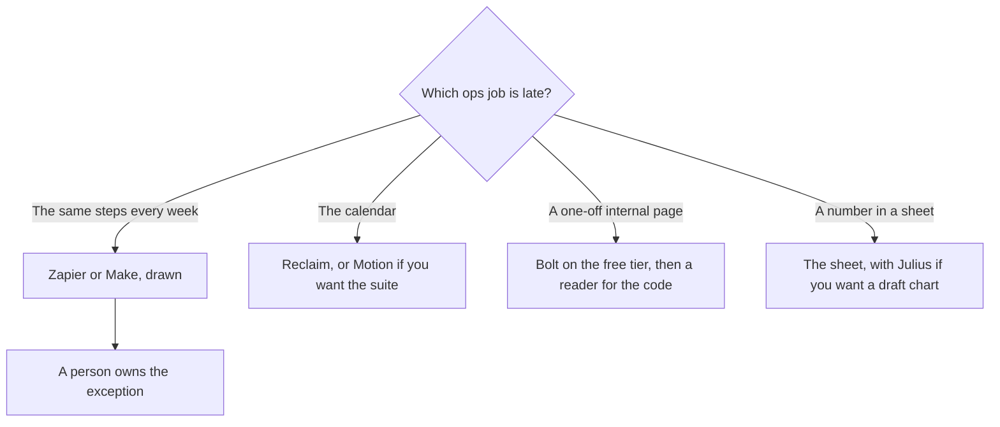

**An ops team should automate the path it can draw, and use an agent only on the step where the path changes.** The rest of the stack is a calendar, a table someone can audit, and a small internal tool. A platform demo that "runs the company" is how a three-person ops pod inherits four meters. This page is one tool per ops job.

The workflow comparison is [Zapier vs Make vs n8n](/blog/zapier-vs-make-vs-n8n/). The agent layer beside those diagrams is [Zapier alternatives for AI workflows](/blog/zapier-alternatives-for-ai-workflows-2026/). What it means to assign steps is [what AI agent orchestration is](/blog/what-is-ai-agent-orchestration-2026/).

Prices are US list prices excluding tax from directory pages checked October 16, 2026, except Bolt and Granola, which were read on their pricing pages October 24, 2026. Published October 24, 2026. We did not score hours saved.

## The ops job

| Job | Start here | First paid step | The limit |
|---|---|---|---|
| A multi-step path across apps you already use | [Zapier](/tools/zapier/) | Professional is $19.99/month annually, 750 tasks, after a 14-day trial. Free is 100 tasks | Tasks multiply. Filters and Formatter do not count, on the card we used |
| A branchy scenario with a lower entry credit price | [Make](/tools/make/) | Core is from $9/month annually for 10,000 credits. Free is 1,000 credits | Some AI modules cost more than one credit. Read the module |
| A self-hosted or euro-priced execution plan | [n8n](/tools/n8n/) | Starter is €20/month billed annually for 2,500 executions. This page does not convert euros to dollars | Unlimited users and workflows. You still operate the executions |
| Focus time on a calendar the team already has | [Reclaim](/tools/reclaim-ai/) | Starter is $10/seat/month. Lite is free, with 5 AI agents | Business is $15/seat. Yearly billing saves 20% on the card. The dollar after that discount was not printed in our note |
| A calendar, tasks, and meetings in one paid app | [Motion](/tools/motion/) | Pro AI is $19/seat/month, 7,500 credits. No free plan. A trial exists | Annual billing saves 33% according to the pricing page. Business AI is $29/seat |
| Tasks that already live in ClickUp | [ClickUp Brain](/tools/clickup-brain/) | Brain² is $9/user/month. The ClickUp Unlimited plan is $7/user/month billed yearly | Everything AI at $28 adds the notetaker and automations. Skip it if you only needed chat |
| A question about a spreadsheet | [Julius](/tools/julius-ai/) | Plus is $20/month, or $16 billed annually, for 2,000 credits | The sheet remains the source. Julius drafts the look at it |
| An internal tool without a ticket to engineering | [Bolt.new](/tools/bolt-new/) | Pro is $25 month to month, or $18 billed annually. Free is 1 million tokens with a daily cap | Someone still reads the code before it holds employee data |
| Decisions from the staff meeting | [Granola](/tools/granola/) | Business is $14/user/month. Basic is free with 30 days of history | A bot-friendly company may prefer Fathom. Ops often does not want a bot in a 1:1 |

Drawing the Zap is [how to automate work with Zapier and Make](/blog/how-to-automate-work-with-zapier-and-make/). Bolt's token card is [Bolt.new pricing explained](/blog/bolt-new-pricing-explained-2026/). The meeting habit is [how to summarize meetings with AI](/blog/how-to-summarize-meetings-with-ai-2026/).

## Draw it before you agent it

Zapier Professional at $19.99 a month annually is the default when the apps are on Zapier's list and 750 tasks cover the month. Team at $69 annually is the shared-folder step. Free at 100 tasks is the proof, not the production path for a daily sync.

Make Core from $9 a month annually is the better fit when the scenario branches and you want the canvas. A credit is not a Zapier task. Compare them on one workflow you already run by hand, and look at the usage after two weeks. n8n is the execution-priced option, in euros on the October 16 card. Choose it when a developer on the ops side will own it, or when the euro invoice is what finance asked for. Do not pick it because a blog converted €20 into a dollar amount. This one will not.

An agent product such as [Lindy](/tools/lindy/), from $49.99 a month for 5,000 credits, belongs on the step you cannot draw: reading an unstructured request and choosing a path. Put a human on anything that pays, emails a customer, or changes a permission. The single-agent definition is [what an AI agent is](/blog/what-is-an-ai-agent-2026/).

## Calendars, tables, and the tool engineering will not schedule

Reclaim Lite is the $0 way to protect focus time, with a cap of five AI agents and a shorter integration list. Starter at $10 is the small-team step. Motion at $19 is the suite when ops wants tasks and the calendar in the same product and will use the credits. Buying both is two calendars. Pick the one that matches where the meetings already live.

Julius Plus at $16 annually is for a question about a table you exported with permission. It is the wrong system of record. The finance file stays in the finance file. A chart of synthetic rows does not go in the weekly review. That boundary is [what synthetic data is](/blog/what-is-synthetic-data-2026/). The spreadsheet category is [best AI for Excel and Google Sheets](/blog/best-ai-for-excel-and-google-sheets-2026/).

Bolt is how ops ships a tracker, a request form, or a vendor list without waiting a quarter. Free is the prototype. Pro at $18 annually is the domain and the higher token pool. [Lovable](/tools/lovable/) is the alternative when several operators should share credits without a per-seat price. Pro is $25 a month. The comparison is [Lovable alternatives](/blog/lovable-alternatives-2026/). Do not put employee personal data in a generated app until someone who can read the code has looked at it.

ClickUp Brain at $9 is the add-on when the work is already in ClickUp. Notion is the other home. Notion Business at $20 per seat is the AI wiki. The comparison is [Notion AI vs ClickUp Brain](/blog/notion-ai-vs-clickup-brain-2026/). Ops should not migrate wikis to get a button.

Granola at $14 is the staff-meeting archive when a bot is unwelcome. Thirty days on Basic is short for an operating cadence. Business is the plan if last quarter's decision has to be findable.

## A small ops stack

Three people: Zapier or Make for the one workflow that already hurts, Reclaim if the calendar is the pain, Granola Basic until history matters, and Bolt's free tier for a single internal page. Add Julius when a weekly spreadsheet question is eating a morning. Add an agent only at the step the diagram cannot express. The productivity roundup around personal work is [best AI productivity tools](/blog/best-ai-productivity-tools-2026/). Founders who are also the ops team can start from [best AI tools for founders](/blog/best-ai-tools-for-founders-2026/) and add a workflow here when the path repeats.

## FAQ

### What should an ops team automate first?

The path with a known trigger, a known set of apps, and an exception a person already handles. A weekly export into a sheet, a form into a tracker, a paid invoice into a channel. Leave hiring, pay, and customer email on a human click.

### Zapier or Make?

Zapier when you want the largest app list and a task count you can explain. Make when the scenario branches and the credit price at the low end is the budget. Run the same workflow in the free tier of each for a week if you are unsure. The usage number decides it.

### Do ops teams need an AI notetaker?

When decisions are getting lost. Granola if the room rejects a bot. Fathom if a bot is acceptable and you want the library. The summary is still a draft until someone confirms the owner and the date.

### Is an internal tool built in Bolt safe for HR data?

Not as a first project. Use it for a low-sensitivity tracker. A generated app that stores personal data needs a review by someone who can read the code, plus the access controls your company already requires. The host's plan price is not that review.

## Last verified

October 24, 2026 for Bolt's pricing page and Granola's pricing page. October 16, 2026 for Zapier, Make, n8n, Reclaim, Motion, ClickUp, Julius, Lindy, Lovable, and Notion. Published October 24, 2026.

**Sources:** [Zapier pricing](https://zapier.com/pricing), [Make pricing](https://www.make.com/en/pricing), [Reclaim pricing](https://reclaim.ai/pricing), [Bolt.new pricing](https://bolt.new/pricing).

*Published by Andrew for [AI Tools Optimizer](https://aitoolsoptimizer.com).*

[Zapier](/tools/zapier/) and [Make](/tools/make/) are in the [automation directory](/tools/category/automation-agents/). Directory pages may use affiliate links. A purchase through them may earn us a commission at no extra cost to you.
