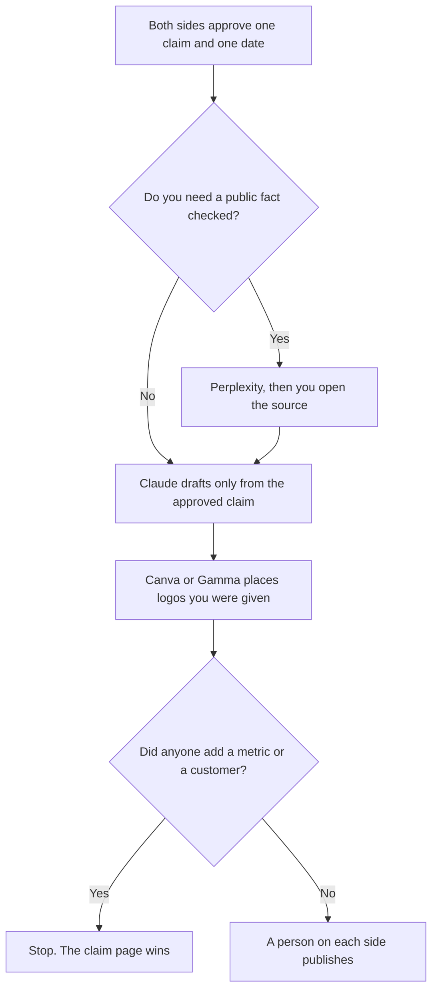

**Partner marketing should use AI to format one claim both companies have approved, a co-branded asset that uses only that claim, and the date the asset may go live.** It should not invent a joint customer, a revenue share, or an MDF number. The alliances desk that owns the relationship is [best AI tools for partnerships teams](/blog/best-ai-tools-for-partnerships-teams-2026/). This page is the marketing motion on top of a relationship that already exists: the post, the one-pager, the webinar line.

The internal brief for what each side will do is [how to write a partner brief with AI](/blog/how-to-write-a-partner-brief-with-ai-2026/). What a partner is allowed to say later is [how to write a partner enablement kit with AI](/blog/how-to-write-a-partner-enablement-kit-with-ai-2026/). The slot on your calendar is [how to create a content calendar brief with AI](/blog/how-to-create-a-content-calendar-brief-with-ai-2026/).

Prices are US list prices excluding tax from directory pages checked October 16, 2026. Perplexity's annual price is the figure in [Perplexity pricing explained](/blog/perplexity-pricing-explained-2026/). A live fetch of several pricing pages returned HTTP 401 on October 24, 2026. Published October 24, 2026. We did not score partner pipeline.

## The partner-marketing job

| The job | Start here | First paid step | The limit |
|---|---|---|---|
| The claim both sides signed | [Notion AI](/tools/notion-ai/) | Business is $20 a seat a month | A claim the model softened does not go to design |
| A cited fact about the partner's public product | [Perplexity](/tools/perplexity/) | Pro is $17 a month billed annually | You open the link. You still need their approval to use their name |
| The joint page or the email | [Claude](/tools/claude/) | Pro is $20 a month, or $17 billed annually | No logo, no quote, no number that was not in the claim |
| The one-pager you will both put a logo on | [Canva](/tools/canva/) | Pro is $18 a month or $180 a year for one person | Logos come from files you were given, not from a generator |
| A short leave-behind deck | [Gamma](/tools/gamma/) | Plus is $9 a seat a month | You delete any price the deck invented |

Partnerships teams keep the CRM record and the commercial terms. Partner marketing keeps the words a stranger will read. If the asset needs a discount, that discount is a term from the partnerships page, pasted in, not a sentence the model thought sounded generous.

## What you are paying for

**Notion Business at $20 a seat** holds the approved claim, the date, and the names of the approvers. Plus at $10 is not the full AI seat. If the partnerships team already keeps the partner record elsewhere, link it. Do not create a second "joint revenue" number. The record rule is [what a system of record for AI is](/blog/what-is-a-system-of-record-for-ai-2026/).

**Perplexity Pro at $17 a month billed annually** is for a public fact you will cite, such as a product page you can open. It is not permission to announce a partnership. Max at $167 is a different workload. The review is [Perplexity review](/blog/perplexity-review-2026/).

**Claude Pro** writes the joint paragraph from the claim. A Project can hold the voice card and the forbidden lines, including "do not mention a customer we did not name." The review is [Claude review](/blog/claude-review-2026/).

**Canva Pro at $18 a month**, or $180 a year, is the layout. Business is $25 per person a month or $250 a year. A generated logo is not the partner's logo. Place the file they sent. The invoice detail is [Canva pricing explained](/blog/canva-pricing-explained-2026/).

**Gamma Plus at $9 a seat** is the fast deck, with 1,000 credits on the card used in the field-marketing article. Pro is $18 a seat. The deck still cannot invent a price. The sales comparison is [Gamma vs Beautiful.ai for sales decks](/blog/gamma-vs-beautiful-ai-for-sales-decks-2026/).

A prompt that holds the line:

"Draft the joint paragraph from the approved claim, the date, and the boilerplate I pasted. Do not add a customer, a metric, a quote, or a discount. If a logo line has no file, write Logo not provided. Do not publish."

## What not to automate

Do not generate a list of partners. Do not announce a logo you have not been given. Do not let a model write the other company's quote. Do not file MDF or a referral fee in the marketing asset. Those numbers live with the people who can spend them. The factual check before anything is public is [how to fact-check AI writing](/blog/how-to-fact-check-ai-writing-2026/).

## FAQ

### How is this different from the partnerships-team roundup?

That page is the relationship: the brief, the CRM record, and the joint commercial story. This page is the campaign a marketer ships with a partner: one claim, one asset, one date. One person may do both. The failure mode here is a co-branded page that outruns what the partner approved.

### Can AI design the co-branded template?

It can lay out a template in Canva from sizes and colors you specify. It cannot invent the partner's logo or their legal line. If the brand guide is missing, the block says Guide missing and you wait.

### What if the partner wants to edit in their own tool?

Give them the claim page, not a chat transcript. Their edits come back as text a person diffs against the claim. A "small" addition of a customer logo is a new claim. It goes through the same approval.

### Do we need Gamma and Canva?

Use Canva when the deliverable is a page or a graphic with real type. Use Gamma when the deliverable is a short deck. You do not need both for one asset. Pick the file the partner will actually open.

## Last verified

October 16, 2026 for Notion AI, Claude, Canva, and Gamma. Perplexity's $17 annual figure is the one in the pricing article, read October 24, 2026. Published October 24, 2026.

**Sources:** [Notion pricing](https://www.notion.com/pricing), [Perplexity pricing](https://www.perplexity.ai/pro), [Claude pricing](https://claude.com/pricing), [Canva pricing](https://www.canva.com/pricing/), [Gamma pricing](https://gamma.app/pricing).

*Published by Andrew for [AI Tools Optimizer](https://aitoolsoptimizer.com).*

[Canva](/tools/canva/) is in the [design directory](/tools/category/design/). Directory pages may use affiliate links. A purchase through them may earn us a commission at no extra cost to you.
