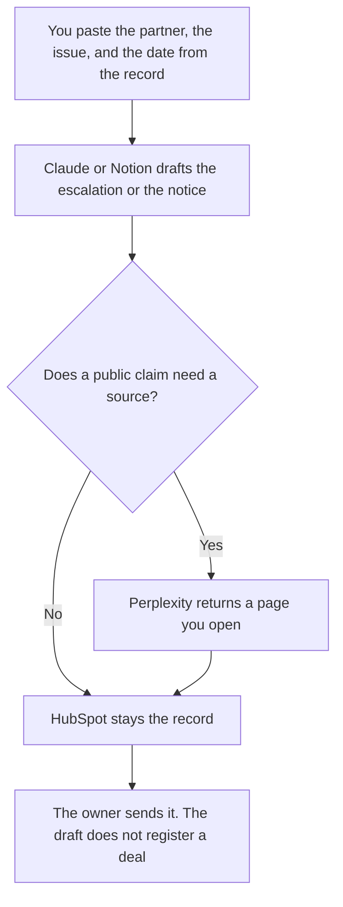

**Partner ops should use AI to draft an escalation from facts already in the record, keep a migration notice to the same dates the customer notice uses, and leave the partner row in the CRM.** The model does not invent a fit score, a revenue share, or a deal-registration outcome. The brief and the joint deck are [best AI tools for partnerships teams](/blog/best-ai-tools-for-partnerships-teams-2026/). The campaign is [best AI tools for partner marketing](/blog/best-ai-tools-for-partner-marketing-2026/). This page is the operating cadence: the exception, the notice, and the record.

The escalation is [how to write a partner escalation note with AI](/blog/how-to-write-a-partner-escalation-note-with-ai-2026/). The customer move, when partners must tell their customers, is [how to write a customer migration notice with AI](/blog/how-to-write-a-customer-migration-notice-with-ai-2026/). The public page you cite before you claim a partner's certification is [Perplexity vs Gemini for vendor diligence](/blog/perplexity-vs-gemini-for-vendor-diligence-2026/).

Claude's prices are from claude.com/pricing on October 24, 2026. Notion, HubSpot, and Perplexity prices are from directory pages checked October 16. HubSpot's Starter figure was labeled limited-time. Published October 24, 2026. We did not score partner fit.

## The partner ops week

| The job | Start here | First paid step | The limit |
|---|---|---|---|
| The page the next exception will open | [Notion AI](/tools/notion-ai/) | Business is $20 a seat a month | The page stores the decision. The chat does not approve it |
| A notice that must match the last one | [Claude](/tools/claude/) | Pro is $17 a month billed annually, or $20 monthly | No date that was not in the paste |
| The partner record | [HubSpot](/tools/hubspot/) | Free tools are $0. Confirm Starter before you cite $7 or $10 | The row is the record. A generated brief does not edit the tier |
| A public claim you must open | [Perplexity](/tools/perplexity/) | Pro is $17 a month billed annually | Open the citation. A second model's agreement is not the page |

Partnerships teams own why this partner and what the joint offer is. Partner marketing owns the campaign. Partner ops owns whether the registration, the notice, and the escalation use the same partner name and the same date. If you are writing the one-pager, you are on the partnerships page. If you are telling a partner that a portal moves on Friday, you are here. The enablement kit, which is a packet rather than an exception, is [how to write a partner enablement kit with AI](/blog/how-to-write-a-partner-enablement-kit-with-ai-2026/).

## What you are paying for

**Notion Business** holds the escalation template, the sent notice, and the date. Plus at $10 is not the full AI tier on the October 16 card. The invoice is [Notion AI pricing explained](/blog/notion-ai-pricing-explained-2026/).

**Claude Pro** is the Project of approved sentences, so a partner notice does not drift from the customer notice. The review is [Claude review](/blog/claude-review-2026/). One exception from a short paste can be ChatGPT Plus at $20, on the October 16 card. Do not merge the two drafts.

**HubSpot free tools** are enough to keep the partner row if that is your CRM. The October 16 card's Starter price was a limited-time offer at $7 or $10 a seat. The invoice is [HubSpot pricing explained](/blog/hubspot-pricing-explained-2026/). A route between tools, if you already run one, should move the id you pasted. It should not decide the partner tier. Zapier's Professional plan is $19.99 a month billed annually on that same check, at the 750-task tier, if you need that route. The invoice is [Zapier pricing explained](/blog/zapier-pricing-explained-2026/).

**Perplexity Pro** is the citation when the escalation depends on a public status page or a published partner policy. Free is $0 with limited weekly use, on that card. The invoice is [Perplexity pricing explained](/blog/perplexity-pricing-explained-2026/).

A prompt that holds the line:

"Draft the partner note from the partner name, the issue, the date, and the ask I pasted. Do not add a revenue share, a tier, or a customer logo. If the owner is missing, write Owner missing."

## What not to automate

Do not let a model approve deal registration. Do not announce a migration to partners before the customer notice's date is the same date. Do not paste another partner's contract into the prompt so the example "sounds commercial." The QBR, which is a review and not an exception, is [how to write a partner QBR with AI](/blog/how-to-write-a-partner-qbr-with-ai-2026/).

## FAQ

### How is this different from the partnerships team page?

That page owns the brief, the record of why the partner exists, and the joint deck. This page owns the operating exceptions and the notices that have to match a date. A strong brief with the wrong migration date is a partner-ops failure.

### How is this different from partner marketing?

Partner marketing owns the campaign and the field motion. Partner ops owns the record, the registration exception, and the notice. A campaign that tells partners to use a portal that moves tomorrow is the notice's problem. Write the notice first.

### Do I need Perplexity for every exception?

No. Use it when the note depends on a public page. An internal registration delay is in your CRM, not on the web. Citing a homepage does not make an internal status true.

### Who may send the note?

The owner named on it. A model does not register a deal, change a tier, or promise a revenue share. A blank owner is an unfinished note.

## Last verified

October 24, 2026 for Claude. October 16, 2026 for Notion, HubSpot, Perplexity, and Zapier. Published October 24, 2026.

**Sources:** [Notion pricing](https://www.notion.com/pricing), [Claude pricing](https://claude.com/pricing), [HubSpot pricing](https://www.hubspot.com/pricing), [Perplexity pricing](https://www.perplexity.ai/pro).

*Published by Andrew for [AI Tools Optimizer](https://aitoolsoptimizer.com).*

[HubSpot](/tools/hubspot/) is in the [marketing and SEO directory](/tools/category/marketing-seo/). Directory pages may use affiliate links. A purchase through them may earn us a commission at no extra cost to you.
