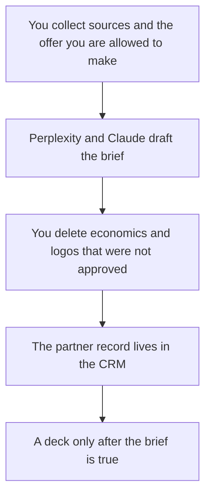

**A partnerships team should use AI to draft a partner brief from sources you can open, keep the partner record in the CRM, and build a joint deck only after the offer is true.** It should not invent a fit score, a revenue share, or a customer logo. The rep-facing stack is [best AI tools for sales teams](/blog/best-ai-tools-for-sales-teams-2026/). The list factory behind a CRM is [best AI tools for RevOps](/blog/best-ai-tools-for-revops-2026/). This page is the mutual motion: why this partner, what each side does, and the file you both can edit.

The buyer one-pager, which is a different audience, is [how to write a sales one-pager with AI](/blog/how-to-write-a-sales-one-pager-with-ai-2026/). Cited company research is [how to use Perplexity for market research](/blog/how-to-use-perplexity-for-market-research-2026/).

Prices are US list prices excluding tax from directory pages checked October 16, 2026. HubSpot Starter was a limited-time offer on that card. Published October 24, 2026. We did not score partner fit.

## The partnerships job

| The job | Start here | First paid step | The limit |
|---|---|---|---|
| A brief with sources you will click | [Perplexity](/tools/perplexity/) | Pro is $17 a month billed annually. Monthly costs more. The card does not print that monthly dollar | You still open the citations |
| The narrative and the mutual offer | [Claude](/tools/claude/) or [ChatGPT](/tools/chatgpt/) | Claude Pro is $20, or $17 billed annually. ChatGPT Plus is $20 | It may not invent economics |
| The page the team reopens next quarter | [Notion AI](/tools/notion-ai/) | Business is $20 a seat. Plus at $10 is not the full AI tier | The CRM, if you have one, stays the record of the deal |
| The partner in the CRM | [HubSpot](/tools/hubspot/) | Free CRM. Starter was listed at $7 or $10 a seat a month, a limited-time offer | Confirm the promo. Credits are extra at $10 per 1,000 |
| The joint deck | [Gamma](/tools/gamma/) or [Plus AI](/tools/plus-ai/) | Gamma Plus is $9 a seat. Plus AI Basic is $10 a user a month billed annually | The file format decides the tool |

## What to use for each artifact

**The research.** Perplexity Free cites sources with a weekly cap. Pro adds Computer, premium data such as PitchBook and Statista, and model choice. Max at $167 a month billed annually is the heavy tier. A partner brief does not need Max. The cost against a drafting seat is [Perplexity Pro vs ChatGPT Plus cost](/blog/perplexity-pro-vs-chatgpt-plus-cost-2026/). The review is [Perplexity review](/blog/perplexity-review-2026/).

**The brief.** Claude Pro holds a long source pack in a Project. ChatGPT Plus holds a repeating brief template. The structure that holds the line: who they are, who we are, the customer we both serve, what each side will do, what we will not promise, and the next meeting. If a revenue share is not in your notes, the model writes Not agreed. The container is [Claude Projects vs ChatGPT Projects](/blog/claude-projects-vs-chatgpt-projects-2026/). The person who sends the brief is [what human-in-the-loop AI is](/blog/what-is-human-in-the-loop-ai-2026/).

**The record.** Notion Business is the wiki for the brief and the meeting notes. HubSpot's free CRM is the system of record for the partner company and the deal stage, if that is the CRM you run. Starter's $7 or $10 figure was promotional as of October 16, 2026. Professional and Enterprise have no dollar on the directory card this page will quote. Extra HubSpot Credits are listed at $10 per 1,000. Set a cap before an agent spends them. Breeze can research an account inside HubSpot. It should not create a partner tier the contract does not name.

**The deck.** If the partner will edit a PowerPoint or Google Slides file, start with Plus AI. If a link is enough, Gamma Plus is the lower seat. The choice is [Plus AI vs Gamma](/blog/plus-ai-vs-gamma-2026/). Design the deck after the brief is true, not before. A slide that adds a joint customer the brief marked as unapproved is a defect.

**A list of possible partners.** [Clay](/tools/clay/) Free includes 500 actions and 100 data credits a month. Launch starts at $167 a month billed annually when you are enriching a real table. That factory is a RevOps purchase. Partnerships can use the free tier to check a short list. Do not stand up a waterfall to "find partners" before you can say what a good partner does. The card is [Clay pricing explained](/blog/clay-pricing-explained-2026/).

A prospect video is optional and easy to overbuy. The sales clip comparison is [HeyGen vs Synthesia for sales](/blog/heygen-vs-synthesia-for-sales-2026/). A partner announcement is closer to a newsletter than to an avatar: [how to create a newsletter with AI](/blog/how-to-create-a-newsletter-with-ai-2026/).

## What not to automate

Do not let a model score "strategic fit" and then sort the pipeline by that score. Do not let it offer a discount, a marketplace fee, or an exclusivity term. Do not publish a co-marketing claim the partner has not seen. The RFP-style response, when a partner sends a questionnaire, is [how to write an RFP response with AI](/blog/how-to-write-a-rfp-response-with-ai-2026/). Same rule: only the answers you can source.

## FAQ

### What should a two-person partnerships team buy first?

Perplexity Free, then Pro if the weekly cap hits. Claude or ChatGPT for the brief. The CRM you already have. Gamma or Plus AI when a deck is actually requested. Clay when the list is the job and RevOps is not already running it.

### Is a partner brief the same as a sales one-pager?

The sales one-pager asks a buyer to take a step. The partner brief asks both companies what they will do. Using the buyer page as the partner page will read as a pitch. Write the mutual sections on purpose.

### Can AI negotiate the terms?

It can list the open terms you pasted. A person negotiates. A generated "standard revenue share" will leak into an email. Leave economics blank until someone with authority fills them in.

### Where do meeting notes go?

Into the partner record, after you delete anything the model upgraded into a decision. The capture choice is [Claude vs ChatGPT for meeting notes](/blog/claude-vs-chatgpt-for-meetings-notes-2026/). The recorder is separate from the chatbot.

## Last verified

October 16, 2026 for Perplexity, Claude, ChatGPT, Notion, HubSpot, Gamma, Plus AI, and Clay prices named above. HubSpot Starter was promotional. Perplexity's month-to-month Pro dollar was not on the card. Published October 24, 2026.

**Sources:** [Perplexity pricing](https://www.perplexity.ai/hub/pricing), [HubSpot](https://www.hubspot.com), [Gamma pricing](https://gamma.app/pricing).

*Published by Andrew for [AI Tools Optimizer](https://aitoolsoptimizer.com).*

[Perplexity](/tools/perplexity/) is in the [research and search directory](/tools/category/research-search/). Directory pages may use affiliate links. A purchase through them may earn us a commission at no extra cost to you.
