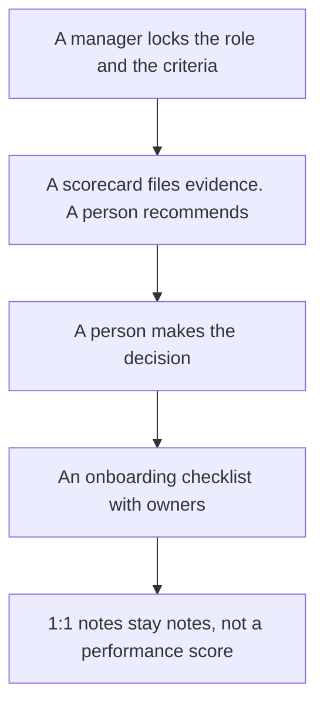

**People ops should use AI to format a checklist, a scorecard, and a note from decisions a person already made.** It should not rank employees, score a candidate, or rewrite a policy into legal advice. The handbook, the training video, and the interview recording stack belong to HR on this site: [best AI tools for HR teams](/blog/best-ai-tools-for-hr-teams-2026/). Sourcing belongs to [best AI tools for recruiters](/blog/best-ai-tools-for-recruiters-2026/). This page is the operating loop between those two: the requisition is approved, the slate needs a fair form, and a new hire needs a task list with an owner.

The scorecard workflow is [how to create interview scorecards with AI](/blog/how-to-create-interview-scorecards-with-ai-2026/). The role text is [how to write a job description with AI](/blog/how-to-write-a-job-description-with-ai-2026/). New-hire pages are [how to create onboarding docs with AI](/blog/how-to-create-onboarding-docs-with-ai-2026/).

Prices are US list prices excluding tax from directory pages checked October 16, 2026. Published October 24, 2026. We did not score culture or hiring tools. This page is not employment or legal advice.

## The operating job

| The job | Start here | First paid step | The limit |
|---|---|---|---|
| The scorecard and the onboarding page people will reopen | [Notion AI](/tools/notion-ai/) | Business is $20 a seat. Plus at $10 is not the full AI tier | The page has an owner. The chat is not the record |
| A draft from a template counsel or a manager already approved | [Claude](/tools/claude/) or [ChatGPT](/tools/chatgpt/) | Claude Pro is $20, or $17 billed annually. ChatGPT Plus is $20 | It may not add a criterion or a benefit |
| Tasks, if the company already lives in ClickUp | [ClickUp Brain](/tools/clickup-brain/) | Brain² starts at $9 a user a month, on top of a ClickUp plan | The workspace is the value. Do not buy ClickUp only for the AI |
| A 1:1 note without a bot on the call | [Granola](/tools/granola/) | Business is $14 a user a month. Basic is free with 30 days of history | The note is private by default on the card. You still tell people |
| The sentence, after the facts are frozen | [Grammarly](/tools/grammarly/) | Pro is $12 a member a month billed annually | It will not catch a wrong policy |

## What to pay for, and what to leave with HR

**The form.** Notion Business is the seat when scorecards and checklists already live in the wiki. Duplicate a row per candidate and per new hire. Do not ask the agent to rank the slate. The card is [Notion AI pricing explained](/blog/notion-ai-pricing-explained-2026/). The place a fact is allowed to live is [what a system of record for AI is](/blog/what-is-a-system-of-record-for-ai-2026/). Your HRIS, which this directory does not replace, remains the employee record.

**The draft.** Claude Pro holds a long template in a Project. ChatGPT Plus holds a custom GPT for a repeating checklist. Go at $8 can draft a short task list and may include ads. If the paste includes candidate data, ChatGPT Business is $20 a user a month billed annually, for two or more users, and does not train on business data by default. A personal Plus seat is a different promise. The ladder is [ChatGPT Go vs Plus vs Pro](/blog/chatgpt-go-vs-plus-vs-pro-2026/).

**The tasks.** ClickUp's Free Forever plan exists. Unlimited is $7 a user a month billed yearly, and Business is $12, on the Brain card. Brain² at $9 adds the model layer, with 1,500 AI Super Credits. Everything AI at $28 adds Notetaker and Super Agents. Buy Brain when the tasks are already in ClickUp. A people-ops team that lives in Notion does not need a second system so an agent can "run onboarding."

**The 1:1.** Granola is the bot-free notepad. Fathom, if a bot is allowed, is the other recorder and is priced on [Fathom pricing explained](/blog/fathom-pricing-explained-2026/). Do not turn 1:1 themes into a performance score. A theme is a note. A score is a manager's decision, outside the model. Company-wide announcements are [best AI tools for internal comms](/blog/best-ai-tools-for-internal-comms-2026/).

## What not to automate

Do not let a model reject a resume, recommend a salary, or describe an employee's health, age, or personality. Do not paste a stack of reviews and ask who to promote. Format the document your process already requires. The interviewer still signs the scorecard.

Offer letters and handbooks need the owner your counsel named. AI can insert a title and a start date you provide into a template that counsel already approved. It cannot clear the template.

## FAQ

### How is this different from the HR list?

HR on this site is the handbook, the training video, and interview capture. People ops here is the checklist, the scorecard criteria, and the operating note. Some tools appear on both lists because a wiki can hold a policy and a task list. The job is different.

### What should a three-person people team buy first?

Notion Business if the pages are the pain. Claude or ChatGPT if the pain is a blank scorecard. Granola's free plan if 1:1 notes disappear. One of those. ClickUp Brain only if ClickUp is already the task system.

### Can AI write the onboarding checklist from the job description?

It can propose tasks. A manager deletes anything the new hire will not actually do in week one. A 40-item list nobody owns is not onboarding. Put a name on each task.

### Where do performance reviews fit?

In the form your company already uses. AI can clean sentences a manager wrote. It should not generate the rating. If you do not have a form, write the form with a person before you involve a model.

## Last verified

October 16, 2026 for Notion, Claude, ChatGPT, ClickUp Brain, Granola, and Grammarly prices named above. Published October 24, 2026.

**Sources:** [Notion AI](https://www.notion.com/product/ai), [ClickUp Brain](https://clickup.com/brain), [Granola](https://www.granola.ai).

*Published by Andrew for [AI Tools Optimizer](https://aitoolsoptimizer.com).*

[Notion AI](/tools/notion-ai/) is in the [productivity and notes directory](/tools/category/productivity-notes/). Directory pages may use affiliate links. A purchase through them may earn us a commission at no extra cost to you.
