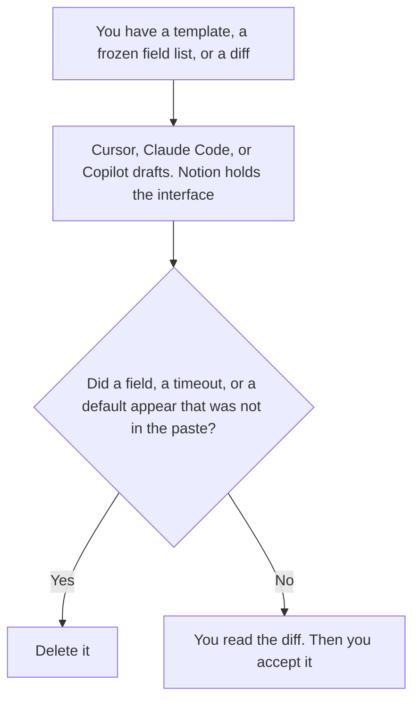

**A platform engineer should use AI to draft a service template other teams will copy, to format an interface doc from fields a person already froze, and to describe a diff they will read.** The model does not add an API field, pick a default timeout, or declare a migration done. The product owner of that contract is [best AI tools for platform PMs](/blog/best-ai-tools-for-platform-pms-2026/). The engineer on a production change, including the alert note, is [best AI tools for DevOps engineers](/blog/best-ai-tools-for-devops-engineers-2026/).

Incident review is [best AI tools for SRE teams](/blog/best-ai-tools-for-sre-teams-2026/). The share of waiting time one tool may use is [what an AI tool timeout budget is](/blog/what-is-ai-tool-timeout-budget-2026/). The fields a handoff must contain are [what an AI agent handoff contract is](/blog/what-is-ai-agent-handoff-contract-2026/).

Cursor's Plus price is the October 24, 2026 help-center figure recorded in [Cursor pricing explained](/blog/cursor-pricing-explained-2026/). Claude Code is included on Claude Pro on the October 24 pricing table, recorded in [Claude Code pricing explained](/blog/claude-code-pricing-explained-2026/). GitHub Copilot's prices are the October 16 directory card recorded in [GitHub Copilot pricing explained](/blog/github-copilot-pricing-explained-2026/). Notion is the October 16 directory card. Published October 24, 2026. We did not score platforms. A template is not a service you have deployed.

## The engineer's three files

| The file | Start here | First paid step | The limit |
|---|---|---|---|
| A template or a diff in the repo, which you will read | [Cursor](/tools/cursor/) | Plus is $8 a month, or $80 a year | Plus omits Cloud Agents on the October 24 help page. You still run the checks you trust |
| A terminal pass on the Claude seat | [Claude Code](/tools/claude-code/) | Included on Claude Pro, at $17 a month billed annually or $20 monthly | The same checks. A second editor is optional |
| Completions in the editor you already use on GitHub | [GitHub Copilot](/tools/github-copilot/) | Pro is $10 a month | Business is $19. Enterprise is $39. Neither adds an API field |
| The interface doc other teams read | [Notion AI](/tools/notion-ai/) | Business is $20 a seat a month | A field you did not freeze stays out |

The platform PM page is the deprecation note, the toggle inventory, and the migration a person still reviews. This page is the engineer who maintains the path other teams copy. The template may include a timeout only if you pasted the seconds. Timeout not set stays in the doc. The budget that splits those seconds across tools is the timeout-budget explainer. The template does not get to spend the whole deadline because the sample app "seems small."

Cursor Plus at $8 is the editor seat on the October 24 help page. Teams is $30, $100, or $200 a seat a month when the company needs a list price. Enterprise is contact sales. Those rows are [Cursor Business pricing explained](/blog/cursor-business-pricing-explained-2026/) and [Cursor Enterprise pricing explained](/blog/cursor-enterprise-pricing-explained-2026/).

Claude Code rides Claude Pro. It is the terminal pass, the same seat the DevOps page uses for a change. This page uses it on the template, not on an alert. GitHub Copilot Pro at $10 is the individual seat on the October 16 card. Business at $19 and Enterprise at $39 are [GitHub Copilot pricing explained](/blog/github-copilot-pricing-explained-2026/) and [GitHub Copilot Enterprise pricing explained](/blog/github-copilot-enterprise-pricing-explained-2026/). The refactor argument between Cursor and Copilot stays on [Cursor vs GitHub Copilot for refactors](/blog/cursor-vs-github-copilot-for-refactors-2026/). This page does not re-rank them.

The interface doc lists the fields you froze, the owner, and the handoff contract version if an agent path is part of the platform. A missing required field is a rejected handoff, which is the contract page. Notion holds that doc. The doc does not gain a field because a sample client failed.

The DevOps page owns the alert note and the single runbook step. The SRE page owns the incident practice. A platform engineer who is also on call uses those pages for that hour. This page does not turn the template into a root cause.

## What you are paying for

**Cursor Plus** is the template and the diff. The review is [Cursor review](/blog/cursor-review-2026/).

**Claude Code** is included on Pro. You are paying for the Claude plan, not a second platform SKU. The review of the seat is [Claude review](/blog/claude-review-2026/).

**Copilot Pro** is completions on the GitHub seat.

**Notion Business** holds the interface doc. The invoice is [Notion AI pricing explained](/blog/notion-ai-pricing-explained-2026/).

A prompt that holds the line:

"Draft the template note, the interface doc, or the diff description from the fields and the seconds I pasted. If a timeout is missing, write Timeout not set. Do not add a field. Do not add a default."

## What not to automate

Do not let an agent publish a template because a sample compiled. Do not widen an interface to make a caller succeed. Do not copy a platform PM's deprecation date into the template unless you pasted it as a field you accept. The engineer owns the diff.

## FAQ

### How is this different from the platform PM page?

That page is the contract as a product: what will be removed, which toggles exist, which move may touch the repo. This page is the engineer maintaining the template and the interface other teams copy. The PM does not merge the template by formatting a note.

### How is this different from the DevOps engineer page?

That page is one change, one runbook step, and an alert note. This page is the paved path those changes start from. An alert still belongs on the DevOps page. A timeout in the template belongs here, and only if you set the seconds.

### How is this different from an SRE team's stack?

The SRE page is the incident practice. This page is the template and the interface before an incident. The handoff contract says which fields a stop must carry. The template can point at that contract. It does not write the postmortem.

### Who may merge?

The person who owns the template, after they read the diff and run the checks they trust. Timeout not set stays in the doc. A suggested field is not an interface you have frozen.

## Last verified

October 24, 2026 for Cursor's help page and for Claude Code on Claude's pricing table, via the posts cited above. October 16, 2026 for GitHub Copilot and Notion. Published October 24, 2026. We did not score uptime.

**Sources:** [Cursor pricing](https://cursor.com/help/account-and-billing/pricing), [Claude pricing](https://claude.com/pricing), [GitHub Copilot plans](https://github.com/features/copilot/plans), [Notion pricing](https://www.notion.com/pricing).

*Published by Andrew for [AI Tools Optimizer](https://aitoolsoptimizer.com).*

[Cursor](/tools/cursor/) is in the [coding directory](/tools/category/coding/). Directory pages may use affiliate links. A purchase through them may earn us a commission at no extra cost to you.
