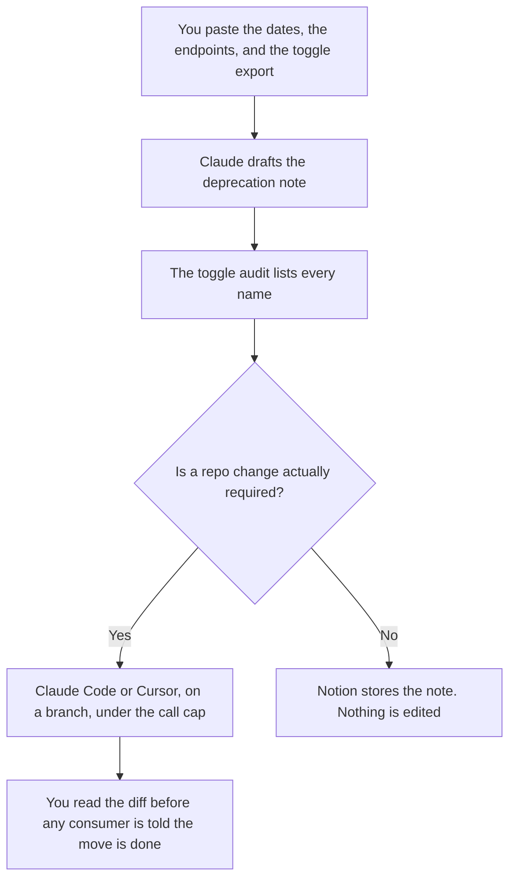

**A platform PM should use AI to draft the deprecation note from dates they already set, format the toggle inventory from an export they pasted, and supervise a migration that stops at the tool-call budget they wrote.** The model does not prioritize the platform roadmap, and it does not widen an API because a call failed. A product's RFC and a single flag's retirement are a sibling job: [best AI tools for technical PMs](/blog/best-ai-tools-for-technical-pms-2026/). This page is the contract other teams consume: what will be removed, which toggles still exist, and which move is allowed to touch the repo.

The deprecation document is [how to write a model deprecation plan with AI](/blog/how-to-write-a-model-deprecation-plan-with-ai-2026/). The inventory is [how to create a feature toggle audit with AI](/blog/how-to-create-a-feature-toggle-audit-with-ai-2026/). The code move is [Cursor vs Claude Code for migrations](/blog/cursor-vs-claude-code-for-migrations-2026/).

Claude's prices, including Claude Code on paid plans, are from claude.com/pricing on October 24, 2026. Cursor and Notion prices are from directory pages checked October 16, 2026. Published October 24, 2026. We did not score delivery.

## The platform PM's week

| The job | Start here | First paid step | The limit |
|---|---|---|---|
| The deprecation note and the consumer notice | [Claude](/tools/claude/) | Pro is $17 a month billed annually, or $20 monthly | No date, endpoint, or replacement that was not in the paste |
| The migration in the platform repo | [Claude Code](/tools/claude-code/) | Included with Pro. No free Claude Code on the October 24 table | Shared usage with chat. You still set a tool-call budget |
| The toggle inventory | [Notion AI](/tools/notion-ai/) | Business is $20 a seat a month | One row per name in the export. Unknown stays unknown |
| A diff on a branch you can read | [Cursor](/tools/cursor/) | Plus is $8 a month, or $80 a year | You review it. The model does not merge |

Technical PMs on the other page own one product's RFC and the flag on that product. Platform PMs own the shared surface: the schema other teams call, the toggles that cross products, and the notice those teams must receive before a removal. If the work is a user-visible feature with no platform constraint, you are on the technical PM page or the product manager page. The shape you refuse to widen in flight is [what an AI output schema lock is](/blog/what-is-ai-output-schema-lock-2026/).

## What you are paying for

**Claude Pro** is the note in a Project, so this removal uses the same headings as the last one. Max from $100 a month is the all-day seat, not the default for one notice. The review is [Claude review](/blog/claude-review-2026/). The seat that includes the coding agent is [Claude Code pricing explained](/blog/claude-code-pricing-explained-2026/).

**Claude Code** is the supervised migration. The October 24 table lists it on Pro and not on Free. It shares the plan's usage. A migration that needs more calls needs a person to raise the budget, which is [what an AI tool call budget is](/blog/what-is-ai-tool-call-budget-2026/). The review is [Claude Code review](/blog/claude-code-review-2026/).

**Notion Business** holds the toggle audit and the consumer note. Plus at $10 is not the full AI tier on the October 16 card. The invoice is [Notion AI pricing explained](/blog/notion-ai-pricing-explained-2026/).

**Cursor Plus** is the editor when the change is a diff you want to read hunk by hunk. Free exists with limited usage on that card. The ladder is [Cursor pricing explained](/blog/cursor-pricing-explained-2026/).

A prompt that holds the line:

"Draft the consumer notice from the endpoints, the dates, and the replacement I pasted. If a replacement is missing, write Replacement missing. Do not add an endpoint. Do not say the migration is finished."

## What not to automate

Do not let an agent flip a default during the audit. Do not tell consumer teams the old path is gone before the diff you reviewed is the one that shipped. Do not paste a customer's payload into the prompt so the example "looks real." The message when the removal is undone is [how to write a rollback comms note with AI](/blog/how-to-write-a-rollback-comms-note-with-ai-2026/).

## FAQ

### How is this different from the technical PM page?

That page owns one product's RFC, the flag note, and the release train. This page owns the shared contract: deprecation across consumers, the toggle inventory, and the platform migration. A flag that belongs to one product stays on their page. A toggle that other products depend on belongs here.

### Do I need both Claude Code and Cursor?

You need the seat that matches the change. Claude Code fits a supervised command sequence. Cursor fits a diff in the editor. Running both on the same branch at once produces a change nobody can explain. Pick one for the move.

### Who is the consumer?

The team that calls the platform, named on the notice. A model does not get to decide that a team "probably does not use" an endpoint. If the paste does not list them, the line says Audience missing.

### Who may ship the removal?

The platform owner, after the note and the diff match. A finished paragraph is not a deploy. A green agent log is not a review.

## Last verified

October 24, 2026 for Claude and for Claude Code on the plan table. October 16, 2026 for Notion and Cursor. Published October 24, 2026.

**Sources:** [Claude pricing](https://claude.com/pricing), [Claude Code](https://claude.com/product/claude-code), [Notion pricing](https://www.notion.com/pricing), [Cursor pricing](https://cursor.com/help/account-and-billing/pricing).

*Published by Andrew for [AI Tools Optimizer](https://aitoolsoptimizer.com).*

[Claude Code](/tools/claude-code/) is in the [coding directory](/tools/category/coding/). Directory pages may use affiliate links. A purchase through them may earn us a commission at no extra cost to you.
