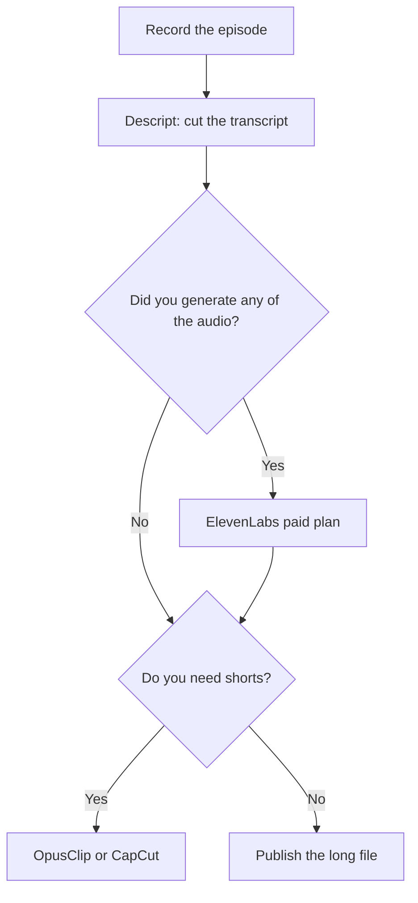

**A podcaster needs an editor that cuts from the transcript, a voice license if the audio is not your own recording, and a clip tool if the show has to become shorts.** Start with [Descript](/tools/descript/). Add [ElevenLabs](/tools/elevenlabs/) when a sponsor read or a host voice has to be generated. Add [OpusClip](/tools/opusclip/) when the long file should become social clips. Skip the rest until a specific episode needs it.

Prices are US list prices excluding tax, recorded October 16, 2026. We did not score sound quality. Commercial use is a plan feature on the voice and music tools below. Free tiers there are for listening to the demo, not for an episode you publish.

## The episode, in order

| Job | Start here | First paid step | Free is enough when |
|---|---|---|---|
| Cut the episode from the transcript | [Descript](/tools/descript/) | Hobbyist $16/person/month billed annually ($24 monthly), 10 media hours, watermark-free 1080p | You are learning, inside 60 media minutes a month |
| A regular video podcast that needs 4K | Descript Creator | $24/month annually ($35 monthly), 30 media hours | You export 1080p on Hobbyist and the hours fit |
| A sponsor voice or a produced narration | [ElevenLabs](/tools/elevenlabs/) | Starter $6/month, commercial license, 30k credits | Never, if the episode is public. Free has no commercial license |
| Shorts from the long episode | [OpusClip](/tools/opusclip/) | Starter $15/month, 150 credits, no watermark | You are testing. Free clips stop exporting after 3 days |
| A social cut you want on a normal timeline | [CapCut](/tools/capcut/) | Pro $19.99/month, or $179.99/year | The free editor covers the template |
| A music bed you will publish | [Suno](/tools/suno/) | Pro $11/month, or $8 billed yearly, with commercial rights | Never for a published bed. Free has no commercial rights |
| Notes from a remote guest recorded as a meeting | [Fathom](/tools/fathom/) | Free for unlimited recordings | You already have the Descript file and only need show notes |
| Cover art | [Canva](/tools/canva/) | Pro $18/month or $180/year | Free templates cover a simple cover |

The edit itself is [how to edit podcasts with Descript](/blog/how-to-edit-podcasts-with-descript-2026/). Descript versus a timeline editor is [Descript vs CapCut](/blog/descript-vs-capcut-2026/). Voices are [best AI voice generators](/blog/best-ai-voice-generators/) and [ElevenLabs pricing explained](/blog/elevenlabs-pricing-explained-2026/).

## Descript is the desk

Free includes 60 media minutes a month and text-based editing. That is one short episode, or a lesson. Hobbyist removes the watermark, adds 10 media hours and 400 AI credits, and is the plan for a show that publishes. Creator at $24 a month on annual billing is the step for 4K, 30 media hours, and full access to Underlord, the co-editor. Business at $50 annual adds translation and dubbing in 30+ languages.

Underlord can propose a tighter cut. You still listen to the edit. Filler-word removal can make a guest sound unlike themselves. Use it as a pass you review, not as the publish button.

If the "podcast" is a meeting you need notes from, you wanted a notetaker. Fathom Free records and transcribes. The comparison with a no-bot notepad is [Granola vs Fathom](/blog/granola-vs-fathom-2026/). Bring the master audio into Descript for the episode. Do not expect Fathom's summary to be the edit.

## Voice, music, and the license line

ElevenLabs Free includes 10,000 credits a month and no commercial license. Starter at $6 is the first plan that includes one, plus 30,000 credits. Creator at $22 adds professional voice cloning. Clone a voice only with consent. The steps are [how to clone a voice with ElevenLabs](/blog/how-to-clone-a-voice-with-elevenlabs/). A host who records themselves does not need ElevenLabs for the episode. They need it for a trailer, an ad in their own voice when they are traveling, or a translation.

Suno Free includes 50 credits a day and no commercial rights or monthly downloads. Pro is the plan that adds commercial use, at $11 a month or $8 on yearly billing, with 2,500 credits. Premier is $35 a month with 10,000 credits. Read Suno's current terms before a sponsor bed ships. The review is [Suno review](/blog/suno-review-2026/).

[Speechify](/tools/speechify/) is for listening to a document, not for producing a show. Premium is $29 a month. The production path for a PDF you want to sound like a show is [turn a PDF into a podcast with AI](/blog/turn-a-pdf-into-a-podcast-with-ai/).

## Clips

OpusClip Free gives 60 credits a month, and free clips cannot be exported after 3 days. Starter at $15 removes the watermark and includes 150 credits. Pro is $29 a month, or $14.50 billed annually, with 300 credits. The review is [OpusClip review](/blog/opusclip-review-2026/). A virality label in the product is the product's label. It is not a prediction we measured.

CapCut is the editor if you want to adjust the clip by hand. Free is a real editor. Pro is $19.99 a month. Use OpusClip to find moments, and CapCut when the caption or the crop needs a person. YouTube-specific packaging is [best AI tools for YouTubers](/blog/best-ai-tools-for-youtubers-2026/). The same clip tools show up there because the file is the same.

Canva Free covers many covers. Pro is the brand kit if the show has a repeating layout. A presenter video that is not the podcast, such as a course, is a different tool: [HeyGen](/tools/heygen/) or [Synthesia](/tools/synthesia/). See [best AI video generators](/blog/best-ai-video-generators-2026/).

## A lean show stack

A weekly interview show: Descript Hobbyist at $16 annual, Canva Free, Fathom Free if the guest call is the recording. Add ElevenLabs Starter at $6 only in the month you generate audio you will publish. Add OpusClip Starter at $15 when shorts are actually on the calendar. That is under $40 before clips, and under $55 with them. Creator and Suno Pro are the upgrades when hours, 4K, or a published music bed show up in the episode, not in a feature tour.

## FAQ

### What AI tool should a podcaster buy first?

Descript, on Free until the 60-minute cap or the watermark blocks a real episode, then Hobbyist at $16 a month billed annually. Buy a voice tool only when the audio is generated.

### Is ElevenLabs free okay for a podcast?

Free is okay for a private test. A published episode needs a paid plan. Starter at $6 a month is the first commercial license.

### Do I need OpusClip and CapCut?

OpusClip finds and captions clips. CapCut is the timeline when you want to fix one. Many shows need neither until they commit to shorts.

### Can I record the guest with a meeting bot?

Yes, if the guest agrees. Fathom Free will transcribe. The master for the episode should still be a clean recording you edit in Descript. A bot track is a backup and a source of show notes.

## Last verified

October 16, 2026.

**Sources:** [Descript pricing](https://www.descript.com/pricing), [ElevenLabs pricing](https://elevenlabs.io/pricing), [OpusClip pricing](https://www.opus.pro/pricing), [Suno](https://suno.com/pricing), [CapCut](https://www.capcut.com/).

[Descript](/tools/descript/) and [ElevenLabs](/tools/elevenlabs/) are in the [audio directory](/tools/category/audio-voice-music/). Directory pages may use affiliate links. A purchase through them may earn us a commission at no extra cost to you.
