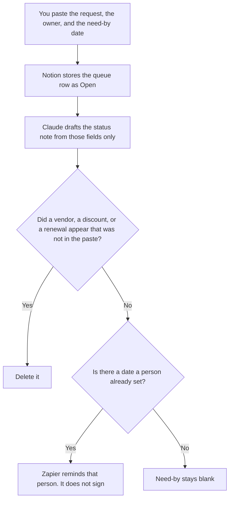

**Procurement ops should use AI to format an intake queue, a renewal row, and an exception from fields a person already entered.** The model does not pick a vendor, invent a discount, or mark a renewal done. The sourcing memo, the RFP, and the approval are [best AI tools for procurement teams](/blog/best-ai-tools-for-procurement-teams-2026/). The people who live with the invoice are [best AI tools for finance ops](/blog/best-ai-tools-for-finance-ops-2026/).

The ask to step outside an AI rule is [how to write an AI exception request with AI](/blog/how-to-write-an-ai-exception-request-with-ai-2026/). A renewal price that is not on a quote stays blank.

Claude's prices are the October 24, 2026 read of claude.com/pricing recorded in [Claude pricing explained](/blog/claude-pricing-explained-2026/). Notion and Zapier prices are from directory pages checked October 16, 2026. A live fetch of Zapier's pricing page returned HTTP 401 on October 24, in the agent-budget article, so that figure stays on the directory record. Perplexity's Pro price is the October 24 figure in [Perplexity pricing explained](/blog/perplexity-pricing-explained-2026/). The hub pricing URL timed out on refetch that day. Published October 24, 2026. We did not score sourcing suites.

## The ops week

| The job | Start here | First paid step | The limit |
|---|---|---|---|
| The queue and the renewal row | [Notion AI](/tools/notion-ai/) | Business is $20 a seat a month | Plus at $10 is not the full AI tier |
| The note from fields you already filled | [Claude](/tools/claude/) | Pro is $17 a month billed annually, or $20 monthly | No discount you did not paste |
| A reminder after a date a person set | [Zapier](/tools/zapier/) | Professional is $19.99 a month billed annually, 750 tasks | The Zap does not renew a contract |
| A public page you still have to open | [Perplexity](/tools/perplexity/) | Pro is $17 a month billed annually | No price without a page you opened |

A renewal row needs the contract end date you copied from the agreement, the owner, and the amount on the last invoice or the quote. If the quote is missing, the cell says Quote not attached. Perplexity can return a vendor's public pricing page. You open it. You do not paste it over a signed price. Enterprise Perplexity is a different seat. This queue does not require it. The organization prices are [Perplexity Enterprise pricing explained](/blog/perplexity-enterprise-pricing-explained-2026/).

## What you are paying for

**Notion Business** is the queue: request, owner, need-by, status, renewal date. The invoice is [Notion AI pricing explained](/blog/notion-ai-pricing-explained-2026/).

**Claude Pro** drafts the weekly note from rows you pasted. Team standard seats are $20 a seat a month billed annually, or $25 monthly, when the note is a company record, as recorded in [Claude Team pricing explained](/blog/claude-team-pricing-explained-2026/). The review is [Claude review](/blog/claude-review-2026/).

**Zapier Professional** is the reminder, on the October 16 card. It fires on a date you stored. It does not choose the date. The task ladder is [Zapier pricing explained](/blog/zapier-pricing-explained-2026/).

**Perplexity Pro** is the public-page check. The research desk is [Perplexity review](/blog/perplexity-review-2026/). A citation you did not open is not a price.

A prompt that holds the line:

"Draft the procurement status note from the rows I pasted. If the quote is missing, write Quote not attached. Do not add a vendor. Do not add a discount. Do not mark a renewal done."

## What not to automate

Do not let a model rank vendors. Do not let a Zap email a supplier because a row sat open. Do not copy a web price onto a renewal that has a quote. The buyer owns the row. Open stays open until a person changes it.

## FAQ

### How is this different from the procurement-team page?

That page is the vendor memo, the RFP you issued, and who approved the recommendation. This page is the queue after intake: who owns the request, when it is due, and which renewal has a date. The same person may do both on a small team. The templates stay different so a reminder does not become a vendor selection.

### How is this different from finance ops?

Finance ops lives with the bill you already owe. Procurement ops lives with the request and the renewal before the next signature. A price on this page is a quote you attached or a page you opened. It is not an accrual. If the invoice and the quote disagree, say so. Do not average them.

### Do I need Perplexity to track renewals?

No. The queue is Notion. Perplexity is the step when a cell needs a public page and you will open it. Pro at $17 annual is that seat on the October 24 record. A renewal with a signed quote does not need a search.

### Who may mark a request closed?

The owner on the row. A formatted note is not a close. A reminder is not a renewal. Quote not attached stays until a person attaches one.

## Last verified

October 24, 2026 for Claude and for Perplexity's annual Pro figure, via the posts cited above. The hub pricing URL timed out that day. October 16, 2026 for Notion and Zapier. Published October 24, 2026. Zapier's pricing page returned HTTP 401 on October 24.

**Sources:** [Notion pricing](https://www.notion.com/pricing), [Claude pricing](https://claude.com/pricing), [Zapier pricing guide](https://zapier.com/blog/zapier-pricing/), [Perplexity pricing](https://www.perplexity.ai/hub/pricing).

*Published by Andrew for [AI Tools Optimizer](https://aitoolsoptimizer.com).*

[Notion AI](/tools/notion-ai/) is in the [notes directory](/tools/category/productivity-notes/). Directory pages may use affiliate links. A purchase through them may earn us a commission at no extra cost to you.
