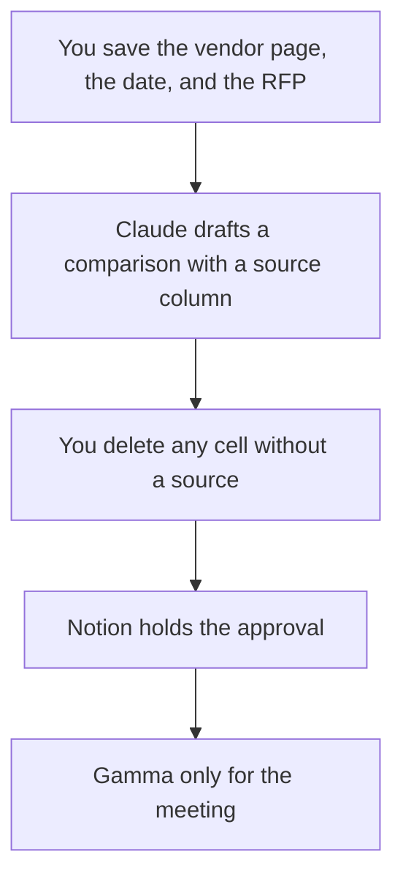

**A procurement team should use AI to keep three artifacts honest: a vendor memo with dated sources, a checklist against the RFP you actually issued, and a record of who approved the recommendation.** The model can organize pages you paste. It cannot invent a discount, a security certification, or a renewal price. If the vendor's page does not say it, the cell says Missing.

The response workflow, when you are the one answering, is [how to write an RFP response with AI](/blog/how-to-write-a-rfp-response-with-ai-2026/). Counsel's neighboring shelf is [best AI tools for legal ops](/blog/best-ai-tools-for-legal-ops-2026/). The people who will live with the bill are [best AI tools for finance ops](/blog/best-ai-tools-for-finance-ops-2026/). The intake queue and the renewal row, which do not pick the vendor, are [best AI tools for procurement ops](/blog/best-ai-tools-for-procurement-ops-2026/).

Prices are US list prices excluding tax from directory pages checked October 16, 2026. Published October 24, 2026. We did not score sourcing suites. A vendor's quote beats any number on this page.

## The procurement job

| The job | Start here | First paid step | The limit |
|---|---|---|---|
| Find the vendor's own pricing page | [Perplexity](/tools/perplexity/) | Pro is $17 a month billed annually | Open the link. A citation is not the contract |
| Draft the comparison from excerpts | [Claude](/tools/claude/) | Pro is $20, or $17 billed annually | It may not fill a blank price |
| The record and the approval | [Notion AI](/tools/notion-ai/) | Business is $20 a seat a month | A chat thread is not the system of record |
| A readout for the steering meeting | [Gamma](/tools/gamma/) | Plus is $9 a seat a month | Only after the memo is signed |
| The line edit | [Grammarly](/tools/grammarly/) | Pro is $12 a member a month billed annually | It will not know your policy |
| A second chat seat | [ChatGPT](/tools/chatgpt/) | Business is $20 a user a month billed annually, minimum two | Plus is a personal seat |

## What to pay for, and what to leave

**The official page.** Perplexity Pro is the cited lookup. Free is enough for a first pass if you are inside the weekly limit on the card. Premium data sources on Pro matter more for company research than for a SaaS sticker, and they are still not a negotiated price. The review is [Perplexity review](/blog/perplexity-review-2026/). The habit of opening the cart page, when the "vendor" is a product you might buy yourself, is [Perplexity vs ChatGPT for shopping research](/blog/perplexity-vs-chatgpt-for-shopping-research-2026/).

**The memo.** Claude Pro, with the RFP and the excerpts in a Project. Ask for columns: requirement, vendor claim, URL, date, gap. ChatGPT Business is the alternative when procurement wants admin controls and no training on business data by default. The container is [Claude Projects vs ChatGPT Projects](/blog/claude-projects-vs-chatgpt-projects-2026/).

**The file that outlives the chat.** Notion Business. Name the approver. The invoice is [Notion AI pricing explained](/blog/notion-ai-pricing-explained-2026/). That habit is [what a system of record for AI is](/blog/what-is-a-system-of-record-for-ai-2026/).

**The steering deck.** Gamma Plus at $9, or $108 a year, after the recommendation is real. Do not let a theme hide a Missing price.

A prompt that holds the line:

"Compare these vendors only against the requirements I paste. Every claim needs the excerpt and the date. If a price, a certification, or a renewal term is not in the excerpts, write Missing. Do not estimate discounts or street prices."

The person who signs is [what human-in-the-loop AI is](/blog/what-is-human-in-the-loop-ai-2026/). The check is [how to fact-check AI writing](/blog/how-to-fact-check-ai-writing-2026/). A competitor-style teardown of a product you might buy can reuse [how to create a competitor teardown with AI](/blog/how-to-create-a-competitor-teardown-with-ai-2026/).

## What not to automate

Do not let a model negotiate. Do not let it mark a security questionnaire complete. Do not convert a foreign list price into USD unless finance published the rate and the date. The directory sometimes records a euro price, as with some automation tools, and this page does not convert those either.

## FAQ

### Can AI replace a sourcing platform?

No. This stack drafts and files. Your existing purchasing system remains the place a PO is issued. A Notion page is not an approval workflow unless your process says it is.

### How should we record a sales quote?

Paste the quote, the date, and the rep's name. The model may summarize it. It may not "normalize" it to a monthly figure the quote did not offer. When the quote and the website disagree, write both and label them.

### Is ChatGPT Plus enough?

For a first draft of a public comparison, often yes, at $20. For vendor documents under NDA, use the company plan your counsel already allows. Business is the ChatGPT admin seat on the card.

### What if the vendor will not publish a price?

Leave the cell as Quote required. A generated range is worse than a blank. Finance can ask. The model should not guess.

## Last verified

October 16, 2026 for Perplexity, Claude, Notion, Gamma, Grammarly, and ChatGPT. Published October 24, 2026.

**Sources:** [Perplexity pricing](https://www.perplexity.ai/hub/pricing), [Claude pricing](https://claude.com/pricing), [Notion pricing](https://www.notion.com/pricing).

*Published by Andrew for [AI Tools Optimizer](https://aitoolsoptimizer.com).*

[Notion AI](/tools/notion-ai/) is in the [productivity and notes directory](/tools/category/productivity-notes/). Directory pages may use affiliate links. A purchase through them may earn us a commission at no extra cost to you.
