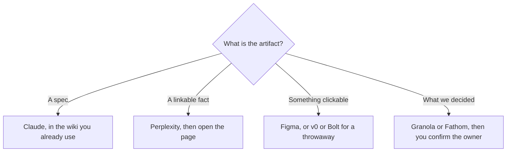

**A product manager should use AI to draft from material the team already has, and to make a prototype someone can click.** The model does not prioritize the roadmap. You do, after the spec, the research, and the meeting notes are things a colleague can check. This page is one tool per PM job. The system that keeps intake rules, the experiment log, and roadmap labels from drifting is [best AI tools for product ops](/blog/best-ai-tools-for-product-ops-2026/).

Prices are US list prices excluding tax from directory pages checked October 16, 2026, except Fathom's plan, read October 24, 2026. Published October 24, 2026. We did not score PRDs.

## The week, with a price

| PM job | Start here | First paid step | Leave it for |
|---|---|---|---|
| A PRD or a decision memo from notes you paste | [Claude](/tools/claude/) or [ChatGPT](/tools/chatgpt/) | Claude Pro $20/month or $17 annual. ChatGPT Plus $20. Go is $8 | A wiki the team does not use |
| The spec lives in Notion | [Notion AI](/tools/notion-ai/) | Business $20/seat/month for the agent | A team that lives in ClickUp |
| The spec lives in ClickUp | [ClickUp Brain](/tools/clickup-brain/) | Brain² from $9/user/month, on a ClickUp plan | A team that lives in Notion |
| A question that needs a link | [Perplexity](/tools/perplexity/) | Pro $17/month billed annually | A private metric in your warehouse |
| A clickable UI | [Figma](/tools/figma/) | Professional Full seat $16/month billed annually. Starter is free, with up to 500 AI credits a month | Production code |
| A front-end draft from a description | [v0](/tools/v0/) or [Bolt.new](/tools/bolt-new/) | v0 Plus is $30 and includes $30 of credits. Bolt Pro is $25/month, or $18 billed annually | A designed system you already maintain in Figma |
| Meeting notes, no bot | [Granola](/tools/granola/) | Business $14/user/month. Basic is free, 30 days of history | A CRM writeback |
| Meeting notes, bot allowed | [Fathom](/tools/fathom/) | Free lists unlimited recordings. Premium is $16/month annually | Talk-time analytics |
| A readout deck | [Gamma](/tools/gamma/) | Plus $9/seat/month | A branded keynote system |

The wiki choice is [Notion AI vs ClickUp Brain](/blog/notion-ai-vs-clickup-brain-2026/). The desk around it is [best AI productivity tools](/blog/best-ai-productivity-tools-2026/).

## The spec

Write the problem, the user, the constraint, and the out-of-scope line yourself, even if they are rough. Then ask Claude or ChatGPT to turn the notes into a one-page spec with open questions separated from decisions. The method is the same discipline as [how to write a blog post with Claude](/blog/how-to-write-a-blog-post-with-claude-2026/): the source is yours, the draft is a draft. A spec with a metric the model invented is a spec you will have to walk back in review.

If the team already writes in Notion, Business at $20 a seat puts the agent on those pages. If the team already writes in ClickUp, Brain² at $9 is the add-on, on top of Unlimited at $7 a user a month billed yearly or Business at $12. Do not migrate wikis to reach an assistant. The Notion invoice is [Notion AI pricing explained](/blog/notion-ai-pricing-explained-2026/).

Perplexity is for the external fact: a competitor's public pricing page, a platform doc, a cited statistic. Pro at $17 a month billed annually is the weekly-research plan. The habit is [how to use Perplexity for market research](/blog/how-to-use-perplexity-for-market-research-2026/). A fuller competitive table is [how to use AI for competitive analysis](/blog/how-to-use-ai-for-competitive-analysis-2026/). Your own funnel numbers stay in the warehouse or the dashboard. Paste them if the spec needs them. Do not ask a chatbot to recall them.

## The prototype

Figma is the file design and engineering already share. A Full seat on Professional is $16 a month billed annually. Starter includes up to 500 AI credits a month. Use the AI features to explore a flow. Keep the components that match the product. The review is [Figma review](/blog/figma-review-2026/).

v0 and Bolt are for a throwaway you can click this afternoon. v0 Plus at $30 includes $30 of credits, so the seat and the usage budget start as the same number. Bolt Pro is $25 a month, or $18 billed annually, with a free tier of 1 million tokens a month and a 300,000 daily limit on the directory page. Show the prototype as a prototype. A generated UI that skips an empty state and an error state is a demo, not a spec. The coding-agent comparison, if an engineer will continue in a repo, is [Cursor vs Claude Code vs Codex](/blog/cursor-vs-claude-code-vs-codex-2026/).

## The meeting and the readout

Granola is the default when a bot in the customer call is unwelcome. Business at $14 unlocks unlimited history. Fathom Free is the default when a bot is fine and you want recordings without a minute pool. The summary still needs a person to confirm owners and dates. The steps are [how to summarize meetings with AI](/blog/how-to-summarize-meetings-with-ai-2026/). The no-bot split is [Granola vs Fathom](/blog/granola-vs-fathom-2026/).

Gamma Plus at $9 turns the readout into a deck after the decisions are real. A roadmap slide with dates the model suggested is the slide to delete. Presentation options are [best AI presentation makers](/blog/best-ai-presentation-makers/).

## A PM stack that stays small

Claude or ChatGPT, the wiki you already have, Figma Starter or the seat the design team already pays for, and Fathom Free or Granola Basic. Add Perplexity Pro when external research is weekly. Add v0 or Bolt when a clickable draft will save a week of debate. Add Notion Business or ClickUp Brain only if that is where the specs live. The priority call remains a meeting you run.

## FAQ

### What AI tool should a product manager buy first?

The assistant you will paste notes into, Claude or ChatGPT. Add a notetaker based on whether a bot can join. Add a prototype tool when words are not settling the design.

### Is Notion AI worth it for PMs?

Yes, when the specs are in Notion and you want the agent on those pages, at $20 a seat. No, when the specs are in ClickUp or in Google Docs. Put the assistant where the documents already are.

### Can I replace discovery with Perplexity?

Perplexity reads public sources. Discovery is still calls with users. Use the tool to prepare and to check a public claim. Use the calls to learn what the public page does not say.

### Should PMs pay for a coding agent?

When you are producing a throwaway prototype, v0 or Bolt is the smaller purchase. When you are changing the product repo, that is an engineering seat, compared in [Cursor vs GitHub Copilot](/blog/cursor-vs-github-copilot-2026/). A PM seat on a coding agent is justified by the diffs you will review, not by the demo.

## Last verified

October 16, 2026 for Claude, Notion, ClickUp, Perplexity, Figma, Granola, Gamma, v0, and Bolt. October 24, 2026 for Fathom. Published October 24, 2026.

**Sources:** [Claude pricing](https://claude.com/pricing), [Notion pricing](https://www.notion.com/pricing), [Figma pricing](https://www.figma.com/pricing/), [Perplexity pricing](https://www.perplexity.ai/pro), [v0](https://v0.app), [Bolt.new](https://bolt.new).

*Published by Andrew for [AI Tools Optimizer](https://aitoolsoptimizer.com).*

[Notion AI](/tools/notion-ai/) and [Figma](/tools/figma/) are in the [productivity](/tools/category/productivity-notes/) and [design](/tools/category/design/) directories. Directory pages may use affiliate links. A purchase through them may earn us a commission at no extra cost to you.
