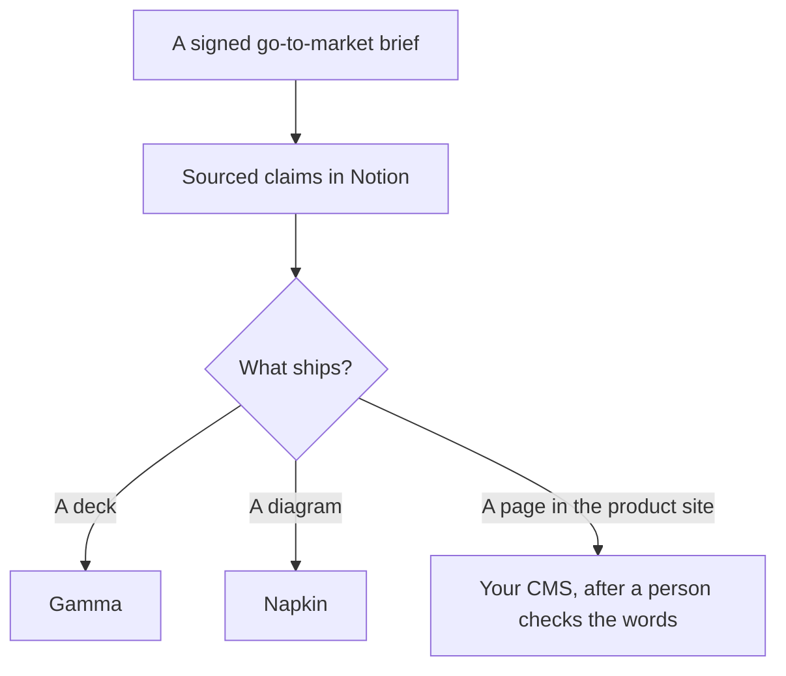

**A product marketing team should use AI to keep three artifacts aligned: the go-to-market brief, the sourced claim about a competitor or a customer, and the page or deck that repeats those words.** A model that invents a segment or a proof point will ship it into the homepage by Friday. This page is one tool per artifact. The broader marketer shelf is [best AI tools for marketers](/blog/best-ai-tools-for-marketers-2026/).

The brief workflow is [how to write a go-to-market brief with AI](/blog/how-to-write-a-go-to-market-brief-with-ai-2026/). The claim workflow is [how to create a competitor teardown with AI](/blog/how-to-create-a-competitor-teardown-with-ai-2026/). The rep file that must match is [how to write a sales enablement deck with AI](/blog/how-to-write-a-sales-enablement-deck-with-ai-2026/).

Prices are US list prices excluding tax from directory pages checked October 16, 2026. Published October 24, 2026. We did not score campaigns.

## The product marketing job

| The job | Start here | First paid step | The limit |
|---|---|---|---|
| The brief and the messaging | [Claude](/tools/claude/) or [ChatGPT](/tools/chatgpt/) | Claude Pro is $20, or $17 billed annually. ChatGPT Plus is $20 | It may not add a segment or a feature |
| A dated public page | [Perplexity](/tools/perplexity/) | Pro is $17 a month billed annually | Open the citation |
| The record | [Notion AI](/tools/notion-ai/) | Business is $20 a seat a month | Plus at $10 is not the full AI tier |
| The deck | [Gamma](/tools/gamma/) | Plus is $9 a seat a month | After the brief is signed |
| One diagram from a paragraph | [Napkin AI](/tools/napkin-ai/) | Plus is $9 a person a month | It is not the brand system |
| The line edit | [Grammarly](/tools/grammarly/) | Pro is $12 a member a month billed annually | It will not know the non-claims |

## What to pay for

**The words.** Claude Pro for the long brief, with the PRD excerpt in a Project. ChatGPT Plus if that is already the team's chat. Business at $20 a user a month billed annually, minimum two, when the launch is confidential and you want admin controls. The ladders are [Claude review](/blog/claude-review-2026/) and [ChatGPT Go vs Plus vs Pro](/blog/chatgpt-go-vs-plus-vs-pro-2026/).

**The source.** Perplexity Pro when you need the competitor's page with a link. The teardown article is the method. A citation you did not open is not a claim. The review is [Perplexity review](/blog/perplexity-review-2026/).

**The system of record.** Notion Business, with an owner on the brief. The invoice is [Notion AI pricing explained](/blog/notion-ai-pricing-explained-2026/). The habit is [what a system of record for AI is](/blog/what-is-a-system-of-record-for-ai-2026/).

**The readout.** Gamma Plus at $108 a seat a year once the words are frozen. If the file must be born in Slides or PowerPoint, [Plus AI](/tools/plus-ai/) Basic is $10 a user a month billed annually. The pair is [Plus AI vs Gamma](/blog/plus-ai-vs-gamma-2026/).

**A single visual.** Napkin Plus at $9 when a paragraph in the brief should become one diagram. Free includes 500 credits a week. Pro at $22 is the brand-kit step. The invoice is [Napkin AI pricing explained](/blog/napkin-ai-pricing-explained-2026/). A full template system is [Canva](/tools/canva/) Pro at $180 a year for one person, or Business at $250 a person a year. The design comparison is [Figma vs Canva for AI prototypes](/blog/figma-vs-canva-for-ai-prototypes-2026/) when the artifact is a product flow rather than a launch graphic.

The fact pass is [how to fact-check AI writing](/blog/how-to-fact-check-ai-writing-2026/). The person who ships the page is [what human-in-the-loop AI is](/blog/what-is-human-in-the-loop-ai-2026/). A customer story, if you have permission, is [how to write a case study with AI](/blog/how-to-write-a-case-study-with-ai-2026/).

## What not to automate

Do not generate a pipeline target. Do not generate a customer quote. Do not let a landing-page builder invent the offer. If you do need a page, the builder choice is [Lovable vs v0 for landing pages](/blog/lovable-vs-v0-for-landing-pages-2026/), and the brief still wins.

## FAQ

### How is this different from a general marketing stack?

General marketing includes a wider set of channels and content. Product marketing here is the launch agreement and the claims that have to match the product. Start with the brief. Add Canva or a page builder when a specific artifact is requested.

### What should a two-person team buy first?

Claude or ChatGPT, Notion, and Perplexity when competitor pages are part of the job. Add Gamma when someone asks for slides. Napkin when a diagram is the blocker. Skip a second design suite until the brief has an owner.

### Can AI own the messaging house?

It can draft from interviews you paste. A person owns the words, the non-claims, and the date. The interview questions, if you still need them, are [how to create a user interview guide with AI](/blog/how-to-create-a-user-interview-guide-with-ai-2026/).

### Where do sales claims live?

On the battlecard and in the enablement deck, both dated, both linked from the brief. Not in a one-off chat. The enablement workflow is linked above.

## Last verified

October 16, 2026 for Claude, ChatGPT, Perplexity, Notion, Gamma, Plus AI, Napkin, Canva, and Grammarly. Published October 24, 2026.

**Sources:** [Claude pricing](https://claude.com/pricing), [Perplexity pricing](https://www.perplexity.ai/hub/pricing), [Gamma pricing](https://gamma.app/pricing).

*Published by Andrew for [AI Tools Optimizer](https://aitoolsoptimizer.com).*

[Claude](/tools/claude/) is in the [chatbots and assistants directory](/tools/category/chatbots-assistants/). Directory pages may use affiliate links. A purchase through them may earn us a commission at no extra cost to you.
