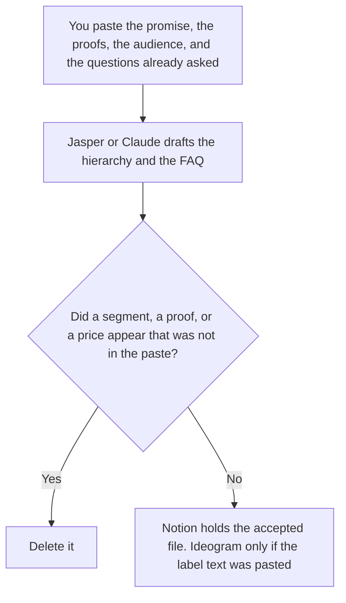

**A product marketing manager should use AI to keep three files aligned for one product: the messaging hierarchy they already approved, the launch FAQ from questions they already collected, and a single objection answered only with a claim they already allowed.** The model does not invent a segment, a proof point, or a price. The team page for the go-to-market brief, the sourced claim, and the page or deck is [best AI tools for product marketing](/blog/best-ai-tools-for-product-marketing-2026/). This page is the person who owns one product's words.

The brand system across products is [best AI tools for brand teams](/blog/best-ai-tools-for-brand-teams-2026/). A product shot whose label must be readable is [Midjourney vs Ideogram for product shots](/blog/midjourney-vs-ideogram-for-product-shots-2026/).

Jasper's Business tier is custom on the October 24, 2026 pricing page, and Pro is $59 a seat a month billed yearly or $69 monthly, with that card saying it includes one seat, as recorded in [Jasper Business pricing explained](/blog/jasper-business-pricing-explained-2026/). Claude's prices are the October 24 read of claude.com/pricing recorded in [Claude pricing explained](/blog/claude-pricing-explained-2026/). Ideogram and Notion prices are from directory pages checked October 16, 2026. Published October 24, 2026. We did not score campaigns.

## The three files

| The file | Start here | First paid step | The limit |
|---|---|---|---|
| The hierarchy: promise, three proofs, one audience | [Jasper](/tools/jasper/) | Pro is $59 a seat a month billed yearly, or $69 monthly, and the October 24 card says 1 seat | Two Brand Voices and three Audiences on Pro. A second user is a Business conversation |
| The FAQ and the objection, from claims you pasted | [Claude](/tools/claude/) | Pro is $17 a month billed annually, or $20 monthly | No proof point that was not in the paste |
| A label or a name that has to be readable | [Ideogram](/tools/ideogram/) | Plus is $20 a month, or $15 billed yearly | The image does not invent the claim. Enterprise is custom |
| The page sales will open | [Notion AI](/tools/notion-ai/) | Business is $20 a seat a month | Plus at $10 is not the full AI tier |

Jasper Pro is the seat when one marketer needs Canvas and the two-voice cap matches the product. The October 24 page's FAQ sends a second user to Business, which is custom, with a 12-month commitment on that FAQ. Unlimited Brand Voices, SSO, API, and Grid are Business lines. Do not multiply $59 by the launch team and call it Pro. The base ladder, from the October 16 reading, is [Jasper pricing explained](/blog/jasper-pricing-explained-2026/).

Claude holds the FAQ. If a question has no approved answer, the line says Answer not approved. It does not get a plausible one. The objection card uses the same rule: one claim you pasted, then stop.

Ideogram is here only when the product name must be read in an image. Plus is the first private paid card on the October 16 record. A stylized shot with type set later can be Midjourney, on the product-shot article. The words still come from the hierarchy.

The team page is the brief, the sourced competitive claim, and the deck. This page does not replace that. A PMM who owns one product still needs the hierarchy and the FAQ before the deck repeats them.

## What you are paying for

**Jasper Pro** is the one-seat hierarchy, inside the voice cap. Business is the quote when you need more than that seat. The review is [Jasper AI review](/blog/jasper-ai-review-2026/).

**Claude Pro** is the FAQ and the objection. The review is [Claude review](/blog/claude-review-2026/).

**Ideogram Plus** is the readable label. The invoice is [Ideogram pricing explained](/blog/ideogram-pricing-explained-2026/).

**Notion Business** is the page sales opens, with the owner and the date. The invoice is [Notion AI pricing explained](/blog/notion-ai-pricing-explained-2026/).

A prompt that holds the line:

"Draft the messaging hierarchy and the FAQ from the promise, proofs, audience, and questions I pasted. If an answer is missing, write Answer not approved. Do not add a segment. Do not add a price."

## What not to automate

Do not let a model name a new persona. Do not publish a label that adds a claim. Do not treat Jasper Business as $59 times seats. The product marketing manager owns the file. A director accepts the promise if your process says so. The model does not.

## FAQ

### How is this different from the product marketing team page?

That page is the go-to-market brief, a sourced claim, and the page or deck. This page is one product's hierarchy, launch FAQ, and a single objection. The deck should repeat these words. It should not be where the words are invented.

### How is this different from a brand team's stack?

The brand team keeps the system that more than one product has to follow. This page is the manager of one product, inside that system. A new voice for a launch is a brand decision. On Jasper, a third Brand Voice is already past Pro's cap of two.

### When is Ideogram the wrong tool?

When the job is a paragraph, not a picture. When the picture cannot be private and you are still on the free plan. When the label text is not approved. Enterprise Ideogram is custom on the pricing article. This page does not invent that dollar.

### Who may change the promise?

The person who owns the product's messaging, in your process. Answer not approved stays out of the FAQ. A formatted hierarchy is not a launch.

## Last verified

October 24, 2026 for Jasper's pricing page and for Claude, via the posts cited above. October 16, 2026 for Ideogram and Notion. Published October 24, 2026. Jasper Business remains custom. No campaign was scored.

**Sources:** [Jasper pricing](https://www.jasper.ai/pricing), [Claude pricing](https://claude.com/pricing), [Ideogram plans](https://docs.ideogram.ai/plans-and-billing/available-plans), [Notion pricing](https://www.notion.com/pricing).

*Published by Andrew for [AI Tools Optimizer](https://aitoolsoptimizer.com).*

[Jasper](/tools/jasper/) is in the [writing directory](/tools/category/writing/). Directory pages may use affiliate links. A purchase through them may earn us a commission at no extra cost to you.
