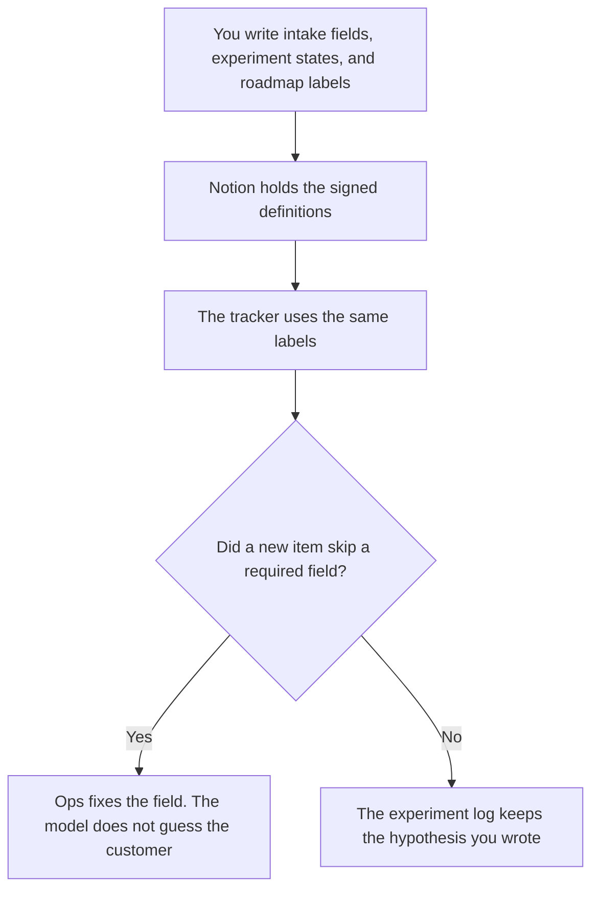

**Product ops should use AI to format the intake rules, the experiment log, and the roadmap labels a person already defined.** The spec and the bet are the product manager's page. This page is the system that keeps feedback, experiments, and the board from drifting apart. We did not score prioritization.

The PM shelf is [best AI tools for product managers](/blog/best-ai-tools-for-product-managers-2026/). The one-sprint sentence is [how to write a sprint goal with AI](/blog/how-to-write-a-sprint-goal-with-ai-2026/). The spec is [how to write a PRD with AI](/blog/how-to-write-a-prd-with-ai-2026/).

Prices are US list prices excluding tax from directory pages checked October 16, 2026. HubSpot Starter was a limited-time offer. Published October 24, 2026.

## The ops job

| The job | Start here | First paid step | The limit |
|---|---|---|---|
| The taxonomy and the roadmap page | [Notion AI](/tools/notion-ai/) | Business is $20 a seat a month | Labels in Notion match the tracker |
| A clean draft of rules you already use | [Claude](/tools/claude/) | Pro is $20 a month, or $17 billed annually | The model formats. It does not add a field |
| The tracker, if work lives in ClickUp | [ClickUp Brain](/tools/clickup-brain/) | From $9 per user a month | Unlimited is $7 a user yearly. The AI add-on is separate |
| A notice when intake is missing a field | [Zapier](/tools/zapier/) | Professional is $19.99 a month billed annually, 750 tasks | The Zap notifies. It does not prioritize |
| Notes from a roadmap review | [Granola](/tools/granola/) | Business is $14 a user a month | No bot in the call. Free history is 30 days |
| Customer context, if ops also reads the CRM | [HubSpot](/tools/hubspot/) | Free CRM. Starter was a promo | Do not invent a Professional price |

Product ops owns the hygiene. Product managers own the bet. Sales ops owns stages in the CRM, on [best AI tools for sales ops](/blog/best-ai-tools-for-sales-ops-2026/). If one team does all three, keep three lists. A feedback tag is not a forecast category.

## What you are paying for

**Notion Business at $20 a seat** holds the taxonomy: the feedback tags, what each tag means, and the roadmap states. A tag the model invented becomes a junk drawer. Write the list, then let AI file notes under it. The record rule is [what a system of record for AI is](/blog/what-is-a-system-of-record-for-ai-2026/).

**Claude Pro** turns a messy export into rows that follow your columns. It can mark a row Missing. It cannot decide the priority. The review is [Claude review](/blog/claude-review-2026/). The person who accepts a label is [what human-in-the-loop AI is](/blog/what-is-human-in-the-loop-ai-2026/).

**ClickUp** is the tracker when the company already runs there. Brain² starts at $9 a user. The plan underneath, Unlimited at $7 yearly or Business at $12 yearly, is a separate seat. Do not treat the AI add-on as the project tool. The comparison with docs is [Notion AI vs ClickUp for docs](/blog/notion-ai-vs-clickup-for-docs-2026/).

**Zapier Professional** pings a channel when a required intake field is empty. Free is 100 tasks. Do not let the Zap set priority. Team is $69 a month billed annually.

**Granola** is for the roadmap meeting itself, without a bot on the screen. Fathom is the path when a bot is acceptable. Premium is $16 a month billed annually, in [Fathom pricing explained](/blog/fathom-pricing-explained-2026/).

**HubSpot** is optional here. Use it when the feedback row must point at an account you already store. The invoice is [HubSpot pricing explained](/blog/hubspot-pricing-explained-2026/).

A prompt that holds the line:

"File these notes under the tags I listed. Do not add a tag. If a note fits none, write Untagged. Do not assign a priority. Do not invent a customer name."

## What not to automate

Do not auto-close feedback. Do not generate a roadmap from a pile of tickets. Do not let an experiment log write its own result. The hypothesis, the metric, and the outcome are rows a person fills. A risk you are tracking beside the roadmap is [how to create a risk register with AI](/blog/how-to-create-a-risk-register-with-ai-2026/).

## FAQ

### Is product ops the same as product management?

On this site, product managers write the spec and the bet. Product ops keeps the intake, the experiment log, and the labels honest. Buy the PM page when the job is the PRD. Buy this page when the job is the system around it.

### Can AI prioritize the backlog?

It can sort by a field you already filled. It should not score "impact." Impact is a judgment with a name on it. A generated score will be treated as math. It is not math.

### Do we need ClickUp and Notion?

No. Pick the tracker the company already updates. Use the other only if you are willing to name which one is the copy. Two roadmaps is the failure mode.

### What belongs in the experiment log?

The hypothesis you wrote, the metric you already collect, the start date, and the result when you have it. A result the model predicted is not a result. Leave it blank until the metric moves.

## Last verified

October 16, 2026 for Notion AI, Claude, ClickUp, Zapier, Granola, and HubSpot. HubSpot Starter was a promotion. Published October 24, 2026.

**Sources:** [Notion pricing](https://www.notion.com/pricing), [Claude pricing](https://claude.com/pricing), [Zapier pricing](https://zapier.com/pricing), [ClickUp pricing](https://clickup.com/pricing).

*Published by Andrew for [AI Tools Optimizer](https://aitoolsoptimizer.com).*

[Notion AI](/tools/notion-ai/) is in the [productivity and notes directory](/tools/category/productivity-notes/). Directory pages may use affiliate links. A purchase through them may earn us a commission at no extra cost to you.
