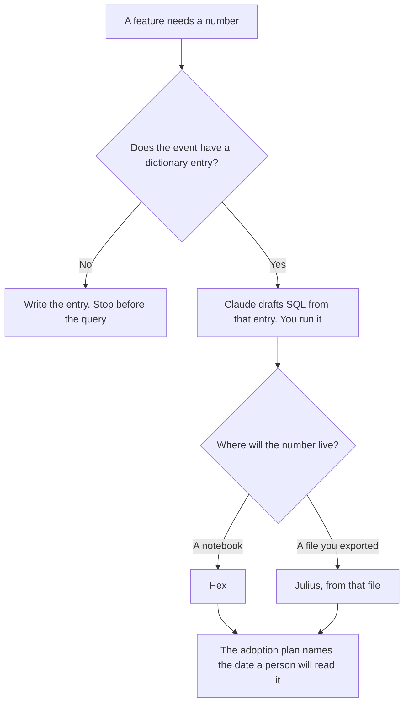

**A product ops analyst should use AI to format an event definition, draft a query from a schema they pasted, and put a date on the page where someone will read the number.** The model does not invent the metric, and it does not declare that a feature was adopted. Queue and cycle-time work is a different job: [best AI tools for ops analysts](/blog/best-ai-tools-for-ops-analysts-2026/). The spec and the prototype belong to [best AI tools for product managers](/blog/best-ai-tools-for-product-managers-2026/).

One field's meaning is [how to create a data dictionary entry with AI](/blog/how-to-create-a-data-dictionary-entry-with-ai-2026/). The plan that names the audience and the date is [how to create a feature adoption plan with AI](/blog/how-to-create-a-feature-adoption-plan-with-ai-2026/). The SQL habit is [Gemini vs Claude for SQL drafts](/blog/gemini-vs-claude-for-sql-drafts-2026/).

Prices are US list prices excluding tax from directory pages checked October 16, 2026. A live fetch of vendor pricing pages on October 24, 2026 returned HTTP 401, so this page stays on the directory record. Published October 24, 2026. We did not score product adoption.

## The analyst's week

| The job | Start here | First paid step | The limit |
|---|---|---|---|
| The event definition people will cite | [Notion AI](/tools/notion-ai/) | Business is $20 a seat a month | Plus at $10 is not the full AI tier |
| A query from a dictionary you pasted | [Claude](/tools/claude/) | Pro is $20 a month, or $17 billed annually | You run it. It may not add a column |
| The notebook the number is published from | [Hex](/tools/hex/) | Professional is $36 an editor a month | Team at $75 is the schedule, if the notebook must refresh |
| A chart from a file you already exported | [Julius AI](/tools/julius-ai/) | Plus is $16 a month billed annually, or $20 monthly | The file is the source. The chart does not invent a row |

Ops analysts on the other page watch queues, clocks, and backlog. Product ops analysts watch whether a feature's event means one thing, and whether the adoption plan's metric matches that event. Product managers decide what to build. If you are writing the spec, you are on their page. If you are writing the definition of `feature_used`, you are on this one.

## What you are paying for

**Notion Business** holds the dictionary and the adoption plan. The chat is not the definition. The invoice is [Notion AI pricing explained](/blog/notion-ai-pricing-explained-2026/).

**Claude Pro** drafts the query and the sentence under the chart, from numbers you paste. It does not set a target. The review is [Claude review](/blog/claude-review-2026/).

**Hex Professional** is the notebook if that is where the company publishes. Community is free and includes an agent trial, on the directory card. A scheduled run is Team, at $75 an editor a month. Do not buy Team so a one-off definition has a home.

**Julius Plus** is the path when you have an export and you need a chart today. Pro is $37 a month billed annually, or $45 monthly, on the directory card. A Julius chart and a Hex notebook can disagree if they used different files. Pick one as the source for the date on the plan.

A prompt that holds the line:

"Draft the sentence under this chart from the metric name, the window, and the number I pasted. Do not add a cause. If the definition is missing, write Definition missing and stop."

## What not to automate

Do not let a model rename an event because the new name is friendlier. Do not paste a user-level extract into a chat to "see what adoption looks like." Aggregate first, in the tool that already has access. Do not announce a lift in the changelog. The announcement is [how to write a changelog announcement with AI](/blog/how-to-write-a-changelog-announcement-with-ai-2026/), and it does not get a number the plan has not published.

## FAQ

### How is this different from the ops analyst page?

That page is cycle time, queue age, and backlog. This page is product events, the dictionary, and the adoption date. The same person sometimes does both. The definitions should not share a page if the owners differ.

### How is this different from the product manager page?

Product managers own the spec, the prototype, and the meeting. Product ops analysts own the event name and the number someone will read after launch. A spec with no event definition will be "measured" five different ways.

### Do I need Hex and Julius?

No. Hex is the notebook you publish. Julius is a chart from a file. Use the one your team will open again. Two charts from two exports are how a launch review argues about the number instead of the feature.

### Who may change the metric?

The owner on the dictionary row and the owner on the adoption plan, together, if they are different people. A model does not retarget the metric because the first read was disappointing.

## Last verified

October 16, 2026 for Notion, Claude, Hex, and Julius. Published October 24, 2026.

**Sources:** [Notion pricing](https://www.notion.com/pricing), [Claude pricing](https://claude.com/pricing), [Hex pricing](https://hex.tech/pricing), [Julius pricing](https://julius.ai/pricing).

*Published by Andrew for [AI Tools Optimizer](https://aitoolsoptimizer.com).*

[Hex](/tools/hex/) is in the [data and analytics directory](/tools/category/data-analytics/). Directory pages may use affiliate links. A purchase through them may earn us a commission at no extra cost to you.
