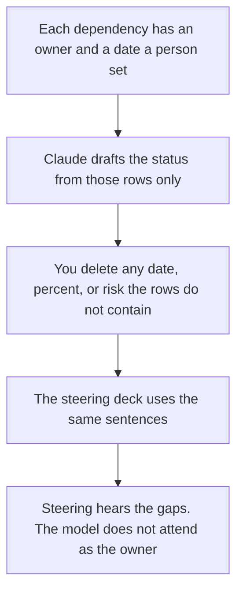

**A program manager should use AI to keep three lists honest: the dependencies and their owners, the status note that only uses facts you pasted, and the steering deck that matches that note.** A model can format a RAID line. It cannot decide that a dependency is fine, invent a date, or close a risk. Product managers write the spec. Scrum masters run the sprint. This page is the cross-team program: several teams, one outcome, a steering meeting that can hear bad news.

The product shelf is [best AI tools for product managers](/blog/best-ai-tools-for-product-managers-2026/). The sprint shelf is [best AI tools for scrum masters](/blog/best-ai-tools-for-scrum-masters-2026/). The weekly note shape is [how to write a status update with AI](/blog/how-to-write-a-status-update-with-ai-2026/). The goals behind the program are [how to write OKRs with AI](/blog/how-to-write-okrs-with-ai-2026/).

Prices are US list prices excluding tax from directory pages checked October 16, 2026. Published October 24, 2026. We did not score on-time delivery.

## The program job

| The job | Start here | First paid step | The limit |
|---|---|---|---|
| The dependency and risk list | [Notion AI](/tools/notion-ai/) or [ClickUp](/tools/clickup-brain/) | Notion Business is $20 a seat. ClickUp Brain² starts at $9 a user a month, on top of a ClickUp plan | The owner field is a person, not a team name alone |
| The narrative for steering | [Claude](/tools/claude/) | Pro is $20 a month, or $17 billed annually | It may not invent a percent complete |
| The steering deck | [Gamma](/tools/gamma/) | Plus is $9 a seat a month | Slides-native work is Plus AI, below |
| Time to do the update | [Reclaim](/tools/reclaim-ai/) | Starter is $10 a seat a month. Lite is free | A calendar agent does not clear a dependency |
| A scheduler that also holds tasks | [Motion](/tools/motion/) | Pro AI is $19 a seat a month, with a trial and no permanent free plan on the card | Credits are Motion's meter, not your milestone count |

A percent complete the model guessed is [a hallucination](/blog/what-is-ai-hallucination-2026/) in a steering forum. The check is [how to fact-check AI writing](/blog/how-to-fact-check-ai-writing-2026/).

## What to pay for

**The list.** Notion Business at $20 a seat a month if the company already keeps docs there. Plus at $10 is not the full AI tier, including Agent and meeting notes. The invoice is [Notion AI pricing explained](/blog/notion-ai-pricing-explained-2026/).

ClickUp is the other home for the list. Unlimited is $7 a user a month billed yearly, or $10 monthly. Business is $12 yearly, or $19 monthly, and is the row with timelines on the card. Brain² AI starts at $9 a user a month and includes 1,500 AI Super Credits on that line. Everything AI is $28 a user a month and adds Notetaker, AI Fields, Automations, and Super Agents. Buy the ClickUp plan you need for the timeline first. Add Brain when the writing inside ClickUp is the pain. The product page is [ClickUp Brain review](/blog/clickup-brain-review-2026/). Do not run the same dependency in Notion and ClickUp unless one of them is clearly a copy.

**The note.** Claude Pro. A prompt that holds the line:

"Draft a program status from these rows only. For each workstream include owner, date, and the risk I wrote. If a date or an owner is blank, write Missing. Do not invent percent complete. Do not mark a risk closed. Do not add a workstream."

The internal status shape is the status-update guide linked above. If the program's failure is public, the customer note is [how to write a status page update with AI](/blog/how-to-write-a-status-page-update-with-ai-2026/). Those are different audiences.

**The deck.** Gamma Plus at $9 a seat, $108 a year, when a link is enough for steering. [Plus AI](/tools/plus-ai/) Basic at $10 a user a month billed annually when the company standard is PowerPoint or Google Slides. The file-format choice is [Plus AI vs Gamma](/blog/plus-ai-vs-gamma-2026/). The deck may not introduce a date the note marked Missing.

**The calendar.** Reclaim Lite is free, with 5 AI agents on the card. Starter at $10 a seat is the small-team row. Business is $15 a seat. Use it to protect time to update the list. [Motion](/tools/motion/) Pro AI at $19 a seat a month includes 7,500 credits a seat. Business AI is $29, with 15,000 credits. There is a trial, not a permanent free plan, on the card. The invoice is [Motion pricing explained](/blog/motion-pricing-explained-2026/). A scheduler that hides a slipped dependency by rebooking your week has not managed the program.

**The retro, if a team wants one.** That ritual is [how to run a retro with AI](/blog/how-to-run-a-retro-with-ai-2026/). It is a team meeting. It is not a substitute for the dependency list.

## What not to automate

Do not let a model email steering that the program is "on track" because most rows look calm. One missing owner is the status. Do not merge two teams' dates into a single date the model thinks is reasonable. Do not paste a customer's confidential milestone into a personal chat if the program note is supposed to live in Notion or ClickUp.

A bug inside one team's work is a triage note, not a program slide, until it threatens the outcome. That workflow is [how to write a bug triage note with AI](/blog/how-to-write-a-bug-triage-note-with-ai-2026/).

## FAQ

### Is a program manager a scrum master of scrum masters?

Sometimes the same person facilitates both. The scrum page is the sprint agenda, the retro, and the board. This page is the dependency that crosses teams and the note a steering group will read. A velocity chart does not name the owner of a vendor decision.

### Do we need both Notion and ClickUp?

No. Pick the system the owners will update. A second AI subscription on the empty system will draft a prettier status from staler facts. Pay for the list people open.

### Can the steering deck be the system of record?

No. The deck is a view. The list with owners is the record. If they disagree, the list wins and the deck is regenerated. That distinction is [what a system of record for AI is](/blog/what-is-a-system-of-record-for-ai-2026/).

### What is a good risk line?

A sentence with an owner and what would have to be true to close it. "Might slip" is not a risk line. The model may format a risk you wrote. It may not close one because the prose sounds resolved.

## Last verified

October 16, 2026 for Notion AI, ClickUp, Claude, Gamma, Plus AI, Reclaim, and Motion. Published October 24, 2026.

**Sources:** [Notion pricing](https://www.notion.com/pricing), [ClickUp Brain pricing](https://clickup.com/brain/pricing), [Reclaim pricing](https://reclaim.ai/pricing), [Motion pricing](https://www.usemotion.com/pricing).

*Published by Andrew for [AI Tools Optimizer](https://aitoolsoptimizer.com).*

[Notion AI](/tools/notion-ai/) is in the [productivity and notes directory](/tools/category/productivity-notes/). Directory pages may use affiliate links. A purchase through them may earn us a commission at no extra cost to you.
