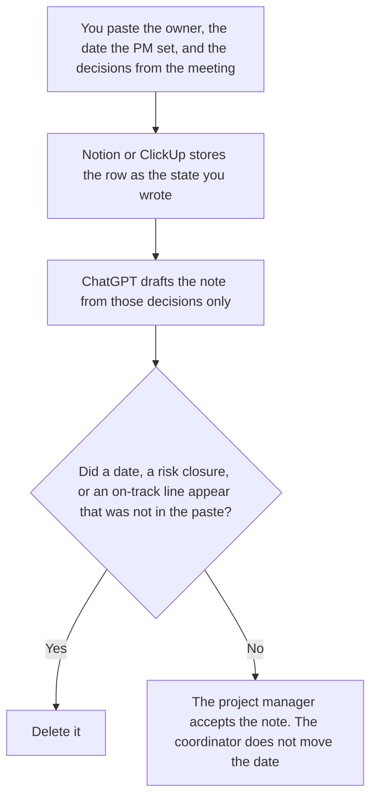

**A project coordinator should use AI to keep a status row, a meeting note, and a date a project manager already set.** The model may format those fields. It may not invent a date, close a risk, or decide the project is on track. The cross-team program, with dependencies and a steering deck, is [best AI tools for program managers](/blog/best-ai-tools-for-program-managers-2026/). The spec is [best AI tools for product managers](/blog/best-ai-tools-for-product-managers-2026/). The sprint is [best AI tools for scrum masters](/blog/best-ai-tools-for-scrum-masters-2026/). This page is the coordinator: one project, the row people read, the note from the meeting that already happened.

The weekly sentence shape is [how to write a status update with AI](/blog/how-to-write-a-status-update-with-ai-2026/). The metrics a company chose to watch, which are not this project's date, are [how to write an AI success metrics memo with AI](/blog/how-to-write-an-ai-success-metrics-memo-with-ai-2026/).

Notion and Grammarly prices are from directory pages checked October 16, 2026. ChatGPT's Plus price is the October 24, 2026 plan-page figure recorded in [ChatGPT pricing explained](/blog/chatgpt-pricing-explained-2026/). ClickUp Brain's prices are the October 24 page recorded in [ClickUp Brain pricing explained](/blog/clickup-brain-pricing-explained-2026/). Published October 24, 2026. We did not score on-time delivery.

## The coordinator's week

| The job | Start here | First paid step | The limit |
|---|---|---|---|
| The status row: owner, date, state | [Notion AI](/tools/notion-ai/) | Business is $20 a seat a month | Plus at $10 is not the full AI tier |
| The meeting note from decisions you pasted | [ChatGPT](/tools/chatgpt/) | Plus is $20 a month | No decision that was not said |
| The same row, if the project already lives in ClickUp | [ClickUp Brain](/tools/clickup-brain/) | Brain AI is $9 a user a month, plus a workspace plan | 1,500 AI Super Credits on that October 24 card. The workspace is a separate bill |
| A clarity pass that must not move a date | [Grammarly](/tools/grammarly/) | Pro is $12 a member a month billed annually, or $30 monthly | Compare the date before and after |

A note that says the project is "on track" has added a judgment. If the PM did not say that, the state stays the word they used, or State not set. A risk closes only when a person closes it. The coordinator records the close. They do not decide it. If the date is missing, the cell says Date not set. It does not inherit the date from a similar project.

ClickUp Brain AI at $9 includes 1,500 AI Super Credits per user per month on the October 24 page. Everything AI is $28 with 5,000 credits. Extra credits on that page were $10 per 10,000. Brain is an add-on. You also pay for a workspace plan. The pricing article does not print the workspace dollar, so this page does not invent one. Use ClickUp when the project already lives there. Do not add it only to hold a note Notion already holds.

## What you are paying for

**Notion Business** is the row when the company keeps projects in Notion: owner, date, state, link to the note. The invoice is [Notion AI pricing explained](/blog/notion-ai-pricing-explained-2026/).

**ChatGPT Plus** drafts the meeting note from the decisions you pasted. Go is $8 a month. Plus is the seat for a saved note. The review is [ChatGPT review](/blog/chatgpt-review-2026/).

**ClickUp Brain** is the add-on when the row is already in ClickUp. Confirm the workspace plan in your account before you add $9. The review is [ClickUp Brain review](/blog/clickup-brain-review-2026/).

**Grammarly Pro** is the pass after the dates are stable. Reject a suggestion that changes "blocked" to "moving." The invoice is [Grammarly pricing explained](/blog/grammarly-pricing-explained-2026/).

A prompt that holds the line:

"Draft the project note from the owner, the date, and the decisions I pasted. If the date is missing, write Date not set. Do not say the project is on track. Do not close a risk. Do not move a date."

## What not to automate

Do not let a model roll a date forward because a meeting slipped. Do not paste a steering-deck narrative into a coordinator note. Do not mark a dependency done because the note sounds calm. The project manager owns the date. The coordinator keeps the row equal to what that manager last said.

## FAQ

### How is this different from the program-manager page?

That page is several teams, a dependency someone owns, and a steering deck that matches the note. This page is one project's row, the meeting note, and a date the PM already set. A coordinator can prepare the row a program manager reads. They do not write the steering judgment. Use that page for the program. Use this page for the row.

### How is this different from a product manager or a scrum master?

The product manager's shelf is the spec. The scrum master's shelf is the sprint. The coordinator's shelf is the status row and the note after the meeting. A coordinator does not rewrite the spec to make the date fit. A sprint goal is a different sentence. Link those pages when the work is actually a spec or a sprint.

### How is this different from a status-update how-to?

That page is the shape of a weekly note: facts you pasted, no invented progress. This page is which seat a coordinator uses for the row, the note, and the date. Both pages refuse an on-track line you did not write. Use the how-to for the fields. Use this page for the tool, including ClickUp when the project already lives there.

### Who may move the date?

The project manager. The coordinator records the new date after the PM sets it. A formatted note is not a new date. Date not set stays until a person writes one. State not set stays until a person writes the state.

## Last verified

October 16, 2026 for Notion and Grammarly. October 24, 2026 for ChatGPT's plan page and for ClickUp Brain's $9 and $28 cards, via the posts cited above. Published October 24, 2026. The ClickUp workspace plan price is not on that AI card, so it is not quoted here.

**Sources:** [Notion pricing](https://www.notion.com/pricing), [ChatGPT and Codex pricing](https://learn.chatgpt.com/docs/pricing), [ClickUp Brain pricing](https://clickup.com/brain/pricing), [Grammarly pricing](https://www.grammarly.com/plans).

*Published by Andrew for [AI Tools Optimizer](https://aitoolsoptimizer.com).*

[Notion AI](/tools/notion-ai/) is in the [notes directory](/tools/category/productivity-notes/). Directory pages may use affiliate links. A purchase through them may earn us a commission at no extra cost to you.
