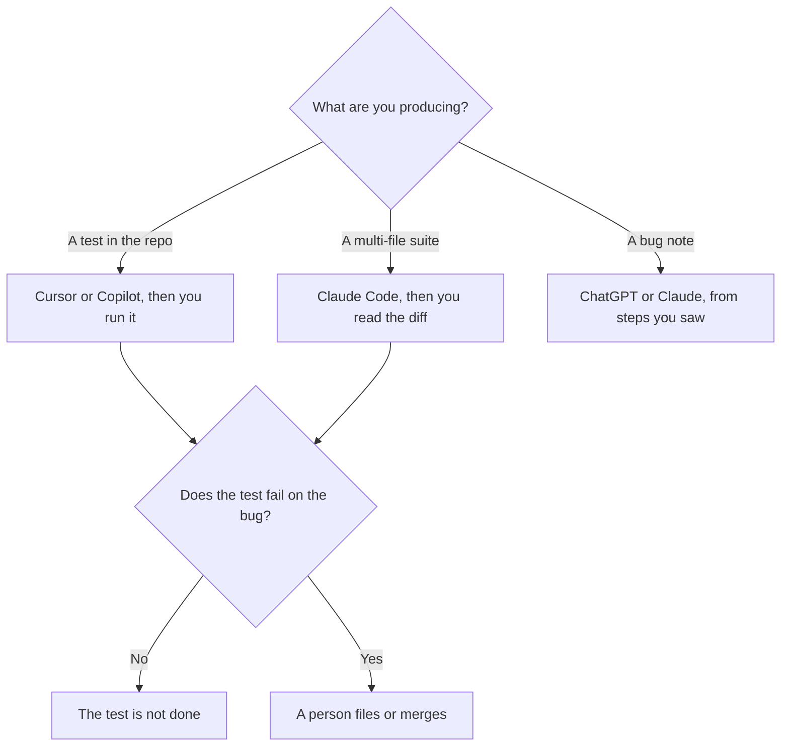

**A QA engineer should buy the tool that matches the artifact: a test in the repo, a diff to review, or a bug note a developer can reproduce.** A model that invents a passing test is not a QA tool. It is a green check you did not earn. This page is the testing week. The people who refactor the code under that test are [Claude vs Cursor for refactors](/blog/claude-vs-cursor-for-refactors-2026/). The general shelf is [best AI coding assistants](/blog/best-ai-coding-assistants-2026/). The lead who formats the release gate from bugs a person already filed, and does not invent a passing test, is [best AI tools for QA leads](/blog/best-ai-tools-for-qa-leads-2026/).

Prices are US list prices excluding tax from directory pages checked October 16, 2026. Published October 24, 2026. We did not score defect detection.

## The artifact, then the tool

| Artifact | Start here | First paid step | The limit |
|---|---|---|---|
| A test next to the code, in the editor | [Cursor](/tools/cursor/) or [GitHub Copilot](/tools/github-copilot/) | Cursor Plus is $8. Copilot Pro is $10. Copilot Free is 2,000 completions a month | You run the test. The tool does not certify the build |
| A terminal agent that drafts a suite you will read | [Claude Code](/tools/claude-code/) on [Claude](/tools/claude/) Pro | Pro is $20, or $17 billed annually. No Claude Code on Free | A suite that does not fail when the bug is present is a bad suite |
| A short reproduction written from notes | [ChatGPT](/tools/chatgpt/) | Plus is $20 and includes Codex. Go is $8 for a written note | The build number has to be yours |
| The test plan in the wiki | [Notion AI](/tools/notion-ai/) | Business is $20 a seat. Plus at $10 is not the full AI tier | A plan is not a run |
| Notes from a bug-review call | [Fathom](/tools/fathom/) | Free includes unlimited recordings, if a bot is allowed | The summary is not the ticket |

## The test and the diff

[Cursor](/tools/cursor/) Plus at $8 is the AI editor on a repo you already have. Free includes Agent, Chat, and Tab with limited usage. Ask for a test that fails on the behavior you saw, and name the file. Then run it. A test the model says "should pass" is not evidence. The bill is [Cursor pricing explained](/blog/cursor-pricing-explained-2026/). The comparison with Copilot is [Cursor vs GitHub Copilot](/blog/cursor-vs-github-copilot-2026/).

[GitHub Copilot](/tools/github-copilot/) Pro at $10 stays in the editor you have, with $15 in monthly credits. Business at $19 adds admin controls and IP indemnity, which is the seat a company security review usually asks about. Free's 2,000 completions a month are enough to learn whether suggestions help you write assertions. The card is [GitHub Copilot pricing explained](/blog/github-copilot-pricing-explained-2026/). A copilot suggests. You accept. The definition is [what an AI copilot is](/blog/what-is-an-ai-copilot-2026/).

[Claude Code](/tools/claude-code/) fits when the change is a suite across files and you will review a diff in git. It requires Claude Pro or Max. Max from $100 is capacity, not a better eye. The review is [Claude Code review](/blog/claude-code-review-2026/). [ChatGPT](/tools/chatgpt/) Plus is the Codex path if that agent already lives in your chat seat. The seat question is [ChatGPT vs Claude for coding](/blog/chatgpt-vs-claude-for-coding-2026/).

Do not ask a model to "find all the bugs." Ask it to draft a check for a behavior you can describe. The eval habit, even for a small suite, is [what AI eval testing is](/blog/what-is-ai-eval-testing-2026/). The person who merges is [what human-in-the-loop AI is](/blog/what-is-human-in-the-loop-ai-2026/).

## The note and the meeting

A bug note needs the build, the steps, the expected result, and the actual result. Paste those four. Ask [Claude](/tools/claude/) or ChatGPT to order them and to mark any step you did not provide. Delete a cause the model guessed. "Probably a race" is not a reproduction.

If the plan lives in Notion, Business at $20 a seat is the AI tier. Generate the outline there, then link the ticket. The card is [Notion AI pricing explained](/blog/notion-ai-pricing-explained-2026/). A status line about the suite is [how to write a status update with AI](/blog/how-to-write-a-status-update-with-ai-2026/). It is not a substitute for the run.

[Fathom](/tools/fathom/) Free is the recorder when a bug review can include a bot. The summary still needs you to pull the reproduction into the ticket. If the room cannot have a bot, use [Granola](/tools/granola/). Business is $14 a user a month. The split is [Fathom vs Fireflies](/blog/fathom-vs-fireflies-2026/) for two bots, and [Otter vs Granola](/blog/otter-vs-granola-2026/) when the live transcript is the alternative.

The pipeline around the tests is a different team. [Best AI tools for DevOps teams](/blog/best-ai-tools-for-devops-teams-2026/) covers the script and the glue. The manager who reads your note is [best AI tools for engineering managers](/blog/best-ai-tools-for-engineering-managers-2026/).

## FAQ

### What should a QA engineer pay for first?

Copilot Free or Cursor Free, if the pain is writing assertions in the repo. Cursor Plus at $8 or Copilot Pro at $10 when the cap hits. Claude Pro only if you want Claude Code for wider drafts. Notion Business only if the plans live in Notion. One of those. The second waits until the first is in the weekly suite.

### Can AI replace a regression run?

It can draft cases. It cannot sign the run. A generated test that never failed is untested. Keep a case a human saw fail, and keep the command that runs it.

### Is a chatbot a test oracle?

No. The spec, the ticket, and the build are the oracle. A chat answer that contradicts the spec is a bug in the chat. Paste the spec. The attachment rule is [what AI grounding is](/blog/what-is-ai-grounding-2026/).

### How do I stop the model from weakening the assert?

Ask for the assertion that fails on the bug you describe, and run it against the bad build before you run it against the fix. A test that passes on both builds did not lock the behavior.

## Last verified

October 16, 2026 for Cursor, GitHub Copilot, Claude, ChatGPT, Notion, Fathom, and Granola prices named above. Published October 24, 2026.

**Sources:** [GitHub Copilot](https://github.com/features/copilot), [Cursor pricing](https://cursor.com/help/account-and-billing/pricing), [Claude pricing](https://claude.com/pricing).

*Published by Andrew for [AI Tools Optimizer](https://aitoolsoptimizer.com).*

[GitHub Copilot](/tools/github-copilot/) is in the [coding directory](/tools/category/coding/). Directory pages may use affiliate links. A purchase through them may earn us a commission at no extra cost to you.
