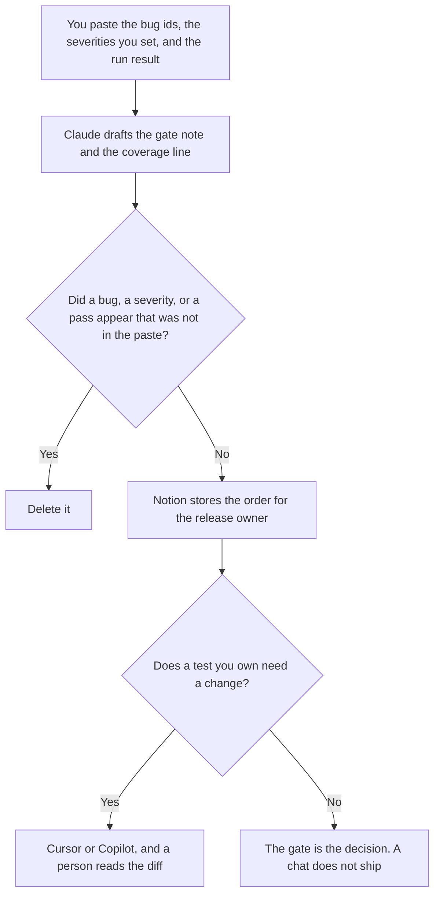

**A QA lead should use AI to format a release gate from bugs a person already filed, a triage order from severity a person already set, and a coverage note from a run a person already executed.** The model does not decide what blocks the release, and it does not invent a passing test. The engineer who writes the test and the bug note is [best AI tools for QA engineers](/blog/best-ai-tools-for-qa-engineers-2026/). The person who sequences the ship is [best AI tools for release managers](/blog/best-ai-tools-for-release-managers-2026/).

The failure note for one eval case, when the "test" is an eval, is [how to create an eval failure triage with AI](/blog/how-to-create-an-eval-failure-triage-with-ai-2026/). This page is the release week for a QA lead.

Claude's prices are from claude.com/pricing on October 24, 2026. Notion, Cursor, and GitHub Copilot prices are from directory pages checked October 16, 2026, except Cursor's Teams seats, which are from the help center recorded October 24. Published October 24, 2026. We did not score defect detection.

## The release week

| The job | Start here | First paid step | The limit |
|---|---|---|---|
| The gate note and the coverage sentence | [Claude](/tools/claude/) | Pro is $17 a month billed annually, or $20 monthly | No severity you did not assign |
| The board the next lead opens | [Notion AI](/tools/notion-ai/) | Business is $20 a seat a month | Plus at $10 is not the full AI tier |
| A diff in a test you already own | [Cursor](/tools/cursor/) | Plus is $8 a month, or $80 a year | You review the diff. The model does not merge it |
| The company coding seat | [GitHub Copilot](/tools/github-copilot/) | Business is $19 a user a month | A personal Pro seat is a different decision |

A gate note that says the release is safe, without the run result you pasted, is a story. If the run was not executed, the note says Run not executed. Untriaged bugs stay untriaged. The lead sets severity. The model does not promote a bug because the title sounds severe.

## What you are paying for

**Claude Pro** holds the gate language so this release uses the same headings as the last one. Team standard seats are $20 a seat a month billed annually, or $25 monthly, when the note is a company record, as recorded in [Claude Team pricing explained](/blog/claude-team-pricing-explained-2026/). The review is [Claude review](/blog/claude-review-2026/).

**Notion Business** is the board: bug id, severity, owner, and whether it blocks. The invoice is [Notion AI pricing explained](/blog/notion-ai-pricing-explained-2026/).

**Cursor** is the editor when you are changing a test, and you will read the diff. Teams seats are $30, $100, or $200 a seat a month on the October 24 help page. The company-seat article is [Cursor business pricing explained](/blog/cursor-business-pricing-explained-2026/). The individual ladder is [Cursor pricing explained](/blog/cursor-pricing-explained-2026/).

**GitHub Copilot Business** is $19 a user a month on the October 16 card. Pick one coding seat for the test change. The gate note does not require either. The invoice is [GitHub Copilot Business pricing explained](/blog/github-copilot-business-pricing-explained-2026/).

A prompt that holds the line:

"Draft the QA gate note from the bug ids, the severities, and the run result I pasted. If the run result is missing, write Run not executed. Do not add a bug. Do not change a severity. Do not say the release is safe."

## What not to automate

Do not ask the model which bugs to waive. Do not paste production credentials so a failing case "can be reproduced" inside a chat. Do not close a bug because the note is short. The QA lead sets the gate. The release owner accepts it. An engineer still owns the test.

## FAQ

### How is this different from the QA engineer page?

That page is the test, the diff, and the bug note a developer can reproduce. This page is the lead's week: which filed bugs block, in what order, and what the last run showed. The same person may write both on a small team. The templates stay different so a bug report does not become the release decision.

### How is this different from the release manager page?

The release manager sequences the ship and the comms. The QA lead says what the tests and the filed bugs show. A release note can quote the gate. It does not replace the severities. If the run was not executed, both pages should say so.

### Do I need a coding seat to write the gate?

No. The note is Claude and Notion. A coding seat matters when a test you already own needs a diff. The diff is reviewed by a person.

### Who may waive a bug?

The person your process names, with the bug id and the reason they wrote. A formatted note is not a waiver. A missing severity stays missing.

## Last verified

October 24, 2026 for Claude and for Cursor's Teams seats. October 16, 2026 for Notion, Cursor Plus, and GitHub Copilot. Published October 24, 2026.

**Sources:** [Claude pricing](https://claude.com/pricing), [Notion pricing](https://www.notion.com/pricing), [Cursor pricing](https://cursor.com/help/account-and-billing/pricing), [GitHub Copilot](https://github.com/features/copilot).

*Published by Andrew for [AI Tools Optimizer](https://aitoolsoptimizer.com).*

[Claude](/tools/claude/) is in the [chatbots and assistants directory](/tools/category/chatbots-assistants/). Directory pages may use affiliate links. A purchase through them may earn us a commission at no extra cost to you.
