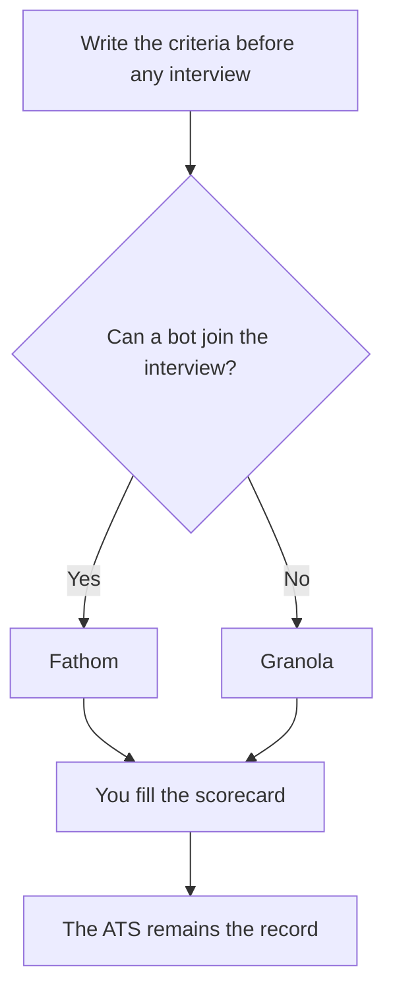

**Recruiters need a tool for the req, a tool for the interview, and a tool for the follow-up. They do not need an "AI recruiter" that scores a human.** This directory does not include an applicant tracking system. Keep the ATS you already run. Use the tools below for the writing, the notes, and the research around it. A model does not decide who is qualified. You do, from criteria you wrote down before the interviews.

Prices are US list prices excluding tax. Perplexity figures are from an October 24, 2026 read. The other prices were recorded October 16, 2026. Nothing here is a hiring-outcome study.

## One job, one starting tool

| Recruiting job | Start here | First paid step | Leave it when |
|---|---|---|---|
| A job post or a scorecard from a real req | [Claude](/tools/claude/) or [ChatGPT](/tools/chatgpt/) | Claude Pro $20/month ($17 annual) or ChatGPT Plus $20 | You need the ATS to store the req |
| A proofread before a candidate sees it | [Grammarly](/tools/grammarly/) | Pro $12/member/month billed annually, or $30 monthly | The draft is still wrong on the facts |
| Interview notes, bot allowed | [Fathom](/tools/fathom/) | Free for unlimited recordings. Premium $16/month annual | The candidate will not accept a bot |
| Interview notes, no bot | [Granola](/tools/granola/) | Business $14/user/month if you need history past 30 days | You wanted a transcript on screen during the call |
| Scheduling the loop | [Reclaim.ai](/tools/reclaim-ai/) | Starter $10/seat/month. Lite is free | You need the ATS scheduler specifically |
| Public facts about a company or a role | [Perplexity](/tools/perplexity/) | Pro $17/month billed annually if you do this daily | The fact is not on a page you opened |
| Outbound to people you have a right to contact | [Instantly](/tools/instantly/) | Growth $47/month, 5,000 emails and 1,000 contacts | You do not have a lawful basis to email them |
| A shared scorecard the team can find | [Notion AI](/tools/notion-ai/) | Business $20/seat/month | The system of record is the ATS |

Interview capture is [Granola vs Fathom](/blog/granola-vs-fathom-2026/). The bot options, if the team standardizes on one, are [Otter vs Fireflies vs Fathom](/blog/otter-vs-fireflies-vs-fathom-2026/). The full notetaker shelf is [best AI meeting notetakers](/blog/best-ai-meeting-notetakers/).

## The req and the scorecard

Paste the hiring manager's notes: level, must-have skills, what the team will not trade away. Ask Claude or ChatGPT for a job post and a scorecard that use only those notes. Delete any requirement the manager did not ask for. Models add degrees and years because job posts in the training data did. That is how a role gets narrower than the team intended. One posting from a signed requirements list, versus several roles that must share the same must-have sentences, is [ChatGPT vs Claude for job descriptions](/blog/chatgpt-vs-claude-for-job-descriptions-2026/).

The editing standard is [how to write a blog post with Claude](/blog/how-to-write-a-blog-post-with-claude-2026/). Grammarly is the surface pass. Free covers grammar. Pro is the tone and rewrite seat. Whether Pro is worth $12 annual is [is Grammarly Pro worth it](/blog/is-grammarly-pro-worth-it-2026/).

Put the scorecard where interviewers will open it. Notion is a reasonable wiki if the company already works there. Business at $20 a seat is the full Notion AI plan. The scorecard is still a document you wrote. An agent that "ranks candidates" from resumes is a different, riskier product, and it is not a recommendation on this page. If you use any ranking feature inside your ATS, read its bias and compliance notes with counsel. This article is not legal advice.

## Interviews

Tell the candidate when a bot or a local recorder is on. Consent rules vary. Fathom's directory page names recruiting search across past interviews as a use case. Free is unlimited recordings. That is the right start for a team that already says the meeting is recorded. Premium at $16 a month billed annually adds advanced summaries and action items.

Granola is the path when a bot would make a candidate cautious, or when the conversation is a coffee chat. Basic keeps 30 days of history. Business at $14 a user removes that limit, and the whole workspace shares one plan. You still type a few keywords. It expands them from the audio.

[Otter](/tools/otter-ai/) is the live transcript, with a 30-minute cap on the free conversation and 300 minutes a month. Use it when interviewers need the text during the call and the loop is short. [Wispr Flow](/tools/wispr-flow/) Pro at $12 a month billed annually ($144 a year) is dictation into the scorecard, not a recording of the candidate.

## Outreach and research

[Perplexity](/tools/perplexity/) is how you check a company's public pages before a hiring-manager brief or a candidate conversation. Open the link. Pro is optional. The steps for a sourced brief are [how to use Perplexity for market research](/blog/how-to-use-perplexity-for-market-research-2026/). Do not use it to infer a candidate's age, health, or any trait you should not be scoring.

[Instantly](/tools/instantly/) Growth at $47 a month is an email sequencer. The directory page lists recruiters reaching candidates as a use case. It also assumes you may email those people. A scraped personal inbox is not a plan. The product review is [Instantly review](/blog/instantly-review-2026/). Warm the sending domain. Keep the message short and specific to a role you are actually hiring for.

[Reclaim](/tools/reclaim-ai/) Lite is free and includes scheduling links. Starter is $10 a seat a month. Use it to protect focus time around interview loops on Google or Outlook. It does not replace the ATS if offers and stages live there.

## A small recruiting stack

One recruiter: ChatGPT or Claude on the plan you already have, Fathom Free or Granola Basic, Grammarly Free, Perplexity Free. Add a paid seat when a limit is real: Claude Pro or ChatGPT Plus when the free cap blocks a busy req week, Fathom Premium when action items are the gap, Granola Business when 30 days is too short, Instantly when outbound volume is a defined, lawful program.

That is a few tens of dollars, not a talent-intelligence suite. [best AI tools for sales teams](/blog/best-ai-tools-for-sales-teams-2026/) is the adjacent page if the same person also runs outbound sales. The tools overlap. The record of a candidate does not belong in a sales sequencer by default.

## FAQ

### What AI tool should a recruiter buy first?

The assistant you will use to draft from a real req, and a notetaker the candidate has been told about. Fathom Free or Granola Basic costs nothing. Pay when a cap, not a demo, gets in the way.

### Can AI screen resumes?

A model can group resumes against criteria you wrote and show you the lines it used. It should not be the decision. Have a person apply the scorecard, and involve counsel before any automated decision feature touches candidates. This page does not recommend a screening score.

### Is there an AI ATS in this directory?

No. Use your ATS as the system of record. The tools here write, transcribe, schedule, and research around it.

### Otter or Fathom for interviews?

Fathom Free if a bot is acceptable and you want unlimited recordings. Otter if you need a live transcript and the interview fits the minute cap. Granola if the bot is the problem.

## Last verified

October 16, 2026 for most plan prices. October 24, 2026 for Perplexity Pro at $17 billed annually. Published October 24, 2026.

**Sources:** [Fathom pricing](https://www.fathom.ai/pricing), [Granola pricing](https://www.granola.ai/pricing), [Reclaim pricing](https://reclaim.ai/pricing), [Instantly pricing](https://instantly.ai/pricing), [Claude pricing](https://claude.com/pricing).

Directory pages for these tools may use affiliate links. A purchase through them may earn us a commission at no extra cost to you.
