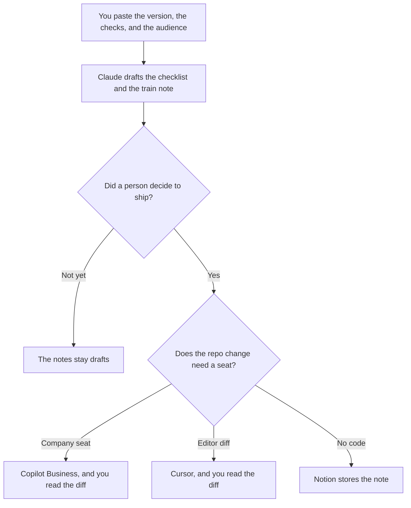

**A release manager should use AI to format the go-live checklist from checks they already marked, draft the train note from the version they already named, and hold a rollback message that does not invent a cause.** The model does not decide to ship, and it does not decide to roll back. The people who run the incident after a bad ship are [best AI tools for SRE teams](/blog/best-ai-tools-for-sre-teams-2026/). The platform contract under the release is [best AI tools for platform PMs](/blog/best-ai-tools-for-platform-pms-2026/).

The day-of list is [how to write a go-live checklist with AI](/blog/how-to-write-a-go-live-checklist-with-ai-2026/). The note that names the train is [how to write a release train note with AI](/blog/how-to-write-a-release-train-note-with-ai-2026/). The message if the change comes back is [how to write a rollback comms note with AI](/blog/how-to-write-a-rollback-comms-note-with-ai-2026/).

Claude's prices are from claude.com/pricing on October 24, 2026. Notion, GitHub Copilot, and Cursor prices are from directory pages checked October 16, 2026. Published October 24, 2026. We did not score releases.

## The release manager's week

| The job | Start here | First paid step | The limit |
|---|---|---|---|
| The checklist and the train note | [Claude](/tools/claude/) | Pro is $17 a month billed annually, or $20 monthly | No check marked passed unless the paste says so |
| The page the company keeps | [Notion AI](/tools/notion-ai/) | Business is $20 a seat a month | Plus at $10 is not the full AI tier |
| A change in the release repo | [GitHub Copilot](/tools/github-copilot/) | Business is $19 a user a month | You still review the diff |
| A diff you want in the editor | [Cursor](/tools/cursor/) | Plus is $8 a month, or $80 a year | The model does not merge |

A feature that is leaving, which is not the same as this week's train, has its own plan: [how to write a feature sunset plan with AI](/blog/how-to-write-a-feature-sunset-plan-with-ai-2026/). The earlier gate, before go-live day, is [how to create a launch readiness checklist with AI](/blog/how-to-create-a-launch-readiness-checklist-with-ai-2026/). Release managers hold the day. They do not absorb every document that mentions the word release.

## What you are paying for

**Claude Pro** is the shared-heading seat so this train uses the same lines as the last one. Team standard seats are $20 a seat a month billed annually, or $25 monthly, for 2 to 150 people, when the note is a company record. The review is [Claude review](/blog/claude-review-2026/). The Team invoice is [Claude Team pricing explained](/blog/claude-team-pricing-explained-2026/).

**Notion Business** holds the checklist and the note people will reread. The invoice is [Notion AI pricing explained](/blog/notion-ai-pricing-explained-2026/).

**GitHub Copilot Business** is the company coding seat: $19 a user a month on the October 16 card, with IP indemnity and 1,900 credits per user. A personal Pro seat at $10 is a different decision. The invoice is [GitHub Copilot Business pricing explained](/blog/github-copilot-business-pricing-explained-2026/).

**Cursor Plus** is the editor when the change is a diff you want to read in place. The ladder is [Cursor pricing explained](/blog/cursor-pricing-explained-2026/). The supervised terminal alternative is [Cursor vs Claude Code for migrations](/blog/cursor-vs-claude-code-for-migrations-2026/), when the change is a migration rather than a train note.

A prompt that holds the line:

"Draft the train note from the version, the audience, and the checks I pasted. If a check is not marked, write Unmarked. Do not say the release is safe. Do not add a feature."

## What not to automate

Do not let a model flip a failed check because the note would otherwise look incomplete. Do not send the rollback message before the rollback owner confirms the version that is serving. Do not paste a customer list into the prompt. The audience is a role you named, not a spreadsheet of addresses.

## FAQ

### How is this different from the SRE page?

SRE work starts when the system is in trouble: the timeline, the comms, the follow-ups. Release management is the planned change: the checklist, the train note, and the rollback message you hope not to send. The same person may write both on a bad day. The templates stay different so a planned note does not sound like an incident, and an incident does not sound like a train.

### How is this different from the platform PM page?

Platform PMs own the contract other products consume. Release managers own the cut of a version going out. A platform deprecation can ride a release. The deprecation plan still has its own dates. This page does not replace it.

### Do I need Copilot and Cursor?

You need the seat that matches the change. Copilot Business is the company seat with indemnity. Cursor is the editor diff. Pick one for the move. The train note does not require either if no code is changing.

### Who may call the release done?

The release owner, after the checklist matches what shipped. A sent note is not a deploy. A green agent log is not a review.

## Last verified

October 24, 2026 for Claude, including Team seat prices. October 16, 2026 for Notion, GitHub Copilot, and Cursor. Published October 24, 2026.

**Sources:** [Claude pricing](https://claude.com/pricing), [Notion pricing](https://www.notion.com/pricing), [GitHub Copilot](https://github.com/features/copilot), [Cursor pricing](https://cursor.com/help/account-and-billing/pricing).

*Published by Andrew for [AI Tools Optimizer](https://aitoolsoptimizer.com).*

[GitHub Copilot](/tools/github-copilot/) is in the [coding directory](/tools/category/coding/). Directory pages may use affiliate links. A purchase through them may earn us a commission at no extra cost to you.
